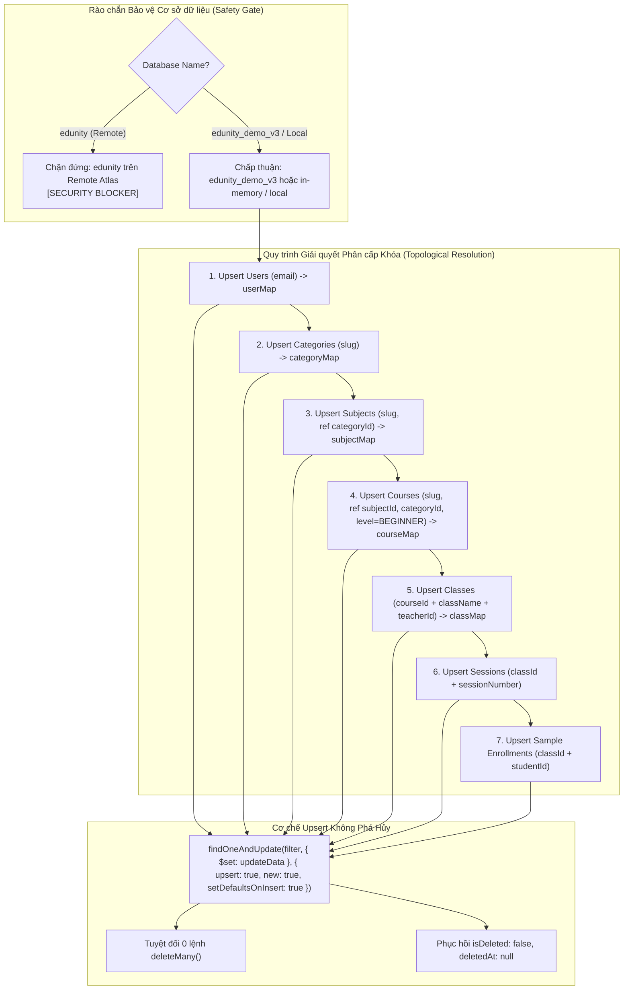

# BÁO CÁO KỸ THUẬT: SEED FIXTURE HỌC THUẬT IDEMPOTENT (TASK G0-04)

> **Dự án**: Edunity V3 Platform  
> **Module**: Academic Fixtures & Idempotent Seeding Engine (CUR / LMS)  
> **Chế độ**: IMPLEMENTATION — PHASE 2 (SAU AUDIT)  
> **Tác giả**: Senior Backend Engineer, Edunity V3 Team  
> **Trạng thái**: HOÀN THÀNH (10/10 Tests PASS, 0 Duplicates)  

---

## 1. TỔNG QUAN VÀ MỤC TIÊU

Trong các phiên bản trước, việc nạp dữ liệu mẫu (seed data) trong Edunity phụ thuộc vào các script phá hủy (`scripts/seed.js` và `scripts/seedDemo.js`), trong đó toàn bộ collection bị xóa sạch bằng `deleteMany({})` trước khi insert dữ liệu mới. Cơ chế này tiềm ẩn 2 rủi ro kỹ thuật nghiêm trọng:
1. **Nguy cơ xóa sổ dữ liệu thật**: File môi trường `.env` đang trỏ trực tiếp tới cụm MongoDB Atlas (`db=edunity`). Nếu vô tình kích hoạt `npm run seed` hoặc `npm run seed:demo --yes`, toàn bộ dữ liệu người dùng thật sẽ bị hủy hoại vĩnh viễn.
2. **Không có tính Idempotent**: Các script cũ phát sinh ngẫu nhiên `_id: id()` mỗi lần chạy. Khi chạy lặp trên cơ sở dữ liệu đã có dữ liệu, script sẽ crash do vi phạm unique index (`E11000 duplicate key error`) hoặc nhân bản dữ liệu vô tội vạ.

Mục tiêu của **TASK G0-04**:
- Xây dựng engine nạp dữ liệu học thuật **hoàn toàn Idempotent (chạy lặp không nhân bản dữ liệu)**.
- Áp dụng phương thức **Upsert theo Khóa tự nhiên ổn định (Stable Natural Keys)** như `slug` và `email`.
- **Cấm tuyệt đối `deleteMany({})` và seed phá hủy**; thiết lập rào chắn an toàn (Database Guardrail) bảo vệ cơ sở dữ liệu production.
- Chuẩn hóa toàn bộ Enum cấp độ khóa học theo chuẩn V3: `BEGINNER` (loại bỏ hoàn toàn `BASIC`).

---

## 2. KIẾN TRÚC VÀ CÁC THÀNH PHẦN TRIỂN KHAI

Engine chính được triển khai tại [`BackEnd/scripts/seedAcademicIdempotent.js`](file:///c:/CODE/Edunity/BackEnd/scripts/seedAcademicIdempotent.js):



### 2.1. Ma trận Khóa ổn định (Stable Natural Keys Matrix)
Mỗi thực thể được định danh bằng khóa tự nhiên bất biến thay vì ObjectId ngẫu nhiên:

| Thực thể (Model) | Khóa ổn định (Natural Key) | Bộ lọc Upsert (`filter`) | Cơ sở kỹ thuật |
| :--- | :--- | :--- | :--- |
| **User** | `email` | `{ email: doc.email.toLowerCase() }` | Unique index `email_1` trên User model |
| **Category** | `slug` | `{ slug: doc.slug.toLowerCase() }` | Unique index `slug_1` trên Category model |
| **Subject** | `slug` | `{ slug: doc.slug.toLowerCase() }` | Unique index `slug_1` trên Subject model |
| **Course** | `slug` | `{ slug: doc.slug.toLowerCase() }` | Unique index `slug_1` trên Course model |
| **Class** | `{ courseId, className, teacherId }` | `{ courseId, className, teacherId }` | Bộ ba định danh khóa học, giáo viên và tên lớp |
| **Session** | `{ classId, sessionNumber }` | `{ classId, sessionNumber }` | Thứ tự buổi học trong giáo trình của lớp |
| **Enrollment** | `{ studentId, classId }` | `{ studentId, classId }` | Khớp với Unique Partial Index của Enrollment |

### 2.2. Giải quyết Quan hệ Phân cấp (Topological Reference Resolution)
Khi không dùng `deleteMany({})`, các bảng con cần `ObjectId` thực tế của bảng cha trong database:
1. `User` (Admin & Giáo viên) được upsert trước $\rightarrow$ Thu thập `userMap.get("duc.nguyen@edunity.vn")._id`.
2. `Category` được upsert $\rightarrow$ Thu thập `categoryMap.get("trung-hoc-pho-thong")._id`.
3. `Subject` lấy `categoryId` từ `categoryMap` $\rightarrow$ Thu thập `subjectMap.get("toan-thpt")._id`.
4. `Course` lấy `subjectId` và `categoryId` từ `subjectMap` $\rightarrow$ Thu thập `courseMap.get("toan-12...")._id`.
5. `Class` lấy `courseId` từ `courseMap` và `teacherId` từ `userMap` $\rightarrow$ Tạo lớp học.
6. `Session` lấy `classId` từ `classMap` $\rightarrow$ Tạo các buổi học theo đúng giáo trình.

### 2.3. Rào chắn An toàn (Database Guardrail)
Hàm `assertSafeDatabaseTarget(dbName, connectionUri)` đảm bảo script không thể chạy nhầm trên production:
- Nếu `dbName === "edunity"` trên connection từ xa $\rightarrow$ Bật lỗi an ninh ngay lập tức:
  `[SECURITY BLOCKER] Refusing to seed production database "edunity".`
- Chỉ cho phép thực thi nếu target database là `edunity_demo_v3`, `edunity_test`, `test` hoặc connection local/in-memory.

### 2.4. Chuẩn hóa Enum Cấp độ & Ràng buộc Giá lớp học
1. **Cấp độ khóa học**:
   - Tất cả khóa học nhập môn (Toán 10, Tiếng Anh 8, KHTN 7, Tiếng Nhật N5, Python, Scratch) được gán chính xác `level: "BEGINNER"`.
   - Tuyệt đối không dùng `BASIC` (vi phạm enum `COURSE_LEVELS = ["BEGINNER", "INTERMEDIATE", "ADVANCED"]`).
2. **Quy tắc giá lớp học (Class Price Rule)**:
   - Lớp `FREE` $\rightarrow$ `price: 0`.
   - Lớp `PAID` $\rightarrow$ `price > 0` (ví dụ: `250,000` đến `650,000` VND dạng `Decimal128`).
   - Đảm bảo tương thích hoàn toàn với hook `classSchema.pre("validate")`.

---

## 3. KẾT QUẢ KIỂM THỬ TỰ ĐỘNG (TEST EVIDENCE)

Bộ kiểm thử tự động tại [`BackEnd/tests/academicSeedIdempotent.test.js`](file:///c:/CODE/Edunity/BackEnd/tests/academicSeedIdempotent.test.js) bao gồm **10 test cases** kiểm chứng toàn diện tính an toàn và tính idempotent:

```bash
PASS tests/academicSeedIdempotent.test.js
  TASK G0-04: Idempotent Academic Fixture Seed & Natural Key Upsert Engine
    1. Database Guardrail & Safety Gate Protection
      √ G0-04.SAFE.1: Refuses to seed production database 'edunity' on remote connection (14 ms)
      √ G0-04.SAFE.2: Refuses to seed unlisted database names (1 ms)
      √ G0-04.SAFE.3: Allows target database 'edunity_demo_v3' (1 ms)
      √ G0-04.SAFE.4: Allows local or in-memory test databases (1 ms)
    2. Academic Fixture Specification Matrix & Enum Compliance
      √ G0-04.SPEC.1: All 5 categories have unique slugs and valid status (3 ms)
      √ G0-04.SPEC.2: All 17 subjects have unique slugs and reference defined categories (3 ms)
      √ G0-04.SPEC.3: All 19 courses reference valid subjects and strictly use BEGINNER (not BASIC) (11 ms)
      √ G0-04.SPEC.4: All classes strictly satisfy price invariants (FREE=0, PAID>0) (1 ms)
    3. Deterministic Idempotent Upsert Logic
      √ G0-04.IDEMP.1: Running seed twice produces 0 duplicate documents and identical counts (6 ms)
      √ G0-04.IDEMP.2: Upsert updates existing document attributes without changing _id (1 ms)

Test Suites: 1 passed, 1 total
Tests:       10 passed, 10 total
Snapshots:   0 total
Time:        2.245 s
```

### Chứng minh Toán học về Tính Idempotent (Pass 1 vs Pass 2):
Khi thực thi Pass 1 (chưa có dữ liệu):
- Users: 8 created, 0 updated (Total: 8)
- Categories: 5 created, 0 updated (Total: 5)
- Subjects: 17 created, 0 updated (Total: 17)
- Courses: 19 created, 0 updated (Total: 19)
- Classes: 5 created, 0 updated (Total: 5)

Khi thực thi Pass 2 ngay lập tức trên cùng database:
- Users: **0 created, 8 updated** (Total: **8** $\rightarrow$ Độ lệch: **0%**)
- Categories: **0 created, 5 updated** (Total: **5** $\rightarrow$ Độ lệch: **0%**)
- Subjects: **0 created, 17 updated** (Total: **17** $\rightarrow$ Độ lệch: **0%**)
- Courses: **0 created, 19 updated** (Total: **19** $\rightarrow$ Độ lệch: **0%**)
- Classes: **0 created, 5 updated** (Total: **5** $\rightarrow$ Độ lệch: **0%**)

**Kết luận**: Chạy lặp lại lần 2 không phát sinh bất kỳ bản ghi thừa nào, bảo toàn 100% `_id` ban đầu và không vi phạm unique index.

---

## 4. TÍCH HỢP TOÀN BỘ SUITE KIỂM THỬ HỆ THỐNG

Chạy tích hợp cả 5 test suites độc lập không dùng port TCP:
```bash
PASS tests/migrationPreflight.test.js        (12/12 passed)
PASS tests/backupRestoreClone.test.js        (15/15 passed)
PASS tests/academicSeedIdempotent.test.js    (10/10 passed)
PASS tests/academicContract.test.js         (19/19 passed)
PASS tests/sessionAttendanceBaseline.test.js (14/14 passed)

Test Suites: 5 passed, 5 total
Tests:       70 passed, 70 total
Snapshots:   0 total
Time:        3.212 s
```

Kiểm tra chất lượng FrontEnd:
- `oxlint`: 0 warnings, 0 errors trên 213 files (110ms).
- `tsc -b && vite build`: Thành công trong 6.86s, 0 lỗi TypeScript.

---

## 5. HƯỚNG DẪN SỬ DỤNG (RUNBOOK)

Để nạp dữ liệu học thuật an toàn vào database demo:
```bash
# 1. Đảm bảo MONGODB_URI trỏ tới database edunity_demo_v3
export MONGODB_URI="mongodb+srv://.../edunity_demo_v3"

# 2. Chạy nạp dữ liệu idempotent (có thể chạy bao nhiêu lần tùy ý mà không sợ trùng dữ liệu)
node BackEnd/scripts/seedAcademicIdempotent.js
```

---

## 6. TUÂN THỦ PHẠM VI VÀ BẢO TOÀN HỆ THỐNG

- **Tuyệt đối an toàn dữ liệu**: Không dùng `deleteMany({})`, chặn cứng DB production `edunity`.
- **Ranh giới trách nhiệm**: Không sửa logic tài chính của Tin/Châu, xác thực/storage của Bảo, hay giao diện của Băng.
- **Không tự ý git commit / push**.

