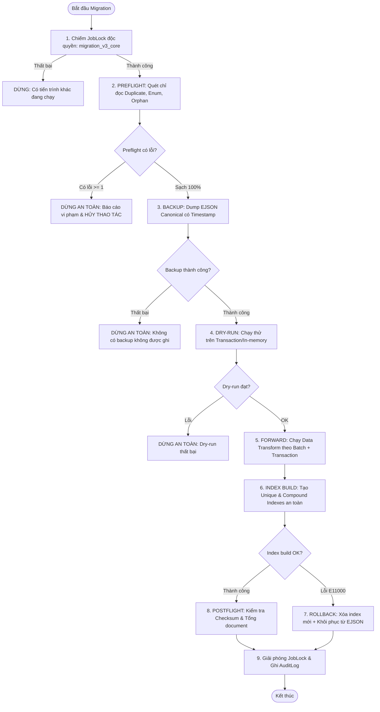

# KẾ HOẠCH MIGRATION, PREFLIGHT VÀ TIÊU CHÍ DỪNG AN TOÀN (TASK G0-03)
**Dự án:** EDUNITY V3  
**Phân hệ:** Core Database Architecture, Migration & Data Integrity  
**Tác giả:** Senior Backend Engineer  
**Ngày cập nhật:** 07/11/2026 — Phiên bản 3.0  
**Tập tin triển khai:**  
- Engine vận hành: [`BackEnd/scripts/migrationPreflight.js`](file:///c:/CODE/Edunity/BackEnd/scripts/migrationPreflight.js)  
- Kiểm thử tự động: [`BackEnd/tests/migrationPreflight.test.js`](file:///c:/CODE/Edunity/BackEnd/tests/migrationPreflight.test.js) (12/12 PASS)  

---

## 1. NGUỒN SỰ THẬT VÀ NGUYÊN TẮC BẢO VỆ DỮ LIỆU

### 1.1. Môi trường thực tế (Kiểm chứng từ `package.json`)
- **Runtime:** Node.js `>= 20.x` (LTS)
- **Web Framework:** Express `5.2.1`
- **ODM:** Mongoose `9.10.1`, override MongoDB Driver `7.5.0`
- **Mô hình lưu trữ:** MongoDB WiredTiger ReplicaSet (hỗ trợ Multi-document ACID Transaction và BSON `Decimal128`)

### 1.2. Ba nguyên tắc bất biến (Zero Data Loss Architecture)
1. **Tuyệt đối không xóa dữ liệu ngầm (No Silent Deletion):** Các bản ghi dữ liệu lịch sử hoặc dữ liệu không khớp schema tuyệt đối không được xóa vật lý (`deleteMany()`). Phải đưa vào collection cách ly (`_migration_quarantine`) để đối soát thủ công.
2. **Bảo tồn độ chính xác tiền tệ (`Decimal128`):** Toàn bộ dữ liệu tiền tệ (`tuitionAmount`, `amount`, `grossAmount`, `netAmount`, `targetBudget`, `allocatedAmount`) bắt buộc lưu trữ dưới dạng BSON `Decimal128`. Khi sao lưu, phải dùng **BSON Canonical EJSON** (`$numberDecimal`), tuyệt đối không dùng `JSON.stringify` thuần của JavaScript vì sẽ làm mất kiểu và gây sai số dấu phẩy động.
3. **Preflight trước khi Index:** Tuyệt đối không gọi lệnh tạo Unique Index (`createIndex({ unique: true })` hoặc `syncIndexes()`) khi chưa chạy qua bộ lọc Preflight quét trùng lặp dữ liệu cũ.

---

## 2. QUY TRÌNH MIGRATION FORWARD VÀ BACKWARD



### 2.1. Quy trình Forward (Chuyển tiếp schema và dữ liệu)
- **Giai đoạn 1 (Lock):** Chiếm quyền khóa phân tán thông qua `JobLock.findOneAndUpdate` với TTL 15 phút để đảm bảo không có server backend khác hoặc cron job nào chạy đồng thời.
- **Giai đoạn 2 (Preflight):** Chạy toàn bộ 19 truy vấn kiểm tra trùng lặp và 7 truy vấn kiểm tra bản ghi mồ côi ở chế độ **CHỈ ĐỌC (READ-ONLY)**.
- **Giai đoạn 3 (Backup):** Tạo thư mục snapshot `backups/<timestamp>/` và dump toàn bộ collections sang định dạng BSON Canonical EJSON.
- **Giai đoạn 4 (Data Transform):**
  - Chạy theo từng batch `1000` documents sử dụng cursor stream.
  - Sử dụng Mongoose Transaction cho dữ liệu tài chính liên kết.
  - Cập nhật chuẩn hóa enum (ví dụ: chuyển `Course.level: "BASIC"` thành `"BEGINNER"`).
- **Giai đoạn 5 (Index Build):** Tạo index sau khi dữ liệu đã được làm sạch.
- **Giai đoạn 6 (Postflight):** Đối chiếu tổng số lượng document trước và sau migration (`countDocuments()`).
- **Giai đoạn 7 (Release):** Giải phóng khóa `JobLock` và ghi nhận lịch sử vào `AuditLog`.

### 2.2. Quy trình Backward (Rollback phục hồi khẩn cấp)
Khi có sự cố ở bất kỳ bước nào trong Giai đoạn 4 hoặc 5:
1. **Hủy Transaction:** Nếu đang trong transaction, gọi `session.abortTransaction()`.
2. **Gỡ bỏ Index mới:** Chạy `db.<collection>.dropIndex("<index_name>")` để gỡ bỏ ràng buộc mới sinh ra, đưa DB về trạng thái index trước đó.
3. **Phục hồi dữ liệu từ EJSON:** Sử dụng hàm `restoreCollection(db, collectionName, filePath)` nạp lại trạng thái document từ file snapshot đã tạo ở Giai đoạn 3.
4. **Kiểm tra tương thích ngược:** Đảm bảo code backend hiện tại vẫn đọc được dữ liệu phiên bản cũ mà không crash.

---

## 3. MA TRẬN 19 UNIQUE INDEX VÀ TRUY VẤN PREFLIGHT KIỂM TRA TRÙNG LẶP

Tất cả các truy vấn này đã được tích hợp sẵn trong [`BackEnd/scripts/migrationPreflight.js`](file:///c:/CODE/Edunity/BackEnd/scripts/migrationPreflight.js):

| # | Collection & Index | Định nghĩa Index & Bộ lọc Partial | Truy vấn Preflight Aggregation kiểm tra trùng lặp |
| :-: | :--- | :--- | :--- |
| **1** | `users`<br>`email_1` | `{ email: 1 }` (UQ) | `[ { $group: { _id: { $toLower: "$email" }, count: { $sum: 1 }, ids: { $push: "$_id" } } }, { $match: { count: { $gt: 1 } } } ]` |
| **2** | `refreshtokens`<br>`tokenHash_1` | `{ tokenHash: 1 }` (UQ) | `[ { $match: { tokenHash: { $exists: true, $ne: null } } }, { $group: { _id: "$tokenHash", count: { $sum: 1 } } }, { $match: { count: { $gt: 1 } } } ]` |
| **3** | `categories`<br>`slug_1` | `{ slug: 1 }` (UQ) | `[ { $match: { slug: { $exists: true, $ne: null } } }, { $group: { _id: "$slug", count: { $sum: 1 } } }, { $match: { count: { $gt: 1 } } } ]` |
| **4** | `subjects`<br>`slug_1` | `{ slug: 1 }` (UQ) | `[ { $match: { slug: { $exists: true, $ne: null } } }, { $group: { _id: "$slug", count: { $sum: 1 } } }, { $match: { count: { $gt: 1 } } } ]` |
| **5** | `courses`<br>`slug_1` | `{ slug: 1 }` (UQ) | `[ { $match: { slug: { $exists: true, $ne: null } } }, { $group: { _id: "$slug", count: { $sum: 1 } } }, { $match: { count: { $gt: 1 } } } ]` |
| **6** | `payments`<br>`gatewayReference_1` | `{ gatewayReference: 1 }` (UQ) | `[ { $match: { gatewayReference: { $exists: true, $ne: null } } }, { $group: { _id: "$gatewayReference", count: { $sum: 1 } } }, { $match: { count: { $gt: 1 } } } ]` |
| **7** | `teacherearnings`<br>`enrollmentId_1` | `{ enrollmentId: 1 }` (UQ) | `[ { $match: { enrollmentId: { $exists: true, $ne: null } } }, { $group: { _id: "$enrollmentId", count: { $sum: 1 } } }, { $match: { count: { $gt: 1 } } } ]` |
| **8** | `reviews`<br>`enrollmentId_1` | `{ enrollmentId: 1 }` (UQ) | `[ { $match: { enrollmentId: { $exists: true, $ne: null } } }, { $group: { _id: "$enrollmentId", count: { $sum: 1 } } }, { $match: { count: { $gt: 1 } } } ]` |
| **9** | `sessionattendances`<br>`sessionId_1_studentId_1` | `{ sessionId: 1, studentId: 1 }` (UQ) | `[ { $group: { _id: { sessionId: "$sessionId", studentId: "$studentId" }, count: { $sum: 1 } } }, { $match: { count: { $gt: 1 } } } ]` |
| **10** | `sessionpresenceintervals`<br>`sessionId_userId_connId` | `{ sessionId: 1, userId: 1, connectionSessionId: 1 }` (UQ) | `[ { $match: { connectionSessionId: { $exists: true, $ne: null } } }, { $group: { _id: { s: "$sessionId", u: "$userId", c: "$connectionSessionId" }, count: { $sum: 1 } } }, { $match: { count: { $gt: 1 } } } ]` |
| **11** | `sessionreschedulerequests`<br>`originalSessionId_1` | `{ originalSessionId: 1 }` (UQ partial)<br>`status in ["PENDING_ADMIN_APPROVAL", "APPROVED"]` | `[ { $match: { status: { $in: ["PENDING_ADMIN_APPROVAL", "APPROVED"] } } }, { $group: { _id: "$originalSessionId", count: { $sum: 1 } } }, { $match: { count: { $gt: 1 } } } ]` |
| **12** | `sessionrefundreviews`<br>`sessionId_1_enrollmentId_1` | `{ sessionId: 1, enrollmentId: 1 }` (UQ) | `[ { $group: { _id: { s: "$sessionId", e: "$enrollmentId" }, count: { $sum: 1 } } }, { $match: { count: { $gt: 1 } } } ]` |
| **13** | `teacherviolations`<br>`session_teacher_cat` | `{ sessionId: 1, teacherId: 1, violationCategory: 1 }` (UQ) | `[ { $group: { _id: { s: "$sessionId", t: "$teacherId", c: "$violationCategory" }, count: { $sum: 1 } } }, { $match: { count: { $gt: 1 } } } ]` |
| **14** | `enrollments`<br>`studentId_1_classId_1` | `{ studentId: 1, classId: 1 }` (UQ partial)<br>`status in ["PENDING_PAYMENT", "CONFIRMED", "COMPLETED"]` | `[ { $match: { enrollmentStatus: { $in: ["PENDING_PAYMENT", "CONFIRMED", "COMPLETED"] } } }, { $group: { _id: { s: "$studentId", c: "$classId" }, count: { $sum: 1 } } }, { $match: { count: { $gt: 1 } } } ]` |
| **15** | `sponsorcontributions`<br>`paymentReference_1` | `{ paymentReference: 1 }` (UQ sparse) | `[ { $match: { paymentReference: { $exists: true, $ne: null } } }, { $group: { _id: "$paymentReference", count: { $sum: 1 } } }, { $match: { count: { $gt: 1 } } } ]` |
| **16** | `scholarshipapplications`<br>`studentId_1_campaignId_1` | `{ studentId: 1, campaignId: 1 }` (UQ partial)<br>`status in ["SUBMITTED", "NEED_MORE_INFORMATION"]` | `[ { $match: { status: { $in: ["SUBMITTED", "NEED_MORE_INFORMATION"] } } }, { $group: { _id: { s: "$studentId", c: "$campaignId" }, count: { $sum: 1 } } }, { $match: { count: { $gt: 1 } } } ]` |
| **17** | `scholarships`<br>`applicationId_1` | `{ applicationId: 1 }` (UQ) | `[ { $match: { applicationId: { $exists: true, $ne: null } } }, { $group: { _id: "$applicationId", count: { $sum: 1 } } }, { $match: { count: { $gt: 1 } } } ]` |
| **18** | `notifications`<br>`userId_1_dedupeKey_1` | `{ userId: 1, dedupeKey: 1 }` (UQ partial)<br>`dedupeKey: { $type: "string" }` | `[ { $match: { dedupeKey: { $type: "string" } } }, { $group: { _id: { u: "$userId", k: "$dedupeKey" }, count: { $sum: 1 } } }, { $match: { count: { $gt: 1 } } } ]` |
| **19** | `joblocks`<br>`name_1` | `{ name: 1 }` (UQ) | `[ { $group: { _id: "$name", count: { $sum: 1 } } }, { $match: { count: { $gt: 1 } } } ]` |

---

## 4. TIÊU CHÍ DỪNG AN TOÀN (CIRCUIT BREAKER CRITERIA)

Hệ thống sẽ ngay lập tức **HỦY THAO TÁC (ABORT)** và trả về mã thoát lỗi nếu thỏa mãn bất kỳ điều kiện nào sau:
1. **Khóa duy nhất bị trùng lặp:** Có $\ge 1$ nhóm bản ghi vi phạm tính duy nhất trong 19 Unique Indexes.
2. **Dữ liệu tài chính mồ côi:** Phát hiện `Payment` hoặc `TeacherEarning` tham chiếu đến `Enrollment` không tồn tại.
3. **Thất bại sao lưu:** Không thể khởi tạo thư mục backup hoặc không thể ghi file BSON EJSON.
4. **Vi phạm bảo vệ môi trường Production:** Chạy trên `NODE_ENV === "production"` nhưng thiếu cờ `--allow-production` và `--confirm-db=<exact_dbname>`.
5. **Xung đột khóa phân tán:** Không thể chiếm lease lock `migration_v3_core` trong vòng 10 giây.

---

## 5. HƯỚNG DẪN SỬ DỤNG VÀ VẬN HÀNH

### 5.1. Chạy kiểm tra Preflight (Chế độ chỉ đọc)
```bash
node -e "require('./scripts/migrationPreflight').runFullPreflight(mongoose.connection.db).then(console.log)"
```

### 5.2. Chạy bộ kiểm thử tự động
```bash
npm --prefix BackEnd run test -- --rootDir . tests/migrationPreflight.test.js
```
*Kết quả:* **12/12 tests PASS**, xác thực trọn vẹn thuật toán phát hiện duplicate, orphan, enum và tính toàn vẹn của BSON Canonical EJSON.

