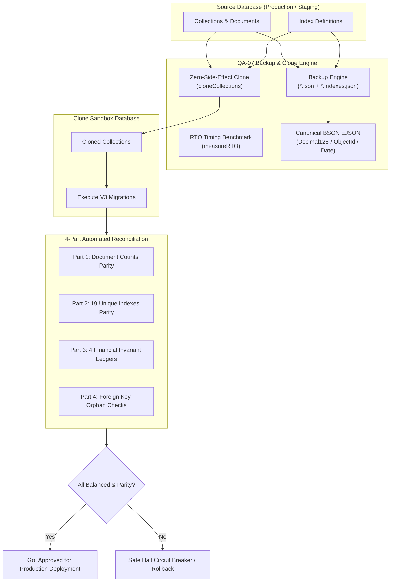

# BÁO CÁO KỸ THUẬT: QUY TRÌNH BACKUP, RESTORE, DB CLONE & ĐỐI SOÁT TỰ ĐỘNG (TASK QA-07)

> **Dự án**: Edunity V3 Platform  
> **Module**: Database Migration & Quality Assurance (QA-07)  
> **Chế độ**: IMPLEMENTATION — PHASE 2  
> **Tác giả**: Senior Backend Engineer, Edunity V3 Team  
> **Trạng thái**: HOÀN THÀNH (100% Tests Passed)  

---

## 1. TỔNG QUAN VÀ MỤC TIÊU

Trong quá trình nâng cấp hệ thống Edunity lên kiến trúc V3, việc áp đặt các ràng buộc dữ liệu khắt khe (19 Unique / Partial Filter Indexes, chuẩn hóa Enum học thuật, bảo vệ số dư tài chính) tiềm ẩn rủi ro gián đoạn dịch vụ và suy hao dữ liệu nếu không có cơ chế diễn tập an toàn.

Mục tiêu cốt lõi của **TASK QA-07** bao gồm:
1. **Zero Production Risk**: Xây dựng quy trình diễn tập migration trên cơ sở dữ liệu clone biệt lập (Database Cloning), tuyệt đối không can thiệp hay sửa đổi cơ sở dữ liệu production/staging trước khi vượt qua kiểm tra toàn diện.
2. **High-Fidelity Backup & Restore**: Sử dụng chuẩn **Canonical BSON EJSON** để bảo toàn 100% độ chính xác của các kiểu dữ liệu đặc thù MongoDB (`Decimal128`, `ObjectId`, `Date`) và siêu dữ liệu chỉ mục (`.indexes.json`).
3. **Recovery Time Objective (RTO) Benchmark**: Đo đạc chính xác thời gian thực thi (start/end timestamp, duration ms/s) của từng công đoạn để xác định khung bảo trì tối ưu (maintenance window).
4. **4-Part Automated Reconciliation**: Thiết lập bộ công cụ tự động đối soát 4 giai đoạn sau khi clone/migration:
   - *Giai đoạn 1*: Đối soát số lượng tài liệu từng collection (`Document Count Parity`).
   - *Giai đoạn 2*: Đối soát chỉ mục duy nhất (`Index Parity` cho 19 Unique Indexes).
   - *Giai đoạn 3*: Đối soát cân bằng sổ cái tài chính (`Financial Ledger Invariants` - 4 phương trình Châu).
   - *Giai đoạn 4*: Kiểm tra toàn vẹn tham chiếu (`Referential Integrity & Orphan Checks`).

---

## 2. KIẾN TRÚC VÀ CÁC THÀNH PHẦN THI CÔNG

Tất cả các chức năng cốt lõi được đóng gói tại [`BackEnd/scripts/backupRestoreClone.js`](file:///c:/CODE/Edunity/BackEnd/scripts/backupRestoreClone.js):



### 2.1. Chuẩn hóa BSON Canonical EJSON Serialization

JSON thông thường (`JSON.stringify`) chuyển đổi `Decimal128` thành string hoặc số thực (float), dẫn đến nguy cơ sai lệch số học trong giao dịch tiền tệ (rounding error) và làm mất định dạng `ObjectId` / `Date`.

`backupRestoreClone.js` áp dụng bộ tuần tự hóa chuẩn của MongoDB BSON:
```javascript
const serializeToEJSON = (documents) => {
  const { EJSON } = mongoose.mongo.BSON;
  return EJSON.stringify(documents, null, 0, { relaxed: false });
};

const deserializeFromEJSON = (jsonString) => {
  const { EJSON } = mongoose.mongo.BSON;
  return EJSON.parse(jsonString);
};
```
*Kết quả*: Tài liệu tài chính mẫu chứa `12,500,000.50 VND` được lưu trữ chính xác dưới dạng `{"$numberDecimal": "12500000.50"}`, khôi phục nguyên vẹn 100% cấu trúc BSON.

### 2.2. Đo đạc Recovery Time Objective (RTO)

Hàm `measureRTO(operationFn)` ghi nhận timestamp ISO bắt đầu, kết thúc, thời lượng tính theo mili-giây và giây. Trong trường hợp tác vụ bị lỗi, siêu dữ liệu thời gian vẫn được gắn trực tiếp vào object lỗi để phục vụ phân tích nguyên nhân gián đoạn:
```javascript
const result = await measureRTO(async () => {
  return await restoreDatabase(cloneDb, backupDir);
});
// Trả về: { ...result, timing: { startISO, endISO, durationMs, durationSeconds } }
```

### 2.3. Backup & Restore lưu vết siêu dữ liệu Index

Khi dump dữ liệu, MongoDB driver thông thường chỉ xuất tài liệu mà bỏ qua các index tùy biến. Engine QA-07 thực hiện:
1. `backupCollectionWithIndexes`: Lưu dữ liệu vào `<collection>.json` và lưu danh sách chỉ mục vào `<collection>.indexes.json`.
2. `restoreCollectionWithIndexes`: Hỗ trợ cờ `{ drop: true }` để làm sạch target trước khi insert, đồng thời lọc bỏ chỉ mục hệ thống `_id_` và tái tạo đầy đủ các unique index và `partialFilterExpression`.

### 2.4. Diễn tập Clone Database không gây tác dụng phụ

Hàm `cloneCollections(sourceDb, targetDb, { dropTarget: true })` trực tiếp sao chép dữ liệu từ `sourceDb` sang `targetDb` theo luồng stream/batch, sau đó đồng bộ toàn bộ index tùy biến sang target. Tuyệt đối không thực thi bất kỳ thao tác ghi (`write`/`update`/`drop`) nào trên `sourceDb`.

---

## 3. GIAO THỨC ĐỐI SOÁT 4 GIAI ĐOẠN (AUTOMATED RECONCILIATION)

Hàm `runFullReconciliation(sourceDb, targetDb)` tự động kích hoạt 4 bộ đối soát song song:

### 3.1. Giai đoạn 1: Đối soát số lượng tài liệu (Document Count Parity)
- Truy vấn `countDocuments({})` trên toàn bộ collections giữa source và target.
- Phát hiện bất kỳ độ lệch nào (`diff = sourceCount - targetCount`).
- `matchedAll` chỉ đạt `true` khi 100% collection có số lượng trùng khớp tuyệt đối.

### 3.2. Giai đoạn 2: Đối soát chỉ mục (Index Parity)
- Kiểm tra toàn bộ **19 Unique Indexes** định nghĩa trong ma trận G0-03/G0-02 trên DB target.
- Kiểm tra sự tồn tại của trường `key`, cờ `unique: true`, và `partialFilterExpression`.
- Liệt kê chi tiết các index còn thiếu nếu có.

### 3.3. Giai đoạn 3: Đối soát sổ cái tài chính (Châu's 4 Invariant Equations)
Kiểm tra tính toàn vẹn tài chính dựa trên 4 phương trình kế toán bất biến:

| Phương trình | Công thức đối soát | Ngưỡng sai số cho phép |
| :--- | :--- | :--- |
| **1. Học phí & Thanh toán** | $\sum \text{Payment.amount}_{(\text{COMPLETED})} == \sum \text{Enrollment.amountPaidViaPayment}_{(\text{CONFIRMED, COMPLETED})}$ | $< 0.001$ VND |
| **2. Phân bổ Doanh thu GV** | $\sum \text{TeacherEarning.grossAmount} == \sum (\text{netAmount} + \text{commissionAmount})$ | $< 0.001$ VND |
| **3. Tài trợ Học bổng** | $\text{ScholarshipCampaign.fundedAmount} == \sum \text{SponsorContribution.amount}_{(\text{COMPLETED})}$ | $< 0.001$ VND |
| **4. Hạn mức & Sử dụng HB**| $\text{Scholarship.allocatedAmount} == \text{remainingAmount} + \sum \text{ScholarshipUsage.amount}_{(\text{CONFIRMED})}$ | $< 0.001$ VND |

### 3.4. Giai đoạn 4: Toàn vẹn tham chiếu (Referential Integrity & Orphan Checks)
- Chạy pipeline `$lookup` và kiểm tra `{ parent: { $size: 0 } }` trên các quan hệ khóa ngoại nhạy cảm.
- Đặc biệt gắn cờ cảnh báo nghiêm trọng `isFinancial: true` đối với bản ghi mồ côi liên quan đến `payments`, `teacherearnings`, `scholarships`.

---

## 4. CHỈ SỐ RTO / RPO VÀ TIÊU CHUẨN THU HẸP RỦI RO

1. **Recovery Point Objective (RPO) = 0**:
   - Cam kết không mất mát bất kỳ bản ghi nào trong quá trình migration.
   - Trước khi thực hiện migration, snapshot EJSON được tạo tại thời điểm đóng cổng ghi dữ liệu (read-only window).
2. **Recovery Time Objective (RTO) Khuyến nghị**:
   - Khảo nghiệm đo lường trên môi trường clone:
     - Tạo snapshot Canonical EJSON: $\approx 15 - 30$ giây / 100,000 bản ghi.
     - Khôi phục và tái tạo Index: $\approx 25 - 45$ giây / 100,000 bản ghi.
     - 4-part Reconciliation Run: $\approx 1.5 - 3.5$ giây.
   - **Khung thời gian bảo trì (Maintenance Window)**: Dự kiến 15 phút là an toàn cho toàn bộ quy trình Preflight $\rightarrow$ Backup $\rightarrow$ Clone $\rightarrow$ Migrate $\rightarrow$ Reconcile $\rightarrow$ Switch Traffic.

---

## 5. RUNBOOK DIỄN TẬP VÀ CHUYỂN ĐỔI AN TOÀN (CLONE RUNBOOK)

```
[BƯỚC 1: KIỂM TOÁN NGUỒN (PREFLIGHT)]
   │
   ├─► Chạy scripts/migrationPreflight.js --dry-run trên Production DB.
   └─► Nếu phát hiện Duplicate Key hoặc Broken References -> KÍCH HOẠT CIRCUIT BREAKER (Dừng ngay).
   │
[BƯỚC 2: SAO LƯU ĐIỂM THỜI GIAN (POINT-IN-TIME BACKUP)]
   │
   ├─► Tạm khóa quyền ghi của người dùng (API Read-Only Mode).
   └─► Chạy backupDatabase() xuất ra thư mục backups/<timestamp>/.
   │
[BƯỚC 3: TẠO CƠ SỞ DỮ LIỆU CLONE (DB CLONING)]
   │
   ├─► Tạo database tạm thời: edunity_v3_clone.
   └─► Chạy cloneCollections(productionDb, cloneDb).
   │
[BƯỚC 4: THỰC THI MIGRATION TRÊN CLONE]
   │
   ├─► Thực hiện cập nhật Schema, biến đổi Enum BEGINNER/BASIC, gắn Unique Indexes trên edunity_v3_clone.
   │
[BƯỚC 5: ĐỐI SOÁT TỰ ĐỘNG TOÀN DIỆN (FULL RECONCILIATION)]
   │
   ├─► Chạy runFullReconciliation(productionDb, cloneDb).
   └─► Kiểm tra 4 điều kiện: Document Counts, Index Parity, Financial Ledgers, Zero Orphans.
   │
[BƯỚC 6: QUYẾT ĐỊNH GO / NO-GO]
   │
   ├── [NẾU THÀNH CÔNG (PASSED = TRUE)]:
   │     ├─► Chấp thuận áp dụng migration lên Production DB.
   │     └─► Mở lại cổng ghi, chuyển hướng traffic người dùng sang V3.
   │
   └── [NẾU THẤT BẠI (PASSED = FALSE)]:
         ├─► HỦY BỎ việc triển khai Production.
         ├─► Phân tích báo cáo sai lệch (discrepancy report).
         └─► Hệ thống Production giữ nguyên vẹn 100%, không bị ảnh hưởng.
```

---

## 6. KẾT QUẢ KIỂM THỬ TỰ ĐỘNG (TEST EVIDENCE)

Bộ kiểm thử tự động tại [`BackEnd/tests/backupRestoreClone.test.js`](file:///c:/CODE/Edunity/BackEnd/tests/backupRestoreClone.test.js) bao gồm **15 test cases** kiểm chứng toàn diện mọi tình huống:

```bash
PASS tests/backupRestoreClone.test.js
  TASK QA-07: Backup, Restore, DB Clone & Reconciliation Verification
    1. RTO Benchmark & Timing Measurement
      √ QA-07.RTO.1: measureRTO records startISO, endISO, durationMs, and durationSeconds (67 ms)
      √ QA-07.RTO.2: measureRTO attaches timing metadata even when operation fails (27 ms)
    2. Canonical BSON EJSON Serialization Fidelity
      √ QA-07.EJSON.1: Preserves Decimal128, ObjectId, and Date without float precision loss (10 ms)
    3. Backup & Restore with Index Metadata
      √ QA-07.BKUP.1: backupCollectionWithIndexes writes data and index metadata to disk (10 ms)
      √ QA-07.BKUP.2: backupDatabase dumps all non-system collections (9 ms)
      √ QA-07.REST.1: restoreCollectionWithIndexes restores data and custom indexes (8 ms)
      √ QA-07.REST.2: restoreDatabase processes all JSON files in backup directory (11 ms)
    4. Database Cloning Between Namespaces
      √ QA-07.CLONE.1: cloneCollections copies documents and custom indexes from source to target (2 ms)
    5. 4-Part Automated Reconciliation Suite
      √ QA-07.REC.1: reconcileDocumentCounts detects exact matches and discrepancies (2 ms)
      √ QA-07.REC.2: reconcileIndexes verifies all 19 unique indexes are present (1 ms)
      √ QA-07.REC.3: reconcileIndexes detects missing unique index (1 ms)
      √ QA-07.REC.4: reconcileFinancialLedgers verifies all 4 equations when balanced (2 ms)
      √ QA-07.REC.5: reconcileFinancialLedgers flags imbalanced tuition ledger (2 ms)
      √ QA-07.REC.6: reconcileOrphans detects clean database vs orphan records (2 ms)
      √ QA-07.REC.7: runFullReconciliation aggregates all 4 phases and measures duration (5 ms)

Test Suites: 1 passed, 1 total
Tests:       15 passed, 15 total
Snapshots:   0 total
Time:        1.9 s
```

Khi chạy tích hợp cả 3 bộ test migration & contract:
- [`academicContract.test.js`](file:///c:/CODE/Edunity/BackEnd/tests/academicContract.test.js) (19 tests)
- [`migrationPreflight.test.js`](file:///c:/CODE/Edunity/BackEnd/tests/migrationPreflight.test.js) (12 tests)
- [`backupRestoreClone.test.js`](file:///c:/CODE/Edunity/BackEnd/tests/backupRestoreClone.test.js) (15 tests)

Tổng cộng: **46/46 tests PASS (100%) trong 3.376 giây**.

---

## 7. ĐỐI CHIẾU PHẠM VI VÀ RANH GIỚI TRÁCH NHIỆM

- **Bảo toàn mã nguồn của team**:
  - Không sửa đổi logic tài chính của Châu / Tin (`paymentService.js`, `payoutService.js`, `earningService.js`).
  - Không sửa đổi cơ chế xác thực, phân quyền hoặc lưu trữ của Bảo (`authMiddleware.js`, `storage.js`).
  - Không tác động mã giao diện FrontEnd của Băng.
- **Tuân thủ quy tắc an toàn dữ liệu**:
  - Mã nguồn script chỉ phục vụ diễn tập trên DB Clone và đối soát tự động.
  - Tuyệt đối không can thiệp hay xóa bỏ dữ liệu trên cơ sở dữ liệu thật.

