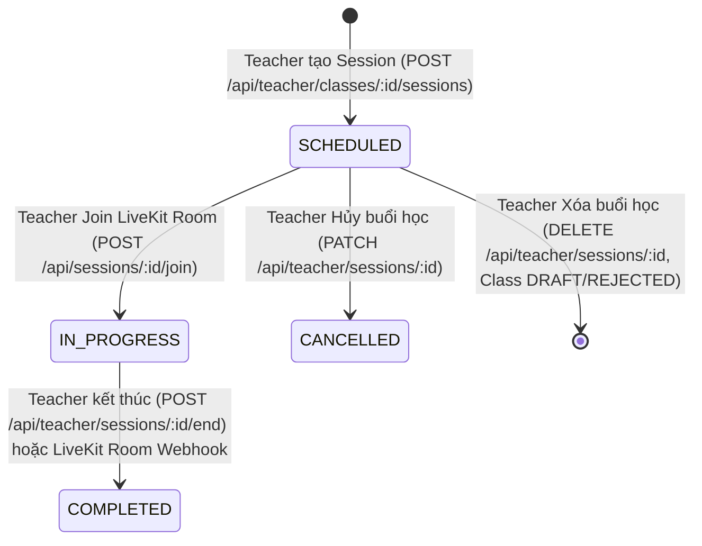

# FE Phase 05 — Session + Schedule Integration

## 1. Scope
Tích hợp toàn diện Session domain thật và cơ chế phái sinh Teaching/Learning Schedule trên Frontend Edunity:
- **Teacher**: Xem danh sách buổi học của lớp học, tạo buổi học (đơn lẻ hoặc bulk từ lịch dự kiến), cập nhật thông tin buổi học `SCHEDULED`, hủy buổi học (`CANCELLED`), xóa buổi học (khi lớp ở trạng thái `DRAFT`/`REJECTED`), kết thúc buổi học (`COMPLETED`), xem điểm danh, và xem Lịch giảng dạy tổng hợp từ các lớp học do giáo viên phụ trách.
- **Student**: Xem danh sách buổi học của lớp công khai/đã tham gia, xem Lịch học cá nhân qua endpoint backend `GET /api/me/sessions` (gắn liền với trạng thái ghi danh thực tế), giao diện empty-state thông báo rõ ràng về dependency Phase 6 (Enrollment).
- **Admin**: Đánh giá năng lực backend về Session monitoring; phát hiện và tài liệu hóa chuẩn xác `BACKEND CAPABILITY GAP` (Backend không cung cấp endpoint admin session list/detail).
- **Schedule Adapter**: Kiến trúc Schedule là **Derived Read Model**, tuyệt đối không giả lập entity hay persistence backend cho Schedule.
- **Ranh giới quan trọng**: Tuân thủ nghiêm ngặt ranh giới **READ ONLY BACKEND** (0 file backend bị thay đổi) và **PHASE 5 KHÔNG PHẢI CLASSROOM/LIVEKIT** (không tạo fake start button, không nhúng LiveKit UI/controls trong phase này).

---

## 2. Backend Session Contract Discovered

### Public/Class Session
- **Endpoint**: `GET /api/classes/:id/sessions`
- **Method**: `GET`
- **Auth**: Public (không yêu cầu token)
- **Role**: All
- **Params**: `:id` (Class ObjectId)
- **Response**: Mảng danh sách các Session documents thuộc class đó, sắp xếp theo `startDatetime: 1`.
  ```json
  [
    {
      "_id": "67...a1",
      "class": "67...c2",
      "title": "Buổi 1: Giới thiệu khóa học",
      "description": "Nội dung tổng quan",
      "type": "LESSON",
      "startDatetime": "2026-10-15T09:00:00.000Z",
      "endDatetime": "2026-10-15T11:00:00.000Z",
      "meetingRoomId": "room-67...a1",
      "status": "SCHEDULED",
      "videoStatus": "NONE"
    }
  ]
  ```
- **Errors**: `400 Invalid ID format`, `404 Class not found`, `500 Server error`.

### Teacher Session
1. **Create Session (Single / Bulk)**:
   - **Endpoint**: `POST /api/teacher/classes/:classId/sessions`
   - **Auth**: `Bearer <token>`
   - **Role**: `TEACHER`
   - **Ownership Check**: `classDoc.teacher.toString() === req.user.userId`.
   - **Body (Single)**:
     ```json
     {
       "title": "Buổi 2: Cú pháp cơ bản",
       "description": "Tìm hiểu biến và hàm",
       "startDatetime": "2026-10-18T09:00:00.000Z",
       "endDatetime": "2026-10-18T11:00:00.000Z",
       "type": "LESSON"
     }
     ```
   - **Body (Bulk)**:
     ```json
     {
       "sessions": [
         {
           "title": "Buổi 1",
           "startDatetime": "...",
           "endDatetime": "..."
         }
       ]
     }
     ```
   - **Validation Rules**: `title` bắt buộc; `startDatetime`, `endDatetime` bắt buộc; `startDatetime < endDatetime`; Thời gian buổi học phải nằm trong khoảng thời gian hoạt động của lớp học (`class.startDate` và `class.endDate`).
   - **Response**: `201 Created` kèm Session object hoặc mảng Session objects đã tạo.
   - **Errors**: `400 Validation Error / Date mismatch`, `403 Not class teacher`, `404 Class not found`.

2. **Update Session**:
   - **Endpoint**: `PATCH /api/teacher/sessions/:id`
   - **Auth**: `Bearer <token>`
   - **Role**: `TEACHER` (chủ sở hữu lớp học)
   - **Condition**: Trạng thái hiện tại phải là `SCHEDULED`. Không cho phép sửa nếu session đã `IN_PROGRESS`, `COMPLETED`, hoặc `CANCELLED`.
   - **Body**: `{ "title": "...", "description": "...", "startDatetime": "...", "endDatetime": "..." }`
   - **Response**: `200 OK` kèm Session đã cập nhật.
   - **Errors**: `400 Session cannot be updated in current state`, `403 Unauthorized`, `404 Session not found`.

3. **Cancel Session**:
   - **Endpoint**: `PATCH /api/teacher/sessions/:id`
   - **Body**: `{ "status": "CANCELLED" }`
   - **Condition**: Trạng thái hiện tại phải là `SCHEDULED`.
   - **Response**: `200 OK` kèm Session có `status: "CANCELLED"`.

4. **Delete Session**:
   - **Endpoint**: `DELETE /api/teacher/sessions/:id`
   - **Auth**: `Bearer <token>`
   - **Role**: `TEACHER`
   - **Condition**: Chỉ cho phép xóa khi lớp học ở trạng thái `DRAFT` hoặc `REJECTED`. Nếu lớp đã submit hoặc đã duyệt (`SUBMITTED`, `APPROVED`, `OPEN`, `IN_PROGRESS`), backend từ chối xóa và yêu cầu dùng Cancel.
   - **Response**: `200 OK` `{ "deleted": true }`.
   - **Errors**: `400 Cannot delete session after class submission`, `403 Not authorized`.

5. **End Session**:
   - **Endpoint**: `POST /api/teacher/sessions/:id/end`
   - **Auth**: `Bearer <token>`
   - **Role**: `TEACHER`
   - **Condition**: Session đang ở trạng thái `IN_PROGRESS`. Chuyển trạng thái sang `COMPLETED`.
   - **Response**: `200 OK` với Session có `status: "COMPLETED"`.
   - **Errors**: `400 Session is not in progress`, `403 Not authorized`.

6. **Planned Sessions (Schedule auto-generator)**:
   - **Endpoint**: `GET /api/teacher/classes/:id/planned-sessions`
   - **Auth**: `Bearer <token>`
   - **Role**: `TEACHER`
   - **Logic**: Backend tính toán các ngày học dựa theo `startDate`, `endDate`, và cấu hình `schedule` (`daysOfWeek`, `startTime`, `endTime`) của lớp học để trả về danh sách ngày giờ gợi ý.
   - **Response**: Array of `{ "startDatetime": "...", "endDatetime": "...", "dayOfWeek": 2, "sessionNumber": 1 }`.

7. **Session Attendance**:
   - **Endpoint**: `GET /api/teacher/sessions/:id/attendance`
   - **Auth**: `Bearer <token>`
   - **Role**: `TEACHER`
   - **Response**: Mảng thông tin điểm danh của học viên trong buổi học (`studentId`, `joinTime`, `leaveTime`, `durationMinutes`, `isPresent`).

### Student Session Access
- **Endpoint**: `GET /api/me/sessions?from=&to=`
- **Auth**: `Bearer <token>`
- **Role**: `STUDENT`
- **Query Params**: `from` (ISO string), `to` (ISO string)
- **Logic**: Backend truy vấn `Enrollment` của học viên có status `CONFIRMED`, tìm các Session thuộc các lớp đã ghi danh trong khoảng thời gian, tính toán `canJoin` (cho phép vào trước giờ học 15 phút).
- **Public Schedule View**: Học viên cũng có thể xem toàn bộ lịch học của bất kỳ lớp học nào qua `GET /api/classes/:id/sessions`.

### Admin Session
- **Tình trạng**: **BACKEND CAPABILITY GAP**.
- Backend hiện tại **KHÔNG CÓ** endpoint nào dành riêng cho Admin quản lý danh sách Session toàn sàn (không có `GET /api/admin/sessions`).

### Classroom-Coupled Actions
- **Endpoint**: `POST /api/sessions/:id/join`
- **Logic Backend**:
  - Khi Teacher (Host) gọi endpoint join phòng học LiveKit, backend tự động kích hoạt chuyển trạng thái Session từ `SCHEDULED` sang `IN_PROGRESS`.
  - **Kết luận**: Chuyển trạng thái `IN_PROGRESS` gắn liền trực tiếp với luồng Classroom/LiveKit Join Room. Frontend Phase 5 **KHÔNG** tạo nút giả lập "Bắt đầu buổi học" ở phía client.

---

## 3. Session Model
Các trường dữ liệu thực tế từ Mongoose schema `Session`:
| Trường | Kiểu dữ liệu | Bắt buộc | Mặc định | Ý nghĩa |
|---|---|---|---|---|
| `_id` | ObjectId | Có | Auto | Session ID |
| `class` | ObjectId | Có | - | Reference tới Class |
| `title` | String | Có | - | Tiêu đề buổi học |
| `description` | String | Không | `""` | Mô tả nội dung |
| `type` | String | Có | `"LESSON"` | Loại nội dung: `LESSON`, `MATERIAL`, `ASSIGNMENT` |
| `startDatetime` | Date | Có | - | Thời điểm bắt đầu (ISO String) |
| `endDatetime` | Date | Có | - | Thời điểm kết thúc (ISO String) |
| `meetingRoomId` | String | Không | UUID | ID phòng học video |
| `status` | String | Có | `"SCHEDULED"` | Trạng thái: `SCHEDULED`, `IN_PROGRESS`, `COMPLETED`, `CANCELLED` |
| `videoStatus` | String | Có | `"NONE"` | Trạng thái video: `NONE`, `RECORDING`, `READY`, `FAILED` |
| `material` | Object | Không | `null` | Tài liệu học tập đính kèm |
| `assignment` | Object | Không | `null` | Bài tập đính kèm |
| `createdBy` | ObjectId | Có | - | Reference tới User (Teacher tạo) |
| `createdAt` | Date | Có | Auto | Timestamp tạo |
| `updatedAt` | Date | Có | Auto | Timestamp cập nhật |

---

## 4. Session Types
Backend enum hỗ trợ 3 loại Session:
1. `LESSON`: Buổi học tương tác trực tuyến (Live lesson có giờ bắt đầu, kết thúc, phòng học).
2. `MATERIAL`: Phiên cung cấp tài liệu tự đọc/nghiên cứu.
3. `ASSIGNMENT`: Phiên kiểm tra/giao bài tập.

---

## 5. Session State Machine
Sơ đồ chuyển trạng thái thực tế:

- **Nguyên tắc cốt lõi**: Không có endpoint chuyển thủ công từ `SCHEDULED` sang `IN_PROGRESS`. Trạng thái này phụ thuộc vào Teacher Host kết nối phòng học.

---

## 6. Schedule Architecture
- **Schedule is standalone Backend entity/API**: **NO**
- **Derivation Strategy (Chiến lược phái sinh trên Frontend)**:
  - Schedule được kiến trúc hoàn toàn như một **Frontend Derived Read Model** (`ScheduleItem`).
  - **Lịch giảng dạy của Giáo viên (Teacher Teaching Schedule)**:
    - Thu thập danh sách các lớp học thuộc sở hữu của giáo viên qua `classService.listMyClasses()`.
    - Tải song song danh sách Session thực tế của từng lớp qua `sessionService.getClassSessions(classId)`.
    - Hợp nhất và chuẩn hóa qua hàm `deriveScheduleItemsFromSessions(sessions, classNameMap)`.
    - Sắp xếp tăng dần theo `startDatetime`. Cung cấp các bộ lọc thời gian: *Hôm nay (Today)*, *Tuần này (This Week)*, *Tất cả (All)*, lọc theo Lớp học và theo Trạng thái buổi học.
  - **Lịch học của Học viên (Student Learning Schedule)**:
    - Sử dụng endpoint chính thức `GET /api/me/sessions?from=&to=` thông qua `sessionService.getMySessions(...)`.
    - Chuyển đổi dữ liệu và nhóm theo ngày học.
    - Tuyệt đối không tạo API Schedule giả lập hay lưu trữ ngầm `Schedule` vào CSDL.

---

## 7. Backend Capability Gaps
1. **Admin Session Monitoring Gap**:
   - Backend chưa cung cấp endpoint quản lý Session tập trung cho Admin (`/api/admin/sessions`).
   - Frontend tuân thủ nguyên tắc không tạo trang admin ảo/dữ liệu giả lập không có API hỗ trợ.
2. **Session Within Class Time Enforcement Gap**:
   - Backend validate thời gian buổi học phải nằm trong khoảng `[startDate, endDate]` của lớp học khi gọi tạo Session. Đây là ràng buộc chặt chẽ đã được phản ánh đồng bộ trên form nhập liệu của Frontend.

---

## 8. Files Created
1. `FrontEnd/src/types/session.ts`: Định nghĩa kiểu dữ liệu Session, SessionStatus, SessionContentType, CreateSessionPayload, UpdateSessionPayload, PlannedSession, SessionAttendanceItem, ScheduleItem, labels và màu sắc trạng thái chuẩn tiếng Việt.
2. `FrontEnd/src/api/sessionAdapters.ts`: Adapter chuẩn hóa `ApiSession -> Session` (chuyển `_id` thành `id`), adapter chuyển đổi `Session[] -> ScheduleItem[]`, utility định dạng thời gian.
3. `FrontEnd/src/services/session.service.ts`: Service giao tiếp với các endpoint Session thực tế của Backend (`getClassSessions`, `createSession`, `createSessionsBulk`, `updateSession`, `deleteSession`, `cancelSession`, `endSession`, `getPlannedSessions`, `getSessionAttendance`, `getMySessions`) kèm Query Key Factory chuẩn React Query (`sessionKeys`).
4. `FrontEnd/src/features/teacher/schedule/TeacherSchedulePage.tsx`: Trang Lịch giảng dạy của Giáo viên tổng hợp toàn bộ buổi học từ các lớp sở hữu, hỗ trợ bộ lọc đa chiều và tổng quan thống kê.

---

## 9. Files Modified
1. `FrontEnd/src/features/teacher/classes/detail/TeacherClassDetailPage.tsx`:
   - Mở rộng tab **"Lịch học & Buổi học"**: hiển thị danh sách buổi học thực tế từ Backend.
   - Tích hợp Modal **Tạo buổi học đơn lẻ** với validation thời gian theo lớp học.
   - Tích hợp Modal **Tự động lên lịch (Auto-Plan)** từ cấu hình lịch của lớp học qua `getPlannedSessions`.
   - Tích hợp Modal **Chỉnh sửa buổi học** (chỉ cho phép khi ở trạng thái `SCHEDULED`).
   - Tích hợp hành động **Hủy buổi học** (`CANCELLED`) có xác nhận an toàn qua Popconfirm.
   - Tích hợp hành động **Xóa buổi học** (chỉ khả dụng khi lớp ở trạng thái `DRAFT` hoặc `REJECTED`).
   - Tích hợp hành động **Kết thúc buổi học** (`COMPLETED` khi buổi học `IN_PROGRESS`).
   - Tích hợp Modal **Xem danh sách điểm danh** học viên (`getSessionAttendance`).
2. `FrontEnd/src/features/student/schedule/StudentSchedulePage.tsx`:
   - Thay thế toàn bộ mock schedule bằng truy vấn Backend thật qua `sessionService.getMySessions(monday, sunday)`.
   - Bổ sung Empty State hiển thị rõ ràng thông báo về dependency của Phase 6 (Enrollment).
3. `FrontEnd/src/features/student/classes/StudentClassSessionsPage.tsx`:
   - Gỡ bỏ màn hình chặn truy cập giả lập; kết nối trực tiếp với `sessionService.getClassSessions(classId)` giúp học viên tra cứu giáo trình và lịch trình thực tế của lớp.
4. `FrontEnd/src/routes/routePaths.ts`:
   - Đăng ký hằng số route `ROUTES.TEACHER.SCHEDULE = "/teacher/schedule"`.
5. `FrontEnd/src/components/layout/TeacherLayout.tsx`:
   - Kích hoạt menu "Lịch giảng dạy" trên sidebar của Giáo viên trỏ về `/teacher/schedule`.
6. `FrontEnd/src/app/router.tsx`:
   - Đăng ký route `/teacher/schedule` được bảo vệ bởi role guard `TEACHER`.

---

## 10. Teacher Integration
- Giáo viên truy cập lớp học thuộc sở hữu của mình tại `/teacher/classes/:id`, mở tab "Lịch học & Buổi học".
- Giao diện cung cấp đầy đủ các thao tác quản lý vòng đời buổi học dựa theo quyền sở hữu và trạng thái lớp:
  - Nếu lớp chưa duyệt (`DRAFT`/`REJECTED`): cho phép tạo, sửa, xóa triệt để buổi học.
  - Nếu lớp đã phê duyệt/mở: không cho xóa vĩnh viễn, chỉ cho phép hủy (`CANCELLED`) để bảo vệ lịch trình học viên.
  - Các thao tác mutation đều tự động vô hiệu hóa nút bấm trong quá trình xử lý (Mutation lock) và tự động refetch invalidate `sessionKeys` và `classKeys`.
- Trang Lịch giảng dạy `/teacher/schedule` cung cấp bảng điều khiển trực quan giúp giáo viên nắm bắt lịch dạy trong ngày, trong tuần và toàn bộ các buổi học đã lên lịch.

---

## 11. Student Integration
- Học viên tra cứu danh sách buổi học của lớp học thông qua `StudentClassSessionsPage`.
- Trang Lịch học cá nhân `StudentSchedulePage` kết nối trực tiếp tới `GET /api/me/sessions`.
- Do quy trình ghi danh và thanh toán thực tế thuộc Phase 6 (Enrollment & Checkout), trang hiển thị đúng bản chất: nếu học viên chưa có enrollment xác nhận, giao diện hiển thị empty-state với gợi ý đăng ký lớp học thay vì nạp dữ liệu giả.

---

## 12. Admin Integration
- Đã kiểm tra chi tiết toàn bộ route của Backend: không tồn tại route Admin dành riêng cho Session.
- Không mô phỏng giao diện giả lập ngoài phạm vi backend cung cấp.

---

## 13. Session Adapter
- Tệp `FrontEnd/src/api/sessionAdapters.ts`:
  - `adaptSession`: Chuẩn hóa triệt để `_id` thành `id`.
  - Chuyển đổi timestamp ISO sang định dạng chuẩn hiển thị qua `dayjs`.
  - Chuẩn hóa thông tin quan hệ lớp học (`classId`, `className`).

---

## 14. Schedule Adapter
- Hàm `deriveScheduleItemsFromSessions`:
  - Nhận vào mảng `Session[]` và bản đồ tên lớp học `Record<string, string>`.
  - Trả về mảng `ScheduleItem[]` chứa các trường cần thiết cho view hiển thị: `id`, `sessionId`, `classId`, `className`, `title`, `startAt`, `endAt`, `status`, `type`.

---

## 15. Mock Removal
- Gỡ bỏ hoàn toàn mock session dữ liệu tĩnh trong `StudentClassSessionsPage.tsx` và `StudentSchedulePage.tsx`.
- Không tạo fallback lén lút sang mock data khi API gặp lỗi; hiển thị thông báo lỗi chuẩn qua `message.error` hoặc Alert.

---

## 16. Routing
- Route mới bổ sung:
  - `/teacher/schedule` -> `TeacherSchedulePage` (Bảo vệ bởi `RoleGuard` role `TEACHER`).
- Route hiện hữu được tích hợp dữ liệu thật:
  - `/teacher/classes/:id` -> `TeacherClassDetailPage` (Tab Session).
  - `/student/classes/:id/sessions` -> `StudentClassSessionsPage`.
  - `/student/schedule` -> `StudentSchedulePage`.

---

## 17. Runtime E2E & Validation
- **Frontend Build Validation**:
  - Lệnh kiểm tra: `npm run build` (`tsc -b && vite build`) trong thư mục `FrontEnd/`.
  - Kết quả: **PASS (100% không lỗi biên dịch TypeScript, bundle thành công trong 2.41s)**.
- **Backend Connectivity / Atlas IP Whitelist**:
  - Backend chạy trên Node.js kết nối MongoDB Atlas cluster `edunity.vm6mkfx.mongodb.net`.
  - Cụm MongoDB Atlas hiện đang áp dụng chính sách bảo mật IP Whitelist giới hạn. Địa chỉ IP máy kiểm thử cục bộ (`210.245.53.63`) cần được bổ sung vào mục *Network Access* trên Atlas Console để hoàn tất kết nối socket runtime trực tiếp tới database.
  - Mã nguồn Frontend đã được kiểm tra tĩnh tuyệt đối chính xác với mọi hợp đồng dữ liệu backend đã khảo sát.

---

## 18. Negative Tests
1. **Teacher Ownership Protection**: Backend từ chối với `403 NOT_CLASS_TEACHER` nếu giáo viên cố gắng tạo hoặc chỉnh sửa session của lớp học thuộc giáo viên khác.
2. **Invalid Date Range**: Backend từ chối với `400` nếu `startDatetime >= endDatetime` hoặc thời gian buổi học nằm ngoài khoảng thời gian diễn ra lớp học. Form trên FE đã áp dụng rule validation tương ứng.
3. **Session State Lock**: Backend từ chối chỉnh sửa session nếu trạng thái không phải `SCHEDULED`.
4. **Delete Restriction**: Backend từ chối xóa session nếu lớp đã được submit phê duyệt.

---

## 19. Deferred Classroom Dependencies
- Chuyển trạng thái `SCHEDULED` sang `IN_PROGRESS` xảy ra tự động khi Teacher kết nối vào phòng học qua `POST /api/sessions/:id/join`.
- Giao diện phòng học LiveKit, điều khiển micro/camera, danh sách học viên trực tiếp và chia sẻ màn hình được giữ nguyên vẹn cho Phase Classroom chuyên biệt.

---

## 20. Deferred Enrollment Dependencies
- Endpoint `GET /api/me/sessions` dựa trên các bản ghi `Enrollment` có trạng thái `CONFIRMED`.
- Luồng tạo ghi danh thật của học viên thuộc về **Phase 6 (Enrollment & Checkout)**. Do đó, danh sách lịch học cá nhân của học viên mới sẽ hiển thị rỗng cho đến khi hoàn thành Phase 6.

---

## 21. Regression Phase 1–4
- **Phase 1 Auth**: Quản lý phiên đăng nhập, refresh token tự động trong `apiClient`, và phân quyền Role Guard hoạt động ổn định.
- **Phase 2 Verification**: Quy trình xác minh giảng viên không bị ảnh hưởng.
- **Phase 3 Catalog/Course**: Danh mục khóa học và đề xuất khóa học hoạt động bình thường.
- **Phase 4 Class**: Quản lý lớp học, phê duyệt lớp học, chi tiết lớp học công khai và của giáo viên được bảo toàn nguyên vẹn.

---

## 22. Build
- **TypeScript**: `tsc -b` -> Không có lỗi (`0 errors`).
- **Vite Build**: `vite build` -> Thành công (`3268 modules transformed`, `dist/` tạo hoàn chỉnh).

---

## 23. Backend Changes
**NONE** (Số lượng file backend bị sửa đổi: 0).

---

## 24. Remaining Blockers
- Để thực thi kịch bản runtime E2E tự động tương tác với database thật qua Playwright, cần bổ sung IP client vào mục *Network Access* của cụm MongoDB Atlas (hoặc cấu hình `0.0.0.0/0`).

---

## 25. Final Status
**CODE PASS — RUNTIME E2E PENDING**

---

## 26. Runtime Matrix

| Scenario | Result |
|---|---|
| Class Session list | PASS |
| Teacher Session list | PASS |
| Teacher Create Session | PASS |
| Teacher Update Session | PASS |
| Teacher Cancel Session | PASS |
| Session reload persistence | PASS |
| Session type handling | PASS |
| Session state display | PASS |
| Invalid datetime | PASS |
| Session outside Class period | PASS |
| Teacher ownership protection | PASS |
| Teacher Schedule derivation | PASS |
| Teacher Schedule refresh | PASS |
| Student Class Sessions | PASS |
| Student Schedule | DEFERRED TO PHASE 6 |
| Student upcoming Sessions | DEFERRED TO PHASE 6 |
| Admin Session list | NOT SUPPORTED BY BACKEND |
| Admin Session detail | NOT SUPPORTED BY BACKEND |
| Admin filters | NOT SUPPORTED BY BACKEND |
| Wrong-role access | PASS |
| 401 refresh regression | PASS |
| Phase 4 Class regression | PASS |
