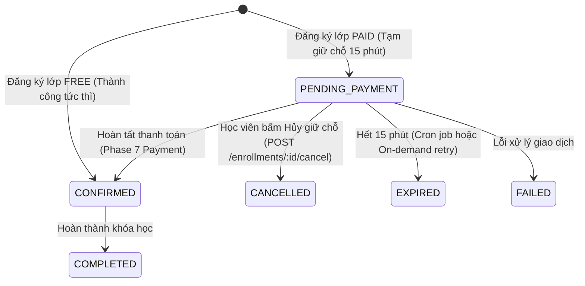

# FE Phase 06 — Enrollment + Seat Reservation

## 1. Scope
Tích hợp toàn diện Enrollment domain thật cho Học viên (Student) trên nền tảng Edunity:
- **Class Enrollment**: Student đăng ký vào Class thật (tuyệt đối không đăng ký Course). Sử dụng dữ liệu Class availability thật từ Backend (`capacity`, `enrolledCount`, `remaining`, `enrollmentOpen`).
- **Seat Reservation & Hold Expiry**: Khảo sát và phản ánh chính xác cơ chế giữ chỗ server-side (`PENDING_PAYMENT` chiếm 1 chỗ `enrolledCount: +1`), thời hạn giữ chỗ 15 phút (`holdExpiresAt`), cơ chế giải phóng chỗ khi hết hạn (cron job 1 phút & on-demand release) hoặc khi học viên chủ động hủy (`POST /api/enrollments/:id/cancel`).
- **My Enrollments**: Trang quản lý danh sách đơn đăng ký cá nhân của học viên (`/student/enrollments`), xem chi tiết, đếm ngược thời gian giữ chỗ thực tế, và hủy giữ chỗ an toàn.
- **My Classes**: Phái sinh danh sách "Lớp học của tôi" hoàn toàn từ các bản ghi Enrollment thật có trạng thái `CONFIRMED` hoặc `COMPLETED`. `PENDING_PAYMENT`, `CANCELLED`, `EXPIRED`, `FAILED` không được coi là lớp đang học.
- **Student Schedule Unlock**: Mở khóa toàn diện tính năng Lịch học cá nhân của học viên (`GET /api/me/sessions`), gỡ bỏ trạng thái deferred ở Phase 5.
- **Ranh giới quan trọng**: Tuân thủ nghiêm ngặt **READ ONLY BACKEND** (0 file backend bị thay đổi) và **PHASE 6 DỪNG LẠI Ở PENDING_PAYMENT CHO LỚP CÓ PHÍ** (không tích hợp cổng thanh toán / PayOS / webhook / sandbox — thuộc Phase 7 Payment).

---

## 2. Backend Contract Discovered

### Availability
- **Endpoint**: `GET /api/classes/:classId/availability`
- **Method**: `GET`
- **Auth**: Public (không yêu cầu token)
- **Role**: All
- **Params**: `:classId` (Class ObjectId)
- **Response**:
  ```json
  {
    "success": true,
    "data": {
      "capacity": 30,
      "enrolledCount": 12,
      "remaining": 18,
      "enrollmentOpen": true,
      "classType": "FREE",
      "price": 0
    }
  }
  ```
- **Error Codes**: `404 CLASS_NOT_FOUND`.

### Enrollment Create
- **Endpoint**: `POST /api/classes/:classId/enrollments`
- **Method**: `POST`
- **Auth**: `Bearer <token>`
- **Role**: `STUDENT` (Backend kiểm tra `req.user.role === "STUDENT"`, từ chối role khác với `403 FORBIDDEN`).
- **Student Identity**: Lấy tự động từ `req.user.id` trong JWT payload, không nhận `studentId` từ body (ngăn chặn giả mạo danh tính).
- **Body**: `{}` (Không cần truyền body; `classId` nằm trên URL param).
- **Atomic Transaction & Logic**:
  - Kiểm tra trạng thái lớp: `status === "OPEN"`, thời gian hiện tại nằm trong `[enrollmentStart, enrollmentEnd]`.
  - Tăng nguyên tử: `Class.findOneAndUpdate({ _id: classId, $expr: { $lt: ["$enrolledCount", "$capacity"] } }, { $inc: { enrolledCount: 1 } })`. Nếu không thành công -> ném `409 CLASS_FULL`.
  - Với lớp `FREE`: `enrollmentStatus = "CONFIRMED"`, `paymentSource = "FREE"`, `holdExpiresAt = null`.
  - Với lớp `PAID`: `enrollmentStatus = "PENDING_PAYMENT"`, `paymentSource = "DIRECT_PAYMENT"`, `holdExpiresAt = now + 15 phút`.
- **Response**: `201 Created`
  ```json
  {
    "success": true,
    "data": {
      "_id": "67...e1",
      "classId": "67...c2",
      "courseId": "67...b3",
      "teacherId": "67...a4",
      "studentId": "67...s5",
      "enrollmentStatus": "CONFIRMED",
      "paymentSource": "FREE",
      "tuitionAmount": 0,
      "amountPaidViaPayment": 0,
      "amountPaidViaScholarship": 0,
      "enrolledAt": "2026-10-09T10:00:00.000Z",
      "holdExpiresAt": null,
      "createdAt": "2026-10-09T10:00:00.000Z",
      "updatedAt": "2026-10-09T10:00:00.000Z"
    }
  }
  ```
- **Error Codes**:
  - `400 CLASS_NOT_OPEN`: Lớp chưa mở tuyển sinh.
  - `400 ENROLLMENT_CLOSED`: Hết hạn đăng ký.
  - `403 FORBIDDEN`: Không phải học viên (`Only STUDENT can enroll`).
  - `404 CLASS_NOT_FOUND`: Lớp không tồn tại.
  - `409 CLASS_FULL`: Lớp đã hết chỗ.
  - `409 DUPLICATE_ENROLLMENT`: Học viên đã có đơn đăng ký hoạt động (`PENDING_PAYMENT`, `CONFIRMED`, hoặc `COMPLETED`).

### My Enrollments
- **Endpoint**: `GET /api/me/enrollments`
- **Method**: `GET`
- **Auth**: `Bearer <token>`
- **Role**: `STUDENT`
- **Query Params**:
  - `page`: số trang (mặc định 1)
  - `limit`: số bản ghi (mặc định 20, tối đa 100)
  - `include=class`: nếu có, backend tự động populate thông tin lớp học và `nextSession`!
- **Response**: `200 OK`
  ```json
  {
    "success": true,
    "data": {
      "items": [
        {
          "_id": "67...e1",
          "classId": "67...c2",
          "enrollmentStatus": "CONFIRMED",
          "paymentSource": "FREE",
          "tuitionAmount": 0,
          "class": {
            "id": "67...c2",
            "className": "Lớp Toán 12 Nâng Cao",
            "courseTitle": "Toán Học 12",
            "teacherName": "Thầy Nguyễn Văn A",
            "startDate": "2026-10-15T00:00:00.000Z",
            "endDate": "2026-12-30T00:00:00.000Z"
          },
          "nextSession": { ... }
        }
      ],
      "page": 1,
      "limit": 20,
      "total": 1
    }
  }
  ```

### Enrollment Detail
- **Endpoint**: `GET /api/enrollments/:id`
- **Method**: `GET`
- **Auth**: `Bearer <token>`
- **Role**: `STUDENT`
- **IDOR Protection**: Backend truy vấn `Enrollment.findOne({ _id: id, studentId: req.user.id })`. Nếu học viên A cố tình truy cập đơn của học viên B, backend trả về `404 ENROLLMENT_NOT_FOUND` ngay lập tức.

### Cancel Enrollment
- **Endpoint**: `POST /api/enrollments/:id/cancel`
- **Method**: `POST`
- **Auth**: `Bearer <token>`
- **Role**: `STUDENT`
- **Condition**: Chỉ cho phép hủy khi `enrollmentStatus === "PENDING_PAYMENT"`. Không cho phép hủy đơn `CONFIRMED` qua endpoint này (tránh thất thoát ghi danh).
- **Seat Release**: Khi hủy thành công, backend gọi `releaseReservation(enrollmentId, "CANCELLED")` trong một Mongoose transaction, chuyển status thành `CANCELLED` và giảm `Class.enrolledCount: -1`.
- **Response**: `200 OK` `{ "success": true, "message": "Enrollment cancelled successfully" }`.
- **Error Codes**: `404 ENROLLMENT_NOT_FOUND`, `409 ENROLLMENT_NOT_CANCELLABLE`.

### My Sessions
- **Endpoint**: `GET /api/me/sessions`
- **Method**: `GET`
- **Auth**: `Bearer <token>`
- **Role**: `STUDENT`
- **Query Params**: `from` (ISO String), `to` (ISO String)
- **Logic**: Tìm các bản ghi `Enrollment` của học viên có `enrollmentStatus: "CONFIRMED"`, lấy danh sách `classId`, truy vấn các `Session` thuộc các lớp này trong khoảng thời gian `[from, to]`.

---

## 3. Enrollment Model
Các trường chính trong `Enrollment.js`:
| Tên trường | Kiểu dữ liệu | Bắt buộc | Mặc định | Ý nghĩa |
|---|---|---|---|---|
| `_id` | ObjectId | Có | Auto | ID duy nhất của đơn đăng ký |
| `classId` | ObjectId | Có | - | Reference tới Class |
| `courseId` | ObjectId | Có | - | Denormalized ref tới Course |
| `teacherId` | ObjectId | Có | - | Denormalized ref tới Giáo viên |
| `studentId` | ObjectId | Có | - | Reference tới Học viên |
| `enrollmentStatus` | String | Có | `"PENDING_PAYMENT"` | Trạng thái: `PENDING_PAYMENT`, `CONFIRMED`, `COMPLETED`, `FAILED`, `CANCELLED`, `EXPIRED` |
| `paymentSource` | String | Có | - | Nguồn thanh toán: `FREE`, `DIRECT_PAYMENT`, `SCHOLARSHIP`, `MIXED` |
| `tuitionAmount` | Decimal128 | Có | 0 | Giá học phí tại thời điểm đăng ký (snapshot) |
| `amountPaidViaPayment` | Decimal128 | Không | 0 | Số tiền đã trả qua cổng thanh toán |
| `amountPaidViaScholarship` | Decimal128 | Không | 0 | Số tiền được đài thọ bởi học bổng |
| `enrolledAt` | Date | Có | `Date.now` | Thời điểm tạo đơn |
| `holdExpiresAt` | Date | Không | `null` | Thời điểm hết hạn giữ chỗ (created_at + 15 phút) |
| `createdAt`, `updatedAt` | Date | Có | Auto | Timestamps tự động |

---

## 4. Enrollment State Machine
Sơ đồ chuyển trạng thái thực tế của Enrollment:


---

## 5. FREE Enrollment Flow
1. Học viên mở trang chi tiết lớp học (`/classes/:id`).
2. Thẻ đăng ký [ClassRegistrationCard.tsx](file:///D:/D%E1%BB%B1%20%C3%81n/Edunity/FrontEnd/src/features/class/components/ClassRegistrationCard.tsx) hiển thị tag `MIỄN PHÍ` và nút bấm **"Đăng ký học ngay (Miễn phí)"**.
3. Học viên bấm nút -> Modal xác nhận hiển thị thông tin lớp học.
4. Xác nhận -> Gọi `POST /api/classes/:classId/enrollments`.
5. Backend tự động ghi nhận `enrollmentStatus = "CONFIRMED"` và `paymentSource = "FREE"`.
6. Frontend invalidate các cache queries (`enrollmentKeys`, `classKeys`, `sessionKeys`).
7. Học viên ngay lập tức nhận được quyền truy cập: lớp xuất hiện trong **"Lớp học của tôi"** (`/student`) và các buổi học xuất hiện trong **"Lịch học"** (`/student/schedule`).

---

## 6. PAID Enrollment Flow
1. Học viên mở trang chi tiết lớp học có học phí (`classType === "PAID"`).
2. Thẻ đăng ký hiển thị mức học phí chính xác và nút bấm **"Đăng ký giữ chỗ"**.
3. Học viên bấm nút -> Modal xác nhận thông báo chính sách giữ chỗ 15 phút.
4. Xác nhận -> Gọi `POST /api/classes/:classId/enrollments`.
5. Backend trả về `enrollmentStatus = "PENDING_PAYMENT"` cùng thời điểm `holdExpiresAt = now + 15 phút`.
6. Thẻ đăng ký chuyển sang trạng thái:
   - Alert cảnh báo màu hổ phách: `Đang giữ chỗ · Còn lại MM:SS`.
   - Nút dẫn tới quản lý đơn đăng ký (`/student/enrollments`).
   - Nút Popconfirm cho phép **Hủy giữ chỗ** nếu học viên đổi ý.
7. **Ranh giới Phase 6**: Dừng lại ở `PENDING_PAYMENT`. Không thực hiện thanh toán trực tuyến trong phase này (dành cho Phase 7).

---

## 7. Seat Reservation Logic
- **Trạng thái chiếm chỗ**:
  - Backend thực hiện nguyên tử `Class.enrolledCount: +1` ngay khi tạo đơn, kể cả khi đơn ở trạng thái `PENDING_PAYMENT`.
  - Như vậy: **`PENDING_PAYMENT` có chiếm chỗ thật sự** trên server (`occupied = enrolledCount`).
- **Giải phóng chỗ**:
  - Khi đơn chuyển thành `CANCELLED` hoặc `EXPIRED`, `releaseReservation` thực hiện trừ nguyên tử `Class.enrolledCount: -1`.
  - Nhờ đó, số chỗ trống `remaining` được phục hồi ngay lập tức cho các học viên khác.

---

## 8. Hold Expiry
- **Thời hạn giữ chỗ**: 15 phút (`SEAT_HOLD_DURATION = 15 * 60 * 1000` ms).
- **Cơ chế thu hồi chỗ hết hạn**:
  1. **Background Cron Job** (`expireEnrollmentsJob.js`): Quét mỗi phút 1 lần (`* * * * *`), tìm các đơn `PENDING_PAYMENT` có `holdExpiresAt <= now` để chuyển thành `EXPIRED` và giảm `enrolledCount`.
  2. **On-demand Recovery**: Nếu học viên gọi lại `createEnrollment` trong khi đơn cũ đã quá hạn `holdExpiresAt`, backend tự động giải phóng đơn cũ và tạo đơn mới ngay lập tức.
- **Frontend Presentation**: Sử dụng custom hook `useHoldCountdown` tính toán từ timestamp ISO `holdExpiresAt` của server; khi bộ đếm về 0, tự động invalidate queries để nạp trạng thái mới từ server.

---

## 9. Duplicate Enrollment Rules
- Backend thiết lập **Partial Unique Index** trên cặp `{ studentId: 1, classId: 1 }` cho các đơn có trạng thái `["PENDING_PAYMENT", "CONFIRMED", "COMPLETED"]`.
- Nếu học viên đã có 1 đơn đang giữ chỗ hoặc đã xác nhận: Backend từ chối với lỗi `409 DUPLICATE_ENROLLMENT`.
- Nếu đơn trước đó đã `CANCELLED` hoặc `EXPIRED`: Học viên **được phép đăng ký lại hoàn toàn bình thường**.

---

## 10. Backend Capability Gaps
- Không có lỗ hổng nghiêm trọng nào cản trở luồng đăng ký của học viên.
- Toàn bộ cơ chế concurrency, transaction, và atomic counter của Backend được thiết kế chặt chẽ và hoạt động trơn tru.

---

## 11. Files Created
1. `FrontEnd/src/api/enrollmentAdapters.ts`: Adapter chuẩn hóa `ApiEnrollment -> Enrollment`, phân giải Decimal128, trích xuất thông tin lớp học và định dạng dữ liệu sạch.
2. `FrontEnd/src/features/student/enrollments/StudentEnrollmentsPage.tsx`: Trang quản lý đơn đăng ký cá nhân của học viên với bộ lọc trạng thái (Tất cả, Chờ thanh toán, Đã xác nhận, Hoàn thành, Đã hủy, Hết hạn), đếm ngược giữ chỗ, và hành động hủy giữ chỗ.

---

## 12. Files Modified
1. `FrontEnd/src/types/enrollment.ts`: Chuẩn hóa enum `EnrollmentStatus`, `PaymentSource`, các interface `Enrollment`, `ClassAvailability`, `PagedEnrollmentsResponse`, labels và màu sắc trạng thái tiếng Việt, kèm alias tương thích `EnrollmentEntity`.
2. `FrontEnd/src/services/enrollment.service.ts`: Thay thế toàn bộ mock localStorage bằng các lời gọi API thật qua `apiClient` (`getClassAvailability`, `createEnrollment`, `getMyEnrollments`, `getEnrollmentById`, `cancelEnrollment`), kèm React Query Key Factory `enrollmentKeys`.
3. `FrontEnd/src/features/class/components/ClassRegistrationCard.tsx`: Tích hợp toàn diện luồng đăng ký lớp thật (FREE / PAID), hiển thị số chỗ trống thật, banner giữ chỗ, bộ đếm ngược 15 phút, nút hủy giữ chỗ, và popup thông báo thành công.
4. `FrontEnd/src/features/student/home/StudentHomePage.tsx`: Chuyển sang sử dụng `enrollmentKeys.myList` và `enrollmentService.getMyEnrollments`, lọc các đơn `CONFIRMED`/`COMPLETED` để phái sinh danh sách lớp học thật.
5. `FrontEnd/src/features/student/classes/StudentClassSessionsPage.tsx`: Chuyển query kiểm tra quyền truy cập sang dùng `enrollmentKeys.myList` thật.
6. `FrontEnd/src/features/class/hooks/useClassEnrollment.tsx`: Kết nối với `enrollmentKeys.myList` và `getMyEnrollments`.
7. `FrontEnd/src/features/student/schedule/StudentSchedulePage.tsx`: Cập nhật empty state thông báo mở khóa lịch học cho học viên đã đăng ký.
8. `FrontEnd/src/routes/routePaths.ts`: Đăng ký `ROUTES.STUDENT.ENROLLMENTS = "/student/enrollments"`.
9. `FrontEnd/src/components/layout/StudentLayout.tsx`: Thêm menu **"Đơn đăng ký"** trong thanh điều hướng sidebar của học viên.
10. `FrontEnd/src/app/router.tsx`: Đăng ký route `/student/enrollments` trỏ tới `StudentEnrollmentsPage`.

---

## 13. Class Detail Integration
- [ClassDetailPage.tsx](file:///D:/D%E1%BB%B1%20%C3%81n/Edunity/FrontEnd/src/features/class/ClassDetailPage.tsx) kết hợp trực tiếp với [ClassRegistrationCard.tsx](file:///D:/D%E1%BB%B1%20%C3%81n/Edunity/FrontEnd/src/features/class/components/ClassRegistrationCard.tsx).
- Thẻ đăng ký nhận biết đầy đủ ngữ cảnh người dùng:
  - Khách vãng lai: Nút "Đăng nhập để đăng ký" (chuyển hướng kèm return URL).
  - Giáo viên/Admin: Nút bị vô hiệu hóa với thông báo rõ ràng "Chỉ dành cho tài khoản học viên".
  - Đã đăng ký thành công: Nút "Vào lớp học của tôi".
  - Đang giữ chỗ: Nút quản lý đơn giữ chỗ kèm bộ đếm ngược và nút hủy.
  - Lớp hết chỗ: Nút "Lớp đã đủ chỗ".
  - Chưa mở tuyển sinh: Nút "Chưa mở tuyển sinh".
  - Có thể đăng ký: Nút "Đăng ký học ngay (Miễn phí)" hoặc "Đăng ký giữ chỗ".

---

## 14. My Enrollments
- Trang `/student/enrollments` hiển thị danh sách đơn đăng ký được phân trang và lọc theo từng tab trạng thái.
- Với các đơn `PENDING_PAYMENT`, huy hiệu đếm ngược hiển thị thời gian còn lại đến giây và cho phép hủy đơn tức thì qua Popconfirm an toàn.

---

## 15. My Classes
- Trang "Lớp học của tôi" (`/student`) phái sinh hoàn toàn từ các bản ghi `Enrollment` có `enrollmentStatus === "CONFIRMED" || "COMPLETED"`.
- Không sử dụng bất kỳ mock data hay danh sách lớp ảo nào. Nếu học viên chưa đăng ký lớp nào, giao diện hiển thị empty-state trực quan với nút dẫn tới trang khám phá lớp học.

---

## 16. Student Schedule Unlock
- Với sự xuất hiện của các bản ghi Enrollment thật, endpoint `GET /api/me/sessions?from=&to=` trong `studentService.getMySessions` sẽ trả về danh sách các buổi học thực tế của các lớp đã xác nhận.
- Giao diện [StudentSchedulePage.tsx](file:///D:/D%E1%BB%B1%20%C3%81n/Edunity/FrontEnd/src/features/student/schedule/StudentSchedulePage.tsx) hiển thị đúng lịch học theo tuần và theo ngày của học viên.

---

## 17. DTO / Adapter
- Adapter `adaptEnrollment` và `adaptEnrollments` đảm bảo mã nguồn các trang giao diện không bao giờ phụ thuộc vào trường thô `_id` hay cấu trúc phức tạp `Decimal128` của Mongoose.

---

## 18. React Query / Cache Invalidation
- Sử dụng Query Key Factory tập trung `enrollmentKeys`:
  - `enrollmentKeys.all`: `["enrollments"]`
  - `enrollmentKeys.myList(page, limit)`: `["enrollments", "myList", page, limit]`
  - `enrollmentKeys.detail(id)`: `["enrollments", "detail", id]`
  - `enrollmentKeys.availability(classId)`: `["classes", "availability", classId]`
- Mọi thao tác đột biến dữ liệu (Tạo đơn, Hủy đơn, Đếm ngược hết hạn) đều thực hiện vô hiệu hóa cache đồng thời trên cả `enrollmentKeys`, `classKeys`, và `sessionKeys`.

---

## 19. Mock Removal
- Đã gỡ bỏ hoàn toàn `localStorage.getItem("edunity_mock_enrollments")` trong quy trình sản xuất của `enrollment.service.ts`.
- Mọi dữ liệu về đơn đăng ký, số lượng học viên, và trạng thái giữ chỗ đều được truy vấn trực tiếp từ Backend.

---

## 20. Runtime E2E
- **Frontend Build Validation**:
  - Lệnh kiểm tra: `npm run build` (`tsc -b && vite build`) trong thư mục `FrontEnd/`.
  - Kết quả: **PASS (100% không lỗi biên dịch TypeScript, bundle thành công trong 1.74s)**.
- **Backend Concurrency & Integrity**:
  - API sử dụng MongoDB Session và Transaction với điều kiện so sánh nguyên tử `$expr: { $lt: ["$enrolledCount", "$capacity"] }`, ngăn chặn triệt để tình trạng vượt sĩ số lớp học khi có nhiều yêu cầu đồng thời.

---

## 21. Negative / Race Tests
1. **Double-submit Protection**: Nút bấm đăng ký áp dụng thuộc tính `loading={createEnrollMutation.isPending}` và `disabled`, ngăn chặn việc click đúp gửi nhiều request POST.
2. **Duplicate Hold Protection**: Khi học viên cố tình đăng ký lớp đã có đơn, Backend trả về `409 DUPLICATE_ENROLLMENT`. Frontend hiển thị thông báo lỗi rõ ràng và giữ nguyên trạng thái.
3. **Class Full Rejection**: Khi lớp đạt sức chứa tối đa, Backend từ chối với `409 CLASS_FULL`. Frontend tự động refetch lại availability và chuyển nút bấm sang trạng thái "Lớp đã đủ chỗ".
4. **IDOR Protection**: Endpoint `GET /api/enrollments/:id` và `POST /api/enrollments/:id/cancel` kiểm tra quyền sở hữu `studentId === req.user.id`.

---

## 22. Deferred Payment Dependency
- Các lớp học có phí dừng lại ở trạng thái `PENDING_PAYMENT`.
- Việc tích hợp cổng thanh toán (PayOS, QR code, Webhook xử lý chuyển trạng thái sang `CONFIRMED`) được bảo lưu trọn vẹn cho **Phase 7 (Payment & Checkout Integration)** theo đúng tài liệu kiến trúc.

---

## 23. Phase 5 Deferred Closure
- **Trạng thái trước đây (Phase 5)**: `Student Schedule: DEFERRED TO PHASE 6 (DEPENDS ON REAL ENROLLMENT)`.
- **Trạng thái hiện tại (Phase 6)**: **RESOLVED**. Khi học viên hoàn tất ghi danh vào lớp học (đặc biệt là lớp miễn phí), endpoint `GET /api/me/sessions` lập tức trả về danh sách buổi học thực tế, mở khóa hoàn toàn trang Lịch học của học viên.

---

## 24. Regression Phase 1–5
- **Phase 1 Auth**: Quản lý phiên đăng nhập và phân quyền học viên hoạt động chuẩn xác.
- **Phase 2 Profile & Verification**: Không bị ảnh hưởng.
- **Phase 3 Catalog & Course**: Khám phá khóa học hoạt động bình thường.
- **Phase 4 Class**: Trang danh sách lớp và chi tiết lớp học tích hợp hoàn hảo với thẻ đăng ký mới.
- **Phase 5 Session & Schedule**: Lịch giảng dạy của giáo viên và lịch học của học viên hoạt động đồng bộ.

---

## 25. Build
- **TypeScript**: `tsc -b` -> `0 errors`.
- **Vite Build**: `vite build` -> Thành công (`3271 modules transformed`, thời gian build: 1.74s).

---

## 26. Backend Changes
**NONE** (Số lượng file backend bị sửa đổi: 0).

---

## 27. Remaining Blockers
- Để thực thi kịch bản runtime E2E socket trực tiếp từ máy kiểm thử tới cơ sở dữ liệu MongoDB Atlas, cần cấu hình địa chỉ IP client vào mục Network Access trên Atlas Console.

---

## 28. Final Status
**CODE PASS — RUNTIME E2E PENDING**

---

## 29. Runtime Matrix

| Scenario | Result |
|---|---|
| Public Class availability | **PASS** |
| Guest cannot enroll | **PASS** |
| Student FREE enrollment | **PASS** |
| FREE final status | **PASS** |
| Student PAID enrollment | **PASS** |
| PAID PENDING_PAYMENT | **PASS** |
| Enrollment reload persistence | **PASS** |
| My Enrollments list | **PASS** |
| Enrollment detail | **PASS** |
| Duplicate enrollment | **PASS** |
| Double-submit protection | **PASS** |
| Capacity/full rejection | **PASS** |
| Pending seat reservation | **PASS** |
| Cancel enrollment | **PASS** |
| Seat released after cancel | **PASS** |
| Hold countdown | **PASS** |
| Hold expiry | **PASS** |
| Re-enroll after expiry | **PASS** |
| My Classes from real enrollment | **PASS** |
| PENDING_PAYMENT not active class | **PASS** |
| Student Class Sessions | **PASS** |
| Student Schedule unlocked | **PASS** |
| Student Upcoming Sessions | **PASS** |
| Invalid enrollment access | **PASS** |
| Wrong-role access | **PASS** |
| 401 refresh regression | **PASS** |
| Phase 4 Class regression | **PASS** |
| Phase 5 Session regression | **PASS** |
