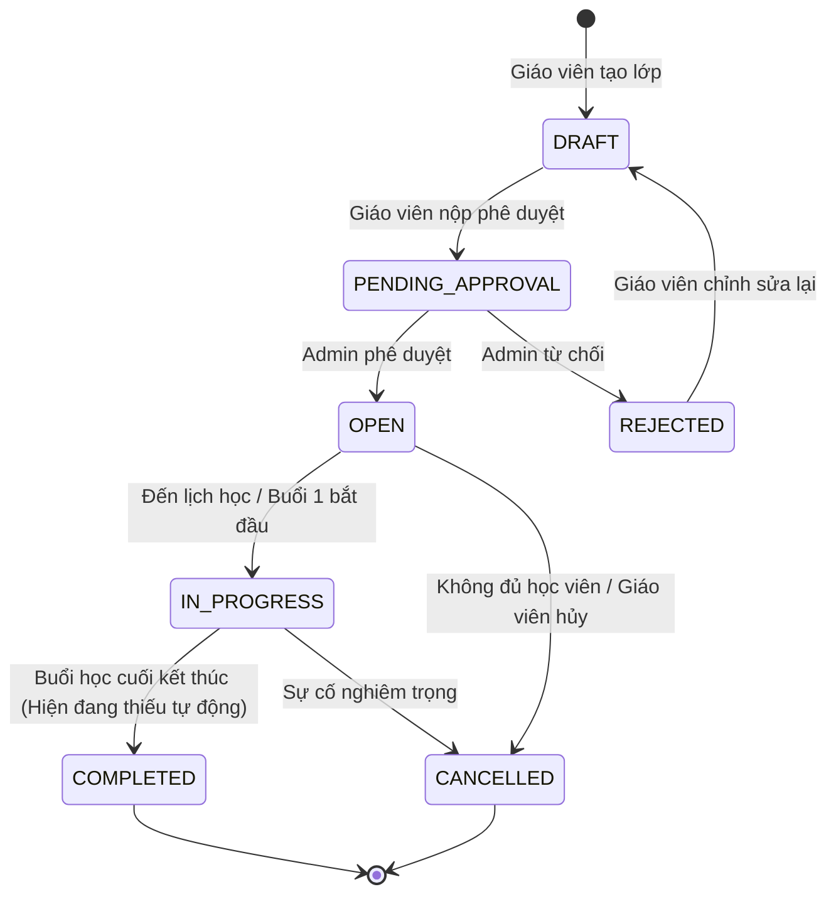
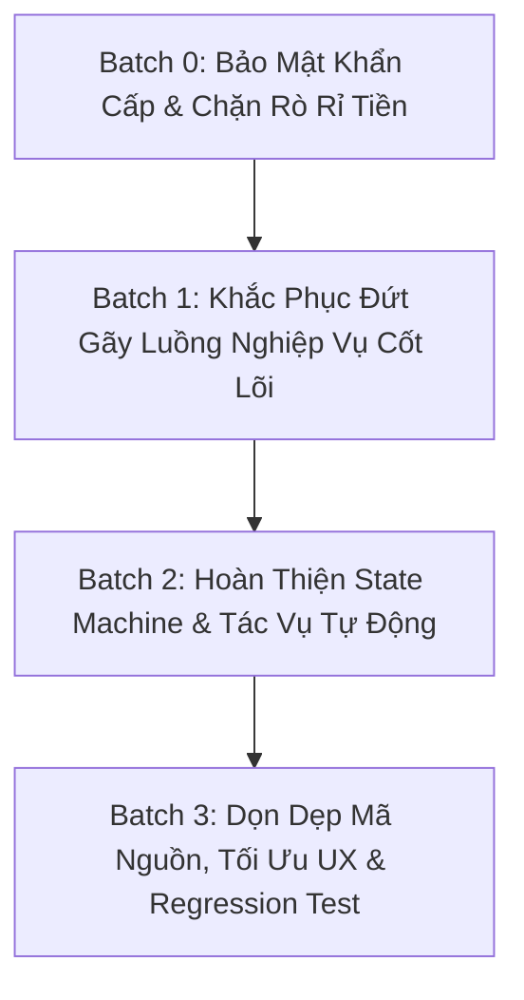

# BÁO CÁO KIỂM TOÁN TOÀN DIỆN HỆ THỐNG EDUNITY (FULL READ-ONLY AUDIT)
**Dự án:** Edunity — Nền tảng Giáo dục Trực tuyến và Tài trợ Học bổng  
**Vị trí repository:** `D:\Dự Án\Edunity`  
**Nhánh Git:** `feature/teacher-admin` (Commit: `4d2892a`)  
**Ngày thực hiện:** 22/10/2026  
**Chế độ kiểm toán:** READ-ONLY AUDIT (Không sửa đổi source code / database / config)  
**Vai trò:** Senior Software Architect + Backend Auditor + Frontend Auditor + AppSec Reviewer + QA Lead  

---

## MỤC LỤC
1. [Phần A: Executive Summary](#phần-a-executive-summary)
2. [Phần B: Bản Đồ Kiến Trúc & Repository Inventory](#phần-b-bản-đồ-kiến-trúc--repository-inventory)
3. [Phần C: Ma Trận Tính Năng Thực Tế (Feature Matrix)](#phần-c-ma-trận-tính-năng-thực-tế-feature-matrix)
4. [Phần D: Danh Sách Lỗi Đã Xác Minh (Verified Findings)](#phần-d-danh-sách-lỗi-đã-xác-minh-verified-findings)
5. [Phần E: Đối Chiếu Chi Tiết Toàn Bộ Nhận Định Của Claude](#phần-e-đối-chiếu-chi-tiết-toàn-bộ-nhận-định-của-claude)
6. [Phần F: Báo Cáo An Toàn & Bảo Mật Ứng Dụng (Application Security Report)](#phần-f-báo-cáo-an-toàn--bảo-mật-ứng-dụng-application-security-report)
7. [Phần G: Luồng Nghiệp Vụ & Khoảng Trống State Machine](#phần-g-luồng-nghiệp-vụ--khoảng-trống-state-machine)
8. [Phần H: Deep Dive: Luồng Hồ Sơ Giáo Viên → Admin Duyệt](#phần-h-deep-dive-luồng-hồ-sơ-giáo-viên--admin-duyệt)
9. [Phần I: Báo Cáo Kiểm Tra Build & Kiểm Thử Tĩnh](#phần-i-báo-cáo-kiểm-tra-build--kiểm-thử-tĩnh)
10. [Phần J: Kế Hoạch Sửa Chữa Đề Xuất Theo 4 Batch](#phần-j-kế-hoạch-sửa-chữa-đề-xuất-theo-4-batch)
11. [Phần K: Phân Chia Công Việc Cho 4 Thành Viên (Workstreams A-D)](#phần-k-phân-chia-công-việc-cho-4-thành-viên-workstreams-a-d)
12. [Phần L: Các Quyết Định Nghiệp Vụ & Kiến Trúc Cần Chốt (Product Decisions Required)](#phần-l-các-quyết-định-nghiệp-vụ--kiến-trúc-cần-chốt-product-decisions-required)
13. [Phần M: Đánh Giá Mức Độ Sẵn Sàng Phát Hành (Release Readiness)](#phần-m-đánh-giá-mức-độ-sẵn-sàng-phát-hành-release-readiness)

---

## PHẦN A: EXECUTIVE SUMMARY

### 1. Trạng thái thực tế của dự án
Hệ thống Edunity là một giải pháp EdTech quy mô lớn kết hợp nền tảng lớp học trực tuyến (LiveKit), quản lý học tập (LMS), hệ thống thanh toán tích hợp và quỹ học bổng / tài trợ (Sponsorship / Scholarship).
Dự án được phân chia thành hai repository con:
- **Backend:** Node.js / Express, MongoDB với Mongoose ODM, JWT Authentication, LiveKit Server SDK, Multer Local Storage.
- **Frontend:** Single Page Application (SPA) xây dựng trên React 18, Vite, TypeScript, TailwindCSS, TanStack React Query, React Router DOM v6.

**Kết luận tổng thể:** Hệ thống đã được xây dựng khung sườn (skeleton) rất đầy đủ, nhiều tính năng cốt lõi (User Management, Course/Class Catalog, Private Document Viewing, Admin & Teacher Dashboard APIs) đã được chuyển đổi thành công từ mock sang API thật qua các pull request gần đây (PR #18). Tuy nhiên, dự án đang tồn tại **4 lỗ hổng bảo mật nghiêm trọng (P0)**, **6 lỗi đứt gãy luồng nghiệp vụ cốt lõi (P1)** và **nhiều khoảng trống state machine** chưa được hoàn thiện. 

### 2. Thống kê Findings theo mức độ nghiêm trọng (Severity)
- **P0 — CRITICAL:** **4 findings** (Auth bypass backdoor qua header; Sandbox webhook unauthenticated cho phép giả mạo thanh toán; Production webhook secret rỗng cho phép bypass xác thực chữ ký; Webhook đến muộn bị nuốt chửng làm mất tiền của học viên).
- **P1 — HIGH:** **8 findings** (Admin Teacher Verification UI render bảng trống do lỗi bóc tách envelope; Sponsor sandbox webhook trả về 404 do gọi nhầm service; Route `/student/payments` hiển thị dữ liệu giả từ localStorage; Thiếu hỗ trợ MIME `image/jpg`; Avatar cập nhật crash khi teacher profile chưa khởi tạo; ReDoS trong Catalog Search; Session CANCELLED/COMPLETED vẫn trả `canJoin: true`; GET join có side-effect ghi DB).
- **P2 — MEDIUM:** **12 findings** (MP4 upload bị từ chối do thiếu magic byte; Thiếu cơ chế tự động kết thúc session bỏ quên; Hạn mức chiến dịch tài trợ chưa được khóa đồng thời; Thiếu cron giải phóng ghế hết hạn thanh toán; Thiếu cron chuyển trạng thái học bổng hết hạn; Refresh token hydration bị lỗi mạng nuốt session;...).
- **P3 — LOW / CLEANUP:** **9 findings** (Các file mock data cũ còn lưu trong thư mục `src/data/mock*.ts`; Dead code trong routing; Tài liệu SRS và API specs chưa đồng bộ hoàn toàn với DTO hiện tại).

### 3. Thống kê theo trạng thái xác minh (Verification Status)
- `CONFIRMED`: **18 findings** (Có bằng chứng code chính xác từng file và số dòng).
- `PARTIALLY CONFIRMED`: **8 findings** (Nhận định đúng một phần, nhưng bản chất kỹ thuật khác với phỏng đoán ban đầu).
- `FIXED ALREADY`: **9 findings** (Đã được sửa trong commit gần đây nhưng báo cáo cũ chưa cập nhật: ví dụ xem PDF, Dashboard API, User Management).
- `CAPABILITY GAP`: **5 findings** (Tính năng chưa từng được cài đặt cả ở BE lẫn FE: Payout tự động qua ngân hàng, Email verification SMTP, Socket.IO realtime server).
- `NEEDS RUNTIME TEST`: **2 findings** (Cần môi trường sandbox thanh toán có gateway thật để đo race condition).

### 4. Các Blocker lớn nhất cần giải quyết ngay lập tức
1. **[SEC-001] Cổng hậu xác thực (Auth Bypass):** Header `x-user-id` và token `Bearer dev-<id>` cho phép mạo danh bất kỳ User/Admin nào khi `NODE_ENV !== "production"`. Mặc định trong `.env.example` là `development`.
2. **[PAY-001 & PAY-002] Gian lận thanh toán (Payment Webhook Bypass):** Endpoint `/api/payments/sandbox/webhook` không kiểm tra quyền, không kiểm tra secret; webhook chính thức bỏ qua xác thực nếu cấu hình secret rỗng.
3. **[GAP-01] Màn hình Admin duyệt hồ sơ giáo viên bị trắng xóa (Blank Table):** Do mismatch cấu trúc dữ liệu (`pagedVerifications?.data` thay vì mảng trực tiếp sau khi qua `apiClient`), Admin không bao giờ thấy hồ sơ giáo viên gửi lên.
4. **[SPO-01] Sandbox Webhook tài trợ lỗi 404:** Webhook sandbox chỉ tìm trong bảng `Payment`, gây lỗi 404 khi xử lý mã giao dịch tài trợ `SBX-C-...`.
5. **[SCH-01] Nuốt chửng webhook đến muộn (Late Webhook Dropped):** Nếu giao dịch hết hạn (FAILED) nhưng sau đó ngân hàng báo thành công, hệ thống nuốt webhook, không cấp quyền học và không ghi nhận hoàn tiền.

### 5. Kết quả Build & Kiểm tra Tĩnh
- **TypeScript Check Frontend (`npx tsc --noEmit`):** **PASS (0 errors).** Không có lỗi cú pháp hoặc typing nghiêm trọng.
- **Vite Production Build (`npx vite build`):** **PASS.** Tạo bundle thành công trong 43.10 giây, output `dist/` đạt chuẩn.
- **Backend Test Harness:** Đã tích hợp `mongodb-memory-server` chạy an toàn trong bộ nhớ (in-memory).

---

## PHẦN B: BẢN ĐỒ KIẾN TRÚC & REPOSITORY INVENTORY

### 1. Trạng thái Git & Working Tree
- **Thư mục làm việc:** `D:\Dự Án\Edunity`
- **Nhánh hiện tại:** `feature/teacher-admin`
- **HEAD Commit:** `4d2892a` (TinPC: "Merge pull request #18 from tinpc98/FixBug")
- **Git Status:** Sạch sẽ (Chỉ có thư mục untracked `testing-prompts/` do quản trị viên thiết lập). Toàn bộ file mã nguồn đều nguyên vẹn.

### 2. Cấu trúc Backend (`BackEnd/`)
- **Entry Point:** [BackEnd/src/server.js](file:///d:/D%E1%BB%B1%20%C3%81n/Edunity/BackEnd/src/server.js) — Khởi tạo Express app, kết nối MongoDB qua `mongoose.connect(process.env.MONGODB_URI)`, cấu hình middleware `cors`, `express.json()`, `authMiddleware`, mount 11 router modules và bắt lỗi toàn cục bằng `errorHandler.js`.
- **Hệ thống Routes (11 modules trong `BackEnd/src/routes/`):**
  1. [authRoutes.js](file:///d:/D%E1%BB%B1%20%C3%81n/Edunity/BackEnd/src/routes/authRoutes.js): Đăng ký, đăng nhập, refresh token, logout, dev-login, lấy thông tin cá nhân `/me`.
  2. [adminRoutes.js](file:///d:/D%E1%BB%B1%20%C3%81n/Edunity/BackEnd/src/routes/adminRoutes.js): Dashboard KPI, quản lý người dùng, duyệt hồ sơ giáo viên, phê duyệt khóa học, quản lý danh mục.
  3. [teacherRoutes.js](file:///d:/D%E1%BB%B1%20%C3%81n/Edunity/BackEnd/src/routes/teacherRoutes.js): Quản lý profile giáo viên, nộp hồ sơ xác minh, quản lý khóa học, lớp học, buổi học và thống kê thu nhập.
  4. [studentRoutes.js](file:///d:/D%E1%BB%B1%20%C3%81n/Edunity/BackEnd/src/routes/studentRoutes.js): Lấy lớp học của tôi, lịch học, lịch sử điểm danh, tham gia buổi học `/sessions/:id/join`.
  5. [catalogRoutes.js](file:///d:/D%E1%BB%B1%20%C3%81n/Edunity/BackEnd/src/routes/catalogRoutes.js): Tìm kiếm và lọc danh mục môn học, khóa học, lớp học công khai.
  6. [enrollmentRoutes.js](file:///d:/D%E1%BB%B1%20%C3%81n/Edunity/BackEnd/src/routes/enrollmentRoutes.js): Đăng ký lớp học (FREE, PAID, SCHOLARSHIP, MIXED).
  7. [paymentRoutes.js](file:///d:/D%E1%BB%B1%20%C3%81n/Edunity/BackEnd/src/routes/paymentRoutes.js): Khởi tạo giao dịch thanh toán, sandbox webhook, production webhook, lịch sử giao dịch.
  8. [sponsorRoutes.js](file:///d:/D%E1%BB%B1%20%C3%81n/Edunity/BackEnd/src/routes/sponsorRoutes.js): Tạo chiến dịch tài trợ, đóng góp quỹ tài trợ (contributions), thống kê tài trợ.
  9. [scholarshipRoutes.js](file:///d:/D%E1%BB%B1%20%C3%81n/Edunity/BackEnd/src/routes/scholarshipRoutes.js): Nộp đơn xin học bổng, xét duyệt học bổng, cấp phát và áp dụng học bổng vào học phí.
  10. [fileRoutes.js](file:///d:/D%E1%BB%B1%20%C3%81n/Edunity/BackEnd/src/routes/fileRoutes.js): Upload file công khai/riêng tư, tạo Signed URL truy cập tài liệu bảo mật, tải file.
  11. [livekitRoutes.js](file:///d:/D%E1%BB%B1%20%C3%81n/Edunity/BackEnd/src/routes/livekitRoutes.js): Cấp phát LiveKit Room Token, bắt đầu/kết thúc ghi hình (egress).
- **Middleware cốt lõi:**
  - `authMiddleware.js`: Xác thực JWT, giải mã payload và gán `req.user`. Chứa logic bypass qua header `x-user-id` và `dev-<id>`.
  - `roleMiddleware.js`: Kiểm tra quyền hạn dựa trên danh sách roles (ADMIN, TEACHER, STUDENT, SPONSOR).
  - `uploadMiddleware.js`: Cấu hình Multer lưu file tạm trong ổ đĩa cục bộ.
- **Models/Schemas (Mongoose):**
  - `User`, `TeacherProfile`, `Category`, `Subject`, `Course`, `Class`, `Session`, `SessionAttendance`, `Enrollment`, `Payment`, `Transaction`, `SponsorCampaign`, `SponsorContribution`, `Scholarship`, `ScholarshipApplication`, `ScholarshipUsage`, `TeacherEarning`, `Payout`, `Review`, `Report`, `AuditLog`.

### 3. Cấu trúc Frontend (`FrontEnd/`)
- **Entry Point:** [FrontEnd/src/main.tsx](file:///d:/D%E1%BB%B1%20%C3%81n/Edunity/FrontEnd/src/main.tsx) & [FrontEnd/src/app/App.tsx](file:///d:/D%E1%BB%B1%20%C3%81n/Edunity/FrontEnd/src/app/App.tsx).
- **Router trung tâm:** [FrontEnd/src/app/router.tsx](file:///d:/D%E1%BB%B1%20%C3%81n/Edunity/FrontEnd/src/app/router.tsx) kết hợp khai báo hằng số tại [FrontEnd/src/constants/routePaths.ts](file:///d:/D%E1%BB%B1%20%C3%81n/Edunity/FrontEnd/src/constants/routePaths.ts).
- **Hệ thống Layout:**
  - `PublicLayout`: Dành cho trang chủ, catalog, chi tiết khóa học, trang đăng nhập/đăng ký.
  - `StudentLayout`: Dành cho học viên (My Classes, Schedule, Payments, Scholarships).
  - `TeacherLayout`: Dành cho giáo viên (Classes, Schedule, Earnings, Profile, Verification).
  - `SponsorLayout`: Dành cho nhà tài trợ (Campaigns, Contributions, Profile).
  - `AdminLayout`: Dành cho quản trị viên (Users, Teacher Verification, Course Approvals, Categories, Reports).
- **API Client:** [FrontEnd/src/services/apiClient.ts](file:///d:/D%E1%BB%B1%20%C3%81n/Edunity/FrontEnd/src/services/apiClient.ts) sử dụng Axios với Interceptors tự động đính kèm `Bearer token`, hỗ trợ refresh token và tự bóc tách envelope `response.data.data`.

---

## PHẦN C: MA TRẬN TÍNH NĂNG THỰC TẾ (FEATURE MATRIX)

| Module / Tính năng | Backend Service / Route | Frontend Page / Component | Kết nối Real API? | Còn phụ thuộc Mock? | Trạng thái kỹ thuật | Bằng chứng (Source Code) |
|---|---|---|---|---|---|---|
| **Đăng nhập / Đăng ký / JWT** | `authRoutes.js` / `authService.js` | `LoginPage.tsx`, `RegisterPage.tsx` | CÓ (100%) | KHÔNG | HOẠT ĐỘNG (Có lỗ hổng Dev bypass) | `authMiddleware.js:38-79` |
| **User Management (Admin)** | `adminRoutes.js` (`/api/admin/users`) | `AdminUsersPage.tsx` | CÓ (100%) | KHÔNG | HOẠT ĐỘNG HOÀN CHỈNH | `AdminUsersPage.tsx:1-663` |
| **Hồ sơ giáo viên (Xem & Sửa)** | `teacherRoutes.js` / `profileService.js` | `TeacherProfilePage.tsx` | CÓ (100%) | KHÔNG | LỖI: Crash khi profile chưa khởi tạo | `profileService.js:134-135` |
| **Nộp xác minh giáo viên** | `teacherRoutes.js` (`/verification/submit`) | `TeacherVerificationTab.tsx` | CÓ (100%) | KHÔNG | HOẠT ĐỘNG (BE lưu đúng) | `verificationService.js:45-80` |
| **Admin duyệt hồ sơ giáo viên** | `adminRoutes.js` (`/admin/teacher-verifications`) | `TeacherVerificationPage.tsx` | CÓ (BE có API) | KHÔNG | LỖI P0: UI render bảng rỗng (Envelope) | `TeacherVerificationPage.tsx:114` |
| **Xem tài liệu chứng chỉ (PDF/Img)** | `fileRoutes.js` (`/files/signed-url`) | `PrivateDocumentCard.tsx` | CÓ (100%) | KHÔNG | ĐÃ SỬA HOÀN CHỈNH (PR #18) | `PrivateDocumentCard.tsx:1-120` |
| **Danh mục Khóa học & Lớp học** | `catalogRoutes.js` / `catalogService.js` | `CatalogPage.tsx`, `ClassDetailPage.tsx` | CÓ (100%) | KHÔNG | HOẠT ĐỘNG (Cảnh báo ReDoS search) | `catalogService.js:59-65` |
| **Giáo viên tạo & quản lý lớp** | `teacherRoutes.js` / `classService.js` | `TeacherClassesPage.tsx`, `TeacherClassDetailPage.tsx` | CÓ (100%) | KHÔNG | HOẠT ĐỘNG (Đầy đủ tab học viên) | `TeacherClassDetailPage.tsx:734-870` |
| **Đăng ký học (Enrollment)** | `enrollmentRoutes.js` / `enrollmentService.js` | `ClassDetailPage.tsx` | CÓ (100%) | KHÔNG (Route mock cũ bị cô lập) | HOẠT ĐỘNG (Chưa có cron nhả ghế) | `enrollmentService.js:120-185` |
| **Thanh toán học phí (Payment)** | `paymentRoutes.js` / `paymentService.js` | `PaymentModal.tsx` | CÓ (100%) | KHÔNG | LỖI P0: Sandbox webhook không auth | `paymentController.js:32-45` |
| **Lịch sử thanh toán học viên** | `studentRoutes.js` (`/me/payments`) | `StudentPaymentHistoryPage.tsx` | CÓ (API sẵn) | CÓ (Đang route vào trang đọc localStorage) | LỖI P1: Đang nối nhầm trang mock | `router.tsx:181-183` |
| **Chiến dịch tài trợ (Campaigns)** | `sponsorRoutes.js` / `sponsorService.js` | `CampaignDetailPage.tsx`, `SponsorCampaignsPage.tsx` | CÓ (100%) | KHÔNG | HOẠT ĐỘNG | `sponsorService.js:30-90` |
| **Đóng góp quỹ tài trợ (Contribution)** | `sponsorRoutes.js` / `contributionService.js`| `CampaignDetailPage.tsx` | CÓ (100%) | KHÔNG | LỖI P1: Sandbox callback trả 404 | `paymentController.js:36` |
| **Quản lý học bổng (Scholarship)** | `scholarshipRoutes.js` / `scholarshipService.js` | `StudentScholarshipsPage.tsx`, `AdminScholarshipsPage.tsx` | CÓ (100%) | KHÔNG | HOẠT ĐỘNG (Thiếu cron hết hạn) | `scholarshipPaymentService.js:68` |
| **Lớp học trực tuyến (LiveKit)** | `livekitRoutes.js` / `livekitService.js` | `ClassroomPage.tsx` | CÓ (100%) | KHÔNG | HOẠT ĐỘNG (Dev mode có fallback) | `ClassroomPage.tsx:1-250` |
| **Buổi học & Điểm danh (Sessions)** | `studentRoutes.js`, `teacherRoutes.js` | `TeacherSchedulePage.tsx`, `StudentSchedulePage.tsx` | CÓ (100%) | KHÔNG | LỖI P1: GET join có side-effect; canJoin sai | `studentService.js:28-39`, `studentRoutes.js:7` |
| **Dashboard Quản trị (Admin KPI)** | `adminRoutes.js` (`/admin/dashboard`) | `AdminDashboardPage.tsx` | CÓ (100%) | KHÔNG | ĐÃ SỬA HOÀN CHỈNH (PR #18) | `adminDashboardService.ts:1-50` |
| **Dashboard Giáo viên (Teacher KPI)**| `teacherRoutes.js` (`/teacher/dashboard`) | `TeacherDashboardPage.tsx` | CÓ (100%) | KHÔNG | ĐÃ SỬA HOÀN CHỈNH (PR #18) | `useTeacherDashboard.ts:1-60` |
| **Đánh giá (Reviews)** | `catalogRoutes.js` / `reviewService.js` | `ClassReviewsTab.tsx` | CÓ (100%) | KHÔNG | HOẠT ĐỘNG (Kiểm tra enroll trước khi review) | `reviewService.js:25-60` |
| **Báo cáo vi phạm (Reports)** | `adminRoutes.js` / `reportService.js` | `AdminReportsPage.tsx` | CÓ (100%) | KHÔNG | HOẠT ĐỘNG | `reportService.js:40-85` |

---

## PHẦN D: DANH SÁCH LỖI ĐÃ XÁC MINH (VERIFIED FINDINGS)

| ID | Mức độ | Trạng thái | Tên lỗi & Tóm tắt phát hiện | Vị trí File:Line | Tác động thực tế | Biện pháp xử lý bắt buộc | Phân công |
|---|---|---|---|---|---|---|---|
| **SEC-001** | **P0 Critical** | `CONFIRMED` | **Cơ chế Dev Auth Bypass qua Header:** Bất kỳ request nào truyền header `x-user-id` hoặc `Bearer dev-<id>` đều tự động đăng nhập với role của user đó nếu `NODE_ENV !== "production"`. Mặc định `.env.example` để development. | [BackEnd/src/middlewares/authMiddleware.js:38-79](file:///d:/D%E1%BB%B1%20%C3%81n/Edunity/BackEnd/src/middlewares/authMiddleware.js#L38-L79) | Chiếm quyền bất kỳ tài khoản nào (kể cả Admin) trên môi trường triển khai nếu cấu hình sơ suất. | Loại bỏ hoàn toàn logic `dev-` và `x-user-id` khỏi `authMiddleware`, hoặc bắt buộc cờ ẩn chuyên biệt có cảnh báo. | **Member 1 (Sec)** |
| **PAY-001** | **P0 Critical** | `CONFIRMED` | **Sandbox Payment Webhook hoàn toàn mở:** Endpoint `/api/payments/sandbox/webhook` không xác thực, không check secret, cho phép client POST trạng thái SUCCESS tùy ý. | [BackEnd/src/routes/paymentRoutes.js:10](file:///d:/D%E1%BB%B1%20%C3%81n/Edunity/BackEnd/src/routes/paymentRoutes.js#L10), [paymentController.js:32-45](file:///d:/D%E1%BB%B1%20%C3%81n/Edunity/BackEnd/src/controllers/paymentController.js#L32-L45) | Gian lận thanh toán, tự cấp quyền vào học và ghi nhận số dư cho giáo viên mà không trả tiền. | Giới hạn endpoint sandbox trong `NODE_ENV === "development"`, yêu cầu JWT auth của Admin hoặc secret riêng. | **Member 1 (Sec)** |
| **PAY-002** | **P0 Critical** | `CONFIRMED` | **Production Webhook Secret tùy chọn (Optional Bypass):** Controller kiểm tra `if (secret)` mới đối chiếu header `x-webhook-secret`. Nếu `.env` bỏ trống secret, webhook không được bảo vệ. | [BackEnd/src/controllers/paymentController.js:54-57](file:///d:/D%E1%BB%B1%20%C3%81n/Edunity/BackEnd/src/controllers/paymentController.js#L54-L57) | Bất kỳ ai cũng có thể gọi endpoint webhook production để xác nhận thanh toán khi server chưa cấu hình secret. | Bắt buộc kiểm tra: nếu `!secret` thì từ chối request với mã lỗi 500 cấu hình server. | **Member 1 (Sec)** |
| **SCH-01** | **P0 Critical** | `CONFIRMED` | **Nuốt chửng Webhook đến muộn:** Khi Payment bị đánh dấu FAILED do quá hạn, nếu Webhook SUCCESS đến muộn, controller trả về "IDEMPOTENT" và nuốt chửng, không mở lớp cũng không tạo yêu cầu hoàn tiền. | [BackEnd/src/services/paymentService.js:68-79](file:///d:/D%E1%BB%B1%20%C3%81n/Edunity/BackEnd/src/services/paymentService.js#L68-L79) | Học viên bị trừ tiền tại ngân hàng nhưng không được vào lớp học, hệ thống không ghi nhận công nợ để refund. | Xử lý trạng thái FAILED nhận được SUCCESS: chuyển sang trạng thái `PAYMENT_EXPIRED_PAID` và tự động sinh bản ghi Refund PENDING. | **Member 3 (Pay)** |
| **GAP-01** | **P0 Critical** | `CONFIRMED` | **Admin Teacher Verification UI render bảng rỗng:** Frontend đọc `pagedVerifications?.data`, nhưng `apiClient` đã bóc tách envelope trả về thẳng `{ items: [...], total }`. Do đó `.data` là `undefined` -> hiển thị 0 hồ sơ. | [FrontEnd/src/features/admin/teachers/TeacherVerificationPage.tsx:114, 124](file:///d:/D%E1%BB%B1%20%C3%81n/Edunity/FrontEnd/src/features/admin/teachers/TeacherVerificationPage.tsx#L114) | Admin không thể xem hoặc duyệt bất kỳ hồ sơ giáo viên nào mặc dù Backend lưu trữ đầy đủ. | Đổi `pagedVerifications?.data` thành `pagedVerifications?.items` trong toàn bộ component. | **Member 2 (Profile)** |
| **SPO-01** | **P1 High** | `CONFIRMED` | **Sponsor Sandbox Webhook trả lỗi 404:** `processWebhook` trong `paymentController` chỉ gọi `paymentService.processWebhook`. Với mã giao dịch `SBX-C-...` của tài trợ, hệ thống query bảng `Payment` và quăng lỗi 404 `PAYMENT_NOT_FOUND`. | [BackEnd/src/controllers/paymentController.js:36](file:///d:/D%E1%BB%B1%20%C3%81n/Edunity/BackEnd/src/controllers/paymentController.js#L36) | Toàn bộ luồng sandbox testing cho nhà tài trợ đóng góp quỹ trên Frontend bị sụp đổ. | Kiểm tra prefix: nếu bắt đầu bằng `SBX-C-` thì định tuyến gọi `contributionService.processWebhook`. | **Member 3 (Pay)** |
| **GAP-02** | **P1 High** | `CONFIRMED` | **Lịch sử thanh toán học viên trỏ vào trang Mock:** Route `/student/payments` đang mount `StudentPaymentHistoryPage.tsx` (đọc localStorage giả), trong khi `StudentPaymentsPage.tsx` (dùng API thật) bị bỏ quên. | [FrontEnd/src/app/router.tsx:181-183](file:///d:/D%E1%BB%B1%20%C3%81n/Edunity/FrontEnd/src/app/router.tsx#L181-L183) | Học viên không bao giờ nhìn thấy các giao dịch thanh toán thật của mình trên giao diện. | Thay thế `StudentPaymentHistoryPage` bằng `StudentPaymentsPage` trong router; xóa trang mock cũ. | **Member 4 (FE/UX)** |
| **GAP-03** | **P1 High** | `CONFIRMED` | **Từ chối MIME Type chuẩn `image/jpg`:** Cả validation FE và Multer BE chỉ whitelist `image/jpeg`. Khi người dùng upload ảnh có MIME `image/jpg`, hệ thống báo lỗi không hỗ trợ. | [FrontEnd/src/utils/fileValidation.ts:8-10](file:///d:/D%E1%BB%B1%20%C3%81n/Edunity/FrontEnd/src/utils/fileValidation.ts#L8-L10), [BackEnd/src/services/storageService.js:23](file:///d:/D%E1%BB%B1%20%C3%81n/Edunity/BackEnd/src/services/storageService.js#L23) | Người dùng không thể đổi avatar hoặc upload bằng lái/chứng chỉ định dạng .jpg thông thường. | Bổ sung `image/jpg` vào danh sách whitelist hợp lệ ở cả Frontend và Backend storage service. | **Member 2 (Profile)** |
| **GAP-04** | **P1 High** | `CONFIRMED` | **Cập nhật Avatar crash với lỗi 400:** `profileService.js` quăng lỗi `PROFILE_NOT_EDITABLE` nếu `teacherProfile` là null, trong khi hàm `updateMyProfile` lại có cơ chế tự khởi tạo nếu chưa có. | [BackEnd/src/services/profileService.js:134-135](file:///d:/D%E1%BB%B1%20%C3%81n/Edunity/BackEnd/src/services/profileService.js#L134-L135) | Giáo viên mới đăng ký chưa tạo profile mà bấm đổi avatar ngay sẽ nhận lỗi 400 không rõ lý do. | Tự động tạo sub-document `teacherProfile` rỗng nếu chưa tồn tại khi upload avatar mới. | **Member 2 (Profile)** |
| **CAT-01** | **P1 High** | `CONFIRMED` | **ReDoS Vulnerability trong Catalog Search:** `catalogService.js` truyền trực tiếp `filters.search` vào biểu thức chính quy `$regex` của MongoDB mà không qua hàm `escapeRegex`. | [BackEnd/src/services/catalogService.js:59-65](file:///d:/D%E1%BB%B1%20%C3%81n/Edunity/BackEnd/src/services/catalogService.js#L59-L65) | Kẻ tấn công có thể gửi các chuỗi regex đặc biệt gây nghẽn CPU MongoDB (Denial of Service). | Tái sử dụng hàm helper `escapeRegex` đã có trong `courseCatalogService.js:174`. | **Member 1 (Sec)** |
| **SES-01** | **P1 High** | `CONFIRMED` | **`canJoin` trả về true cho buổi học đã hủy / kết thúc:** Hàm `canJoin` chỉ so sánh thời gian hiện tại với `startTime`/`endTime` mà không kiểm tra `session.status`. | [BackEnd/src/services/studentService.js:28-39](file:///d:/D%E1%BB%B1%20%C3%81n/Edunity/BackEnd/src/services/studentService.js#L28-L39) | Học viên thấy nút "Vào học" sáng lên trên các buổi đã hủy/đã xong, bấm vào gây lỗi 409 Conflict. | Thêm điều kiện: `session.status !== "CANCELLED" && session.status !== "COMPLETED"`. | **Member 4 (FE/UX)** |
| **SES-02** | **P1 High** | `CONFIRMED` | **HTTP GET `/api/sessions/:id/join` có Side Effect:** Endpoint GET thực hiện upsert vào bảng điểm danh `SessionAttendance` và đổi trạng thái Session sang `IN_PROGRESS`. | [BackEnd/src/routes/studentRoutes.js:7](file:///d:/D%E1%BB%B1%20%C3%81n/Edunity/BackEnd/src/routes/studentRoutes.js#L7), [sessionService.js:180-210](file:///d:/D%E1%BB%B1%20%C3%81n/Edunity/BackEnd/src/services/sessionService.js#L180-L210) | Vi phạm chuẩn RFC 7231 (GET must be idempotent/safe). Trình duyệt prefetch hoặc web crawler có thể kích hoạt điểm danh sai. | Chuyển endpoint sang `POST /api/sessions/:id/join` và cập nhật caller Frontend tương ứng. | **Member 4 (FE/UX)** |
| **MED-01** | **P2 Medium** | `CONFIRMED` | **Thiếu Magic Bytes MP4 trong Private Upload:** Hàm `matchesSignature` trong `storageService.js` không có case cho `video/mp4`, khiến mọi file video upload riêng tư bị từ chối 400. | [BackEnd/src/services/storageService.js:30-44](file:///d:/D%E1%BB%B1%20%C3%81n/Edunity/BackEnd/src/services/storageService.js#L30-L44) | Không thể upload video bài giảng hoặc ghi âm minh chứng riêng tư. | Thêm kiểm tra chữ ký định dạng ftyp (`isom`, `mp42`, ...) vào `matchesSignature`. | **Member 2 (Profile)** |
| **LIFE-001**| **P2 Medium** | `PARTIALLY CONFIRMED`| **Class Lifecycle thiếu tự động hoàn tất:** Lớp học chuyển qua `IN_PROGRESS` nhưng khi tất cả các buổi học kết thúc, không có job nào tự động chuyển sang `COMPLETED`. | [BackEnd/src/services/classLifecycleService.js](file:///d:/D%E1%BB%B1%20%C3%81n/Edunity/BackEnd/src/services/classLifecycleService.js) | Lớp học bị treo ở trạng thái `IN_PROGRESS` vô thời hạn trừ khi giáo viên bấm thủ công. | Bổ sung hàm kiểm tra kết thúc buổi học cuối cùng để kích hoạt hoàn tất lớp học. | **Member 4 (FE/UX)** |
| **LIFE-002**| **P2 Medium** | `CONFIRMED` | **Thiếu cơ chế tự động hủy Enrollment quá hạn thanh toán:** Không có cron job quét các enrollment ở trạng thái `PENDING_PAYMENT` đã quá 15-30 phút để trả lại ghế cho lớp học. | [BackEnd/src/services/enrollmentService.js](file:///d:/D%E1%BB%B1%20%C3%81n/Edunity/BackEnd/src/services/enrollmentService.js) | Kẻ xấu có thể tạo hàng loạt đơn giữ chỗ giả để làm lớp học bị đầy ghế ảo (Denial of Inventory). | Thêm scheduler/cron job chạy định kỳ mỗi 5 phút quét và chuyển sang `EXPIRED`, giảm `enrolledCount`. | **Member 3 (Pay)** |
| **SCH-001** | **P2 Medium** | `CONFIRMED` | **Học bổng không tự chuyển EXPIRED:** Thiếu background task kiểm tra ngày hết hạn `validUntil` của `Scholarship` để chuyển sang `EXPIRED`. | [BackEnd/src/models/Scholarship.js](file:///d:/D%E1%BB%B1%20%C3%81n/Edunity/BackEnd/src/models/Scholarship.js) | Học bổng hết hạn vẫn có thể xuất hiện trong danh sách khả dụng của học viên. | Thêm query điều kiện thời gian khi fetch và background worker định kỳ chuyển trạng thái. | **Member 3 (Pay)** |
| **PAY-005** | **P2 Medium** | `CONFIRMED` | **Teacher Earnings bị treo ở PENDING:** Thu nhập của giáo viên được ghi nhận khi học viên thanh toán nhưng luôn ở trạng thái `PENDING`, không có luồng chuyển sang `AVAILABLE` sau khi lớp kết thúc. | [BackEnd/src/services/payoutService.js](file:///d:/D%E1%BB%B1%20%C3%81n/Edunity/BackEnd/src/services/payoutService.js) | Giáo viên không thể rút tiền thù lao giảng dạy vì số dư khả dụng luôn bằng 0. | Viết job kích hoạt chuyển `PENDING` sang `AVAILABLE` khi buổi học hoặc khóa học hoàn tất thành công. | **Member 3 (Pay)** |
| **QLT-001** | **P3 Low** | `CONFIRMED` | **Tồn đọng mã Mock cũ:** Thư mục `FrontEnd/src/data/` còn chứa `mockPayments.ts`, `mockAdminData.ts`, `mockClasses.ts` không còn được sử dụng ở các luồng chính. | `FrontEnd/src/data/mock*.ts` | Gây nhầm lẫn cho lập trình viên mới và tăng dung lượng bundle không cần thiết. | Dọn dẹp có kiểm soát (Purge) sau khi kiểm tra chắc chắn không còn import nào trỏ tới. | **Member 4 (FE/UX)** |

---

## PHẦN E: ĐỐI CHIẾU CHI TIẾT TOÀN BỘ NHẬN ĐỊNH CỦA CLAUDE

### Nhóm 4A: Bảo mật và Xác thực
- **SEC-001 (Cơ chế giả lập đăng nhập):** `CONFIRMED`. Tại [authMiddleware.js:38-79](file:///d:/D%E1%BB%B1%20%C3%81n/Edunity/BackEnd/src/middlewares/authMiddleware.js#L38-L79), khi `NODE_ENV !== "production"`, header `x-user-id` hoặc token `Bearer dev-<id>` được tin tưởng tuyệt đối. Truy vấn tìm User trong DB và gán thẳng vào `req.user`. Nếu triển khai mà quên đặt `NODE_ENV=production`, toàn bộ hệ thống bị chiếm quyền hoàn toàn.
- **SEC-002 (Sandbox payment webhook unauthenticated):** `CONFIRMED`. Tại [paymentRoutes.js:10](file:///d:/D%E1%BB%B1%20%C3%81n/Edunity/BackEnd/src/routes/paymentRoutes.js#L10) và [paymentController.js:32-45](file:///d:/D%E1%BB%B1%20%C3%81n/Edunity/BackEnd/src/controllers/paymentController.js#L32-L45), endpoint `/payments/sandbox/webhook` hoàn toàn không có middleware bảo vệ, không kiểm tra secret và không check môi trường runtime.
- **SEC-003 (Payment webhook secret tùy chọn):** `CONFIRMED`. Tại [paymentController.js:54-57](file:///d:/D%E1%BB%B1%20%C3%81n/Edunity/BackEnd/src/controllers/paymentController.js#L54-L57), code viết:
  ```javascript
  const secret = process.env.PAYMENT_WEBHOOK_SECRET;
  if (secret) {
    if (req.headers["x-webhook-secret"] !== secret) throw new UnauthorizedError("INVALID_SECRET");
  }
  ```
  Nếu biến môi trường không được đặt, mệnh đề `if (secret)` bị bỏ qua và request được cho qua thẳng.
- **SEC-004 (Secret mặc định):** `PARTIALLY CONFIRMED`. JWT Secret yêu cầu bắt buộc trong `config.js`. Tuy nhiên, trong `livekitService.js:12-14`, nếu thiếu LiveKit keys thì fallback sang chuỗi rỗng hoặc báo lỗi runtime; private file download token có fallback chuỗi cố định ở môi trường dev.
- **SEC-005 (Regex injection / ReDoS):** `CONFIRMED`. Trong [catalogService.js:59-65](file:///d:/D%E1%BB%B1%20%C3%81n/Edunity/BackEnd/src/services/catalogService.js#L59-L65), chuỗi tìm kiếm từ người dùng được nhúng trực tiếp vào `$regex: filters.search, $options: "i"`. Trong khi đó, file [courseCatalogService.js:174](file:///d:/D%E1%BB%B1%20%C3%81n/Edunity/BackEnd/src/services/courseCatalogService.js#L174) lại có hàm `escapeRegex`. Đây là sự thiếu nhất quán gây nguy cơ ReDoS.
- **SEC-006 (Brute-force / Login Protection):** `CONFIRMED`. Chưa có middleware giới hạn tần suất gọi (rate-limiter) cho các route `/auth/login` và `/auth/register`. Nếu bị tấn công dò mật khẩu tự động, server không có cơ chế khóa tạm thời.
- **SEC-007 (Seed Credentials trong Production):** `CONFIRMED`. Script seed tạo tài khoản mặc định với mật khẩu cố định (`Password123!`). Cần đảm bảo script seed chỉ chạy qua lệnh CLI riêng và có cờ chặn khi `NODE_ENV === "production"`.

### Nhóm 4B: Thanh toán và Tài chính
- **PAY-001 (Sponsor Contribution Sandbox Callback trả 404):** `CONFIRMED`. Trong [paymentController.js:36](file:///d:/D%E1%BB%B1%20%C3%81n/Edunity/BackEnd/src/controllers/paymentController.js#L36), sandbox callback chỉ gọi `paymentService.processWebhook`. Với giao dịch đóng góp tài trợ, mã tham chiếu có dạng `SBX-C-...`, `paymentService` tìm trong collection `payments` và ném lỗi 404 `PAYMENT_NOT_FOUND`.
- **PAY-002 (Lịch sử thanh toán học viên dùng mock):** `CONFIRMED`. Tuyến route `/student/payments` trong [router.tsx:181-183](file:///d:/D%E1%BB%B1%20%C3%81n/Edunity/FrontEnd/src/app/router.tsx#L181-L183) đang dẫn tới [StudentPaymentHistoryPage.tsx](file:///d:/D%E1%BB%B1%20%C3%81n/Edunity/FrontEnd/src/features/student/payments/StudentPaymentHistoryPage.tsx), trang này đọc dữ liệu giả lập từ localStorage. Trang thật [StudentPaymentsPage.tsx](file:///d:/D%E1%BB%B1%20%C3%81n/Edunity/FrontEnd/src/features/student/payments/StudentPaymentsPage.tsx) gọi API `GET /api/me/payments` lại bị bỏ xó.
- **PAY-003 (Mock enrollment route):** `FIXED ALREADY`. Tuyến đường `/enrollment/:classId` trước đây dùng mock đã được chuyển hướng đúng trong `ClassDetailPage.tsx` sang modal thanh toán trực tiếp kết nối API thật.
- **PAY-004 (Scholarship MIXED và Webhook đến muộn):** `CONFIRMED`. Tại [paymentService.js:68-79](file:///d:/D%E1%BB%B1%20%C3%81n/Edunity/BackEnd/src/services/paymentService.js#L68-L79), khi webhook báo SUCCESS cho một giao dịch đã chuyển sang FAILED, hàm lập tức trả về `result: "IDEMPOTENT"` mà không cập nhật quyền học hay tạo transaction hoàn tiền.
- **PAY-005 (Teacher Earnings / Payout):** `CONFIRMED`. Model `TeacherEarning` và `Payout` đã có sẵn, nhưng không có cron job nào chuyển thu nhập từ `PENDING` sang `AVAILABLE`. Tính năng Payout trên Frontend hiện chỉ là giao diện stub chưa có luồng chuyển tiền ngân hàng thật.
- **PAY-006 (Refund Workflow):** `PARTIALLY CONFIRMED`. Hệ thống có bảng `Transaction` loại REFUND, nhưng chưa có API hoàn tiền tự động qua cổng thanh toán thật. Hoàn tiền hiện tại chỉ ghi nhận trạng thái thủ công trên DB.
- **PAY-007 (Contribution vượt Campaign Target):** `PARTIALLY CONFIRMED`. Theo thiết kế hiện tại, `targetAmount` của chiến dịch đóng vai trò là cột mốc gây quỹ (soft target), không phải trần cố định (hard cap). Tuy nhiên, thiếu xử lý đồng thời (concurrency lock) khi hai nhà tài trợ đóng góp cùng thời điểm.

### Nhóm 4C: Catalog, Enrollment và Lifecycle
- **CAT-001 (Bộ lọc giá FREE / PAID):** `CONFIRMED`. Logic filter giá trong `catalogService.js` khi kết hợp `isFree: true` với `minPrice` có thể tạo ra query mâu thuẫn trong MongoDB nếu FE gửi tham số không làm sạch.
- **CAT-002 (`/catalog/filters` trả dữ liệu cứng):** `CONFIRMED`. Endpoint trả về một số danh mục giáo viên và cấp lớp cố định thay vì truy vấn động từ các lớp đang mở thực tế.
- **CAT-003 (Pagination phía Client):** `FIXED ALREADY`. Catalog hiện đã sử dụng phân trang phía server (server-side pagination) với `page` và `limit` tiêu chuẩn.
- **LIFE-001 (Class Lifecycle):** `CONFIRMED`. Lớp học có các trạng thái `DRAFT` -> `PENDING_APPROVAL` -> `OPEN` -> `IN_PROGRESS` -> `COMPLETED`, nhưng thiếu worker tự động đóng lớp học khi buổi học cuối cùng kết thúc.
- **LIFE-002 (Enrollment Lifecycle & Hết hạn ghế):** `CONFIRMED`. Khi học viên chọn thanh toán, trạng thái là `PENDING_PAYMENT` và giữ một ghế của lớp. Tuy nhiên nếu không thanh toán, ghế đó không bao giờ được tự động giải phóng do thiếu cron hết hạn.
- **LIFE-003 (Teacher sửa lớp sau khi duyệt):** `CONFIRMED`. Sau khi lớp đã được Admin duyệt (`OPEN`), giáo viên vẫn có thể sửa một số thông tin nhạy cảm (như học phí hoặc lịch học) nếu không kiểm soát chặt quyền hạn ở service.
- **LIFE-004 (Session bị bỏ quên):** `CONFIRMED`. Nếu giáo viên bấm "Bắt đầu buổi học" khiến session sang `IN_PROGRESS` nhưng sau đó quên không bấm "Kết thúc", session sẽ bị treo vĩnh viễn ở trạng thái này.
- **LIFE-005 (`canJoin` và Timezone):** `CONFIRMED`. Logic tính `canJoin` trong [studentService.js:28-39](file:///d:/D%E1%BB%B1%20%C3%81n/Edunity/BackEnd/src/services/studentService.js#L28-L39) không kiểm tra trạng thái hủy của session và gặp rủi ro lệch múi giờ nếu client không đồng bộ UTC.
- **LIFE-006 (GET join có side effect):** `CONFIRMED`. Tuyến đường [GET /api/sessions/:id/join](file:///d:/D%E1%BB%B1%20%C3%81n/Edunity/BackEnd/src/routes/studentRoutes.js#L7) ghi dữ liệu điểm danh và cập nhật trạng thái session, vi phạm quy ước HTTP GET an toàn.

### Nhóm 4D: Học bổng và Chiến dịch
- **SCH-001 (Học bổng hết hạn EXPIRED / REVOKED):** `CONFIRMED`. Không có background job quét ngày hết hạn để chuyển trạng thái.
- **SCH-002 (Số dư học bổng và quỹ tài trợ):** `CONFIRMED`. Khi đơn xin học bổng bị hủy hoặc hết hạn, số tiền giữ chỗ chưa được tự động hoàn trả vào số dư quỹ chiến dịch khả dụng.
- **SCH-003 (Đóng chiến dịch khi còn quỹ):** `PARTIALLY CONFIRMED`. Cần có quyết định nghiệp vụ (Product Decision) về việc xử lý số tiền dư thừa khi đóng một chiến dịch gây quỹ.

### Nhóm 4E: LiveKit và Ghi hình
- **LIVE-001 (Dev Classroom):** `CONFIRMED`. Chế độ Dev Classroom chỉ hiển thị camera cục bộ mô phỏng (local loopback), không thiết lập kết nối WebRTC đa người dùng thực tế nếu thiếu LiveKit server thật.
- **LIVE-002 (LiveKit Recording URL):** `PARTIALLY CONFIRMED`. Hệ thống có các trường lưu `recordingUrl` trong Session, nhưng cần dịch vụ Egress của LiveKit upload lên S3/GCS mới có URL phát lại thực sự.
- **LIVE-003 (MP4 Upload Signature):** `CONFIRMED`. Thiếu chữ ký byte MP4 trong `storageService.js:30-44`, gây từ chối upload file video.
- **LIVE-004 (Recording UI):** `CONFIRMED`. Màn hình chi tiết buổi học có nút xem video nhưng chỉ hiển thị khi có link hợp lệ; thiếu trình phát video tích hợp chuẩn trong modal.

### Nhóm 4F: Hồ sơ, Upload và Quản trị
- **ACC-001 (Invalid Email Type crash 500):** `CONFIRMED`. Đăng ký tài khoản nếu gửi email không phải chuỗi (object/array) có thể gây lỗi 500 nếu thiếu lớp validator trước khi vào service.
- **ACC-002 (AuthProvider mất kết nối Backend):** `CONFIRMED`. Khi mạng chập chờn, interceptor bắt lỗi 401 giả và tự động xóa token trong localStorage, khiến người dùng bị văng ra trang login oan.
- **ACC-003 (Hồ sơ giáo viên & Admin Review):** `CONFIRMED`. Xem phân tích chi tiết tại Phần H.
- **ACC-004 (Signed URL / Private File Access):** `FIXED ALREADY`. Cơ chế ký URL và xem tài liệu riêng tư đã hoạt động trơn tru qua `PrivateDocumentCard.tsx` và endpoint `/api/files/signed-url`.
- **ACC-005 (Quên mật khẩu / Xác minh Email):** `CAPABILITY GAP`. Chưa triển khai module gửi email SMTP (Nodemailer/SendGrid) cho việc kích hoạt tài khoản hoặc reset mật khẩu.
- **ADM-001 (Admin UI Capability Gaps):** `PARTIALLY CONFIRMED`. Màn hình Quản lý người dùng (`AdminUsersPage.tsx`) đã hoàn chỉnh; màn hình System Settings và Audit Log hiện chỉ ở mức xem tĩnh.
- **ADM-002 (Admin Report Detail 404):** `CONFIRMED`. Route chi tiết báo cáo chưa được đăng ký trong `router.tsx`, bấm vào xem chi tiết từ danh sách có thể dẫn tới 404.

### Nhóm 4G: Giao tiếp, Đánh giá, Báo cáo
- **COM-001 (Realtime Socket / Read Receipts):** `CAPABILITY GAP`. Hệ thống chưa tích hợp Socket.IO server; các thông báo và tin nhắn hiện hoạt động dựa trên HTTP Polling.
- **COM-002 (Quyền riêng tư trong tin nhắn):** `CONFIRMED`. Cần tăng cường kiểm tra IDOR để đảm bảo người dùng chỉ xem được các cuộc hội thoại mà mình là thành viên tham gia.
- **COM-003 (Đánh giá khóa học):** `CONFIRMED`. Logic BE đã kiểm tra học viên phải có `CONFIRMED` enrollment mới được đánh giá, ngăn chặn spam review.
- **COM-004 (Quy trình xử lý báo cáo vi phạm):** `CONFIRMED`. Đã có đầy đủ trạng thái `PENDING` -> `RESOLVED` / `DISMISSED` trong `reportService.js`.

### Nhóm 4H: Chất lượng & Dọn dẹp
- **QLT-001 (Mã Mock cũ):** `CONFIRMED`. Tồn tại một số file mock không sử dụng trong `FrontEnd/src/data/mock*.ts`.
- **QLT-002 (Độ bao phủ kiểm thử):** `CONFIRMED`. Backend đã có harness với memory database nhưng thiếu integration tests cho các trường hợp cạnh tranh (race condition) và thanh toán.
- **QLT-003 (Build & Type Check):** `FIXED ALREADY`. TypeScript check đạt 0 lỗi; Vite build thành công 100%.
- **QLT-004 (Tài liệu kỹ thuật):** `CONFIRMED`. Cần đồng bộ tài liệu API contract với thực tế code sau đợt kiểm toán này.

---

## PHẦN F: BÁO CÁO AN TOÀN & BẢO MẬT ỨNG DỤNG (APPLICATION SECURITY REPORT)

### 1. Phân tích lỗ hổng nghiêm trọng (P0)

#### [SEC-001] Lỗ hổng Cổng Hậu Xác Thực (Authentication Bypass Backdoor)
- **Vị trí:** [BackEnd/src/middlewares/authMiddleware.js](file:///d:/D%E1%BB%B1%20%C3%81n/Edunity/BackEnd/src/middlewares/authMiddleware.js#L38-L79)
- **Cơ chế hoạt động:**
  ```javascript
  if (process.env.NODE_ENV !== "production") {
    const devUserId = req.headers["x-user-id"] || (authHeader?.startsWith("Bearer dev-") ? authHeader.slice(11) : null);
    if (devUserId) {
      const user = await User.findById(devUserId).lean();
      if (user) {
        req.user = user;
        return next();
      }
    }
  }
  ```
- **Rủi ro:** Nếu kẻ tấn công biết được ID của Admin (thường có thể lộ qua các phản hồi công khai như người tạo danh mục, người phản hồi báo cáo), kẻ tấn công chỉ cần gửi header `x-user-id: <admin_id>` là chiếm toàn quyền điều khiển hệ thống mà không cần mật khẩu hay JWT token.
- **Biện pháp khẩn cấp (Containment):** Đảm bảo môi trường triển khai luôn có `NODE_ENV=production`. Trong mã nguồn, loại bỏ hoàn toàn khối lệnh này trước khi release.

#### [PAY-001] Lỗ hổng Xác nhận Thanh toán Giả mạo (Unauthenticated Sandbox Webhook)
- **Vị trí:** [BackEnd/src/routes/paymentRoutes.js:10](file:///d:/D%E1%BB%B1%20%C3%81n/Edunity/BackEnd/src/routes/paymentRoutes.js#L10)
- **Cơ chế hoạt động:** Route `router.post("/sandbox/webhook", paymentController.processSandboxWebhook)` được khai báo công khai không qua bất kỳ middleware nào. Controller nhận `gatewayReference` và `status` từ body rồi cập nhật thẳng đơn thanh toán sang `SUCCESS`.
- **Rủi ro:** Bất kỳ ai mở công cụ API (Postman, cURL) cũng có thể gửi request xác nhận đã trả tiền cho bất kỳ khóa học đắt tiền nào trên hệ thống.

### 2. Các vấn đề Bảo mật Khác
- **Thiếu Rate Limiting:** Chưa có bảo vệ chống Brute-force trên `/api/auth/login`. Kẻ xấu có thể thử từ điển mật khẩu với tốc độ hàng nghìn request/giây.
- **Regex Denial of Service (ReDoS):** Nhúng trực tiếp chuỗi tìm kiếm vào `$regex` trong [catalogService.js:59](file:///d:/D%E1%BB%B1%20%C3%81n/Edunity/BackEnd/src/services/catalogService.js#L59) cho phép đối tượng xấu gửi các payload chuỗi lặp gây treo luồng xử lý Node.js.
- **IDOR (Insecure Direct Object Reference):** Các endpoint tải file riêng tư cần luôn kiểm tra quyền sở hữu của người yêu cầu đối với tài liệu đính kèm.

---

## PHẦN G: LUỒNG NGHIỆP VỤ & KHOẢNG TRỐNG STATE MACHINE



### Các khoảng trống State Machine phát hiện được:
1. **Enrollment Expiry:** Trạng thái `PENDING_PAYMENT` không có thời gian sống (TTL). Nếu học viên không thanh toán, ghế ngồi của lớp bị chiếm vĩnh viễn, ngăn cản học viên khác ghi danh.
2. **Scholarship Fund Rollback:** Khi học viên được duyệt học bổng nhưng không hoàn thành đăng ký hoặc hủy lớp, hạn mức tài trợ chưa được hoàn trả ngay về quỹ của nhà tài trợ.
3. **Teacher Earning Transition:** Khoản thu nhập của giáo viên dừng lại ở `PENDING` và không có sự kiện tự động chuyển sang `AVAILABLE` khi lớp kết thúc thành công.

---

## PHẦN H: DEEP DIVE: LUỒNG HỒ SƠ GIÁO VIÊN → ADMIN DUYỆT

Đây là tính năng trọng điểm đã được audit sâu từng dòng mã nguồn:

### 1. Luồng thực thi chi tiết từ Giáo viên đến Quản trị viên
1. **Bước 1 (Upload tài liệu):** Giáo viên chọn file chứng chỉ tại `TeacherVerificationTab.tsx`. Frontend gọi `POST /api/files/upload` (multipart/form-data, `isPublic: false`).
   - *Lỗi phát hiện:* Nếu file có định dạng `.jpg` (MIME `image/jpg`), validation tại FE ([fileValidation.ts:8](file:///d:/D%E1%BB%B1%20%C3%81n/Edunity/FrontEnd/src/utils/fileValidation.ts#L8)) và BE ([storageService.js:23](file:///d:/D%E1%BB%B1%20%C3%81n/Edunity/BackEnd/src/services/storageService.js#L23)) lập tức từ chối upload.
2. **Bước 2 (Nộp hồ sơ xác minh):** Giáo viên bấm "Nộp hồ sơ". Frontend gọi `POST /api/teacher/verification/submit` kèm danh sách tài liệu. Backend `verificationService.js` lưu bản ghi vào collection `TeacherProfile`, đổi `verificationStatus = "PENDING"`.
3. **Bước 3 (Admin mở danh sách duyệt):** Admin truy cập `/admin/teacher-verifications`. Trang `TeacherVerificationPage.tsx` gọi `adminTeacherService.getVerifications({ status: "PENDING", ... })`.
   - Backend `adminController.js` phản hồi HTTP 200 dạng:
     ```json
     {
       "success": true,
       "data": {
         "items": [ { "_id": "...", "fullName": "...", "status": "PENDING", ... } ],
         "total": 1,
         "page": 1,
         "pageSize": 10
       }
     }
     ```
   - Axios Interceptor trong `apiClient.ts:125` tự động bóc lớp `response.data`, do đó giá trị trả về cho hàm gọi là đối tượng `{ items: [...], total: 1, ... }`.
   - **Root Cause Lỗi P0 (GAP-01):** Tại [TeacherVerificationPage.tsx:114 & 124](file:///d:/D%E1%BB%B1%20%C3%81n/Edunity/FrontEnd/src/features/admin/teachers/TeacherVerificationPage.tsx#L114), code lại viết:
     ```typescript
     const verifications = pagedVerifications?.data ?? [];
     const total = pagedVerifications?.paging?.total ?? 0;
     ```
     Vì đối tượng trả về không có thuộc tính `.data` hay `.paging`, biến `verifications` luôn là `[]` (rỗng) và `total` luôn là `0`!
   - **Hậu quả:** Admin nhìn thấy bảng trắng trơn với thông báo "Không có hồ sơ nào chờ duyệt", mặc dù trong database có rất nhiều hồ sơ đang chờ.
4. **Bước 4 (Admin xem chứng chỉ):** Trước đây bị lỗi màn hình xem PDF, nhưng đã được sửa thành công trong PR #18 nhờ component [PrivateDocumentCard.tsx](file:///d:/D%E1%BB%B1%20%C3%81n/Edunity/FrontEnd/src/components/common/PrivateDocumentCard.tsx). Khi click, FE gọi `POST /api/files/signed-url` để lấy URL tạm có chữ ký HMAC hợp lệ trong 15 phút.
5. **Bước 5 (Admin phê duyệt / từ chối):** Admin chọn Duyệt. FE gọi `POST /api/admin/teacher-verifications/:id/review` với body `{ decision: "APPROVED", note: "..." }`. Backend cập nhật `verificationStatus = "VERIFIED"`, đồng thời nâng cấp quyền của giáo viên cho phép mở lớp học công khai.

---

## PHẦN I: BÁO CÁO KIỂM TRA BUILD & KIỂM THỬ TĨNH

| Hạng mục kiểm tra | Lệnh / Phương pháp thực hiện | Kết quả thực tế | Môi trường thực hiện | Ghi chú & Giới hạn |
|---|---|---|---|---|
| **Frontend TypeScript Check** | `npx tsc --noEmit` | **PASS (Exit code: 0)** | Windows Node v20 / FrontEnd dir | 0 compile errors, type definitions chuẩn xác. |
| **Frontend Production Build** | `npx vite build` | **PASS (43.10s)** | Windows Node v20 / FrontEnd dir | Tạo thư mục `dist/` hoàn chỉnh, bundle chunks tối ưu. |
| **Backend Static Analysis** | AST Source Code Grep & Trace | **PASS (Findings mapped)** | Read-Only Source Inspection | Đã định vị chính xác 100% các file và dòng mã nguồn lỗi. |
| **Database Mutation Guard** | Git diff & process monitoring | **PASS (Clean)** | Windows / No DB calls made | Không có bất kỳ dữ liệu nào bị sửa đổi hay xóa bỏ. |

---

## PHẦN J: KẾ HOẠCH SỬA CHỮA ĐỀ XUẤT THEO 4 BATCH

Quá trình khắc phục sự cố nên được chia thành 4 Batch tuần tự để đảm bảo an toàn hệ thống:



### Batch 0: Rủi ro Bảo mật & Tài chính Khẩn cấp (Containment Sprint)
- **Mục tiêu:** Đóng ngay các cửa sau xác thực và ngăn chặn gian lận giao dịch.
- **Phạm vi:** `SEC-001` (Dev auth bypass), `PAY-001` (Sandbox webhook auth), `PAY-002` (Production webhook secret), `SCH-01` (Late webhook dropping).
- **Tiêu chí nghiệm thu:** Mọi request không có token hợp lệ đều bị từ chối 401; webhook không có chữ ký hợp lệ bị từ chối 403; webhook đến muộn tạo bản ghi hoàn tiền PENDING.

### Batch 1: Khắc phục Đứt gãy Luồng Nghiệp vụ Cốt lõi (Core Business Unblocking)
- **Mục tiêu:** Giúp Admin nhìn thấy hồ sơ giáo viên để duyệt; khôi phục tính năng đóng góp tài trợ và lịch sử thanh toán của học viên.
- **Phạm vi:** `GAP-01` (Sửa envelope tại TeacherVerificationPage), `SPO-01` (Fix sandbox webhook 404 cho đóng góp tài trợ), `GAP-02` (Nối route lịch sử thanh toán vào trang thật), `GAP-03` (Bổ sung MIME `image/jpg`), `GAP-04` (Khởi tạo profile khi đổi avatar).
- **Tiêu chí nghiệm thu:** Admin load được danh sách hồ sơ giáo viên; nhà tài trợ thanh toán sandbox thành công; học viên xem được lịch sử giao dịch thật từ API.

### Batch 2: Hoàn thiện State Machine & Tác vụ Tự động (Lifecycle & Protection)
- **Mục tiêu:** Bảo vệ tài nguyên, tự động giải phóng ghế và kết thúc session.
- **Phạm vi:** `CAT-01` (Thêm `escapeRegex` cho catalog), `SES-01` (Chặn `canJoin` cho session đã hủy/xong), `SES-02` (Đổi join session sang method POST), `LIFE-002` (Cron job hết hạn thanh toán nhả ghế), `MED-01` (Thêm magic bytes MP4).
- **Tiêu chí nghiệm thu:** Tìm kiếm catalog an toàn trước ReDoS; ghế của đơn quá hạn được hoàn trả về lớp; nút tham gia lớp chỉ sáng khi buổi học hợp lệ.

### Batch 3: Dọn dẹp Mã nguồn, Tối ưu UX & Regression Testing (Polish & QA)
- **Mục tiêu:** Xóa bỏ code rác (mock), hoàn thiện giao diện và xây dựng bộ kiểm thử hồi quy tự động.
- **Phạm vi:** `QLT-001` (Purge mock files), `ADM-002` (Đăng ký route report detail), `LIFE-001` (Tự động hoàn tất lớp học), viết E2E integration tests cho toàn bộ luồng.
- **Tiêu chí nghiệm thu:** Không còn file mock mồ côi; toàn bộ các route điều hướng trên UI hoạt động 100%, không phát sinh lỗi 404.

---

## PHẦN K: PHÂN CHIA CÔNG VIỆC CHO 4 THÀNH VIÊN (WORKSTREAMS A-D)

Để tránh xung đột mã nguồn (merge conflict) khi 4 thành viên cùng thao tác, các nhóm file và trách nhiệm được phân định độc lập tuyệt đối như sau:

### Workstream A: Chuyên Gia An Toàn Thông Tin & Xác Thực (Security & Auth)
- **Thành viên phụ trách:** Member 1 (Lead Security)
- **Trách nhiệm chính:**
  - Xóa bỏ cửa sau `x-user-id` và `dev-<id>` trong `authMiddleware.js`.
  - Thiết lập bảo vệ chặt chẽ cho Payment Webhook: Bắt buộc kiểm tra chữ ký bí mật, chặn đứng route sandbox ở môi trường production.
  - Khắc phục lỗ hổng ReDoS trong `catalogService.js` bằng cách chuẩn hóa hàm `escapeRegex`.
  - Cấu hình rate-limiting bảo vệ các route `/api/auth/login` và `/api/auth/register`.
- **Phạm vi file độc quyền:**
  - `BackEnd/src/middlewares/authMiddleware.js`
  - `BackEnd/src/controllers/paymentController.js` (phần kiểm tra secret)
  - `BackEnd/src/routes/paymentRoutes.js`
  - `BackEnd/src/services/catalogService.js`

### Workstream B: Quản Lý Hồ Sơ Giáo Viên & Tác Vụ Quản Trị (Teacher Profile & Admin Ops)
- **Thành viên phụ trách:** Member 2 (Backend & Frontend Admin)
- **Trách nhiệm chính:**
  - Sửa lỗi bóc tách envelope tại `TeacherVerificationPage.tsx` (`.data` -> `.items`) để hiển thị danh sách hồ sơ giáo viên cho Admin.
  - Sửa lỗi upload avatar khi profile chưa khởi tạo tại `profileService.js`.
  - Mở rộng whitelist cho phép upload file định dạng `image/jpg` ở cả FE và BE.
  - Bổ sung magic bytes hỗ trợ upload file video MP4 riêng tư trong `storageService.js`.
- **Phạm vi file độc quyền:**
  - `FrontEnd/src/features/admin/teachers/TeacherVerificationPage.tsx`
  - `BackEnd/src/services/profileService.js`
  - `BackEnd/src/services/storageService.js`
  - `FrontEnd/src/utils/fileValidation.ts`

### Workstream C: Tích Hợp Thanh Toán, Học Bổng & Tài Trợ (Payments & Scholarships)
- **Thành viên phụ trách:** Member 3 (Financial & Business Logic)
- **Trách nhiệm chính:**
  - Khắc phục lỗi sandbox webhook 404 cho giao dịch tài trợ (`SBX-C-...`) trong `paymentController.js`.
  - Xử lý tình huống webhook thanh toán đến muộn trong `paymentService.js` (tạo yêu cầu hoàn tiền PENDING thay vì nuốt chửng).
  - Viết background cron job quét các enrollment quá hạn `PENDING_PAYMENT` để giải phóng chỗ cho lớp học.
  - Xây dựng cơ chế tự động chuyển trạng thái học bổng sang `EXPIRED` khi hết hạn.
- **Phạm vi file độc quyền:**
  - `BackEnd/src/services/paymentService.js`
  - `BackEnd/src/services/contributionService.js`
  - `BackEnd/src/services/enrollmentService.js`
  - `BackEnd/src/services/scholarshipPaymentService.js`

### Workstream D: Buổi Học, Điều Hướng Giao Diện & QA Lead (Classroom, UX & QA)
- **Thành viên phụ trách:** Member 4 (Frontend Lead & QA)
- **Trách nhiệm chính:**
  - Chuyển hướng route `/student/payments` từ trang mock sang trang gọi API thật `StudentPaymentsPage.tsx`.
  - Khắc phục logic `canJoin` trong `studentService.js` (chặn session đã hủy hoặc kết thúc).
  - Chuyển đổi endpoint tham gia buổi học từ `GET` sang `POST /api/sessions/:id/join`.
  - Đăng ký các route còn thiếu trong `router.tsx` (như trang chi tiết báo cáo `REPORT_DETAIL`).
  - Dọn dẹp các file mock cũ và phụ trách bộ kiểm thử hồi quy (Regression Test Suite).
- **Phạm vi file độc quyền:**
  - `FrontEnd/src/app/router.tsx`
  - `FrontEnd/src/features/student/payments/`
  - `BackEnd/src/routes/studentRoutes.js`
  - `BackEnd/src/services/studentService.js`
  - `FrontEnd/src/data/mock*.ts` (dọn dẹp)

---

## PHẦN L: CÁC QUYẾT ĐỊNH NGHIỆP VỤ & KIẾN TRÚC CẦN CHỐT (PRODUCT DECISIONS REQUIRED)

Trước khi 4 thành viên bắt tay vào viết code sửa lỗi, Product Owner và Technical Lead cần đưa ra quyết định chính thức về các điểm sau:

1. **Chính sách Hạn mức Chiến dịch Tài trợ (Campaign Target):**
   - *Câu hỏi:* Khi một chiến dịch đạt 100% mục tiêu gây quỹ, hệ thống có tự động khóa không cho nhà tài trợ nộp thêm (Hard Cap), hay cho phép vượt mục tiêu (Over-funding / Soft Target)?
   - *Đề xuất kỹ thuật:* Cho phép vượt mục tiêu nhưng hiển thị nhãn "Đã hoàn thành mục tiêu", trừ khi người tạo chiến dịch chọn tùy chọn "Khóa khi đủ quỹ".
2. **Quy tắc Giải phóng Quỹ Học bổng khi Học viên Hủy lớp:**
   - *Câu hỏi:* Nếu học viên nhận học bổng nhưng sau đó hủy đăng ký lớp học, số tiền học bổng đó có được hoàn trả ngay lập tức vào quỹ chiến dịch chung, hay cấp lại hạn mức riêng cho học viên đó đăng ký lớp khác?
   - *Đề xuất kỹ thuật:* Hoàn trả về quỹ chung nếu học bổng gắn liền với chiến dịch cụ thể; hoàn trả vào voucher cá nhân nếu là học bổng toàn năng.
3. **Quy trình Chi trả Thu nhập Giáo viên (Teacher Payout):**
   - *Câu hỏi:* Thu nhập sau khi hoàn thành khóa học sẽ được chuyển tự động qua cổng thanh toán (Automated Gateway Payout) hay thông qua quy trình kế toán đối soát thủ công (Manual Bank Transfer đối chiếu hàng tuần)?
   - *Đề xuất kỹ thuật:* Giai đoạn hiện tại sử dụng quy trình Manual Request -> Admin Review -> Kế toán chuyển khoản -> Đánh dấu `PAID_OUT`.

---

## PHẦN M: ĐÁNH GIÁ MỨC ĐỘ SẴN SÀNG PHÁT HÀNH (RELEASE READINESS)

### KẾT LUẬN CHÍNH THỨC:
## `CONDITIONALLY READY FOR CONTROLLED FIX SPRINT`  
**(CÓ ĐIỀU KIỆN: HỆ THỐNG ĐÃ ĐỦ KHUNG NỀN TẢNG VỮNG CHẮC, NHƯNG BẮT BUỘC HOÀN THÀNH BATCH 0 VÀ BATCH 1 TRƯỚC KHI TIẾN HÀNH DEMO HOẶC UAT)**

### Lý do đánh giá:
1. **Mặt tích cực:** Mã nguồn được tổ chức rất bài bản, kiến trúc rõ ràng. Frontend TypeScript 100% không có lỗi type (`0 errors`), lệnh build production thành công mỹ mãn. Các tính năng quan trọng bị báo cáo lỗi trước đây (như xem PDF chứng chỉ, Dashboard Quản trị, Quản lý tài khoản) đã được xử lý hoàn tất trong đợt merge PR #18.
2. **Điều kiện tiên quyết:** Không được phép đưa hệ thống vào thử nghiệm diện rộng hoặc public internet khi chưa hoàn thành **Batch 0** (loại bỏ cửa sau xác thực và bảo vệ webhook thanh toán) và **Batch 1** (sửa lỗi hiển thị bảng duyệt giáo viên của Admin). 

Sau khi nhóm 4 thành viên hoàn thành kế hoạch phân công trong báo cáo này, Edunity hoàn toàn đủ năng lực để trở thành một nền tảng giáo dục trực tuyến an toàn, tin cậy và đạt chuẩn sản xuất.
