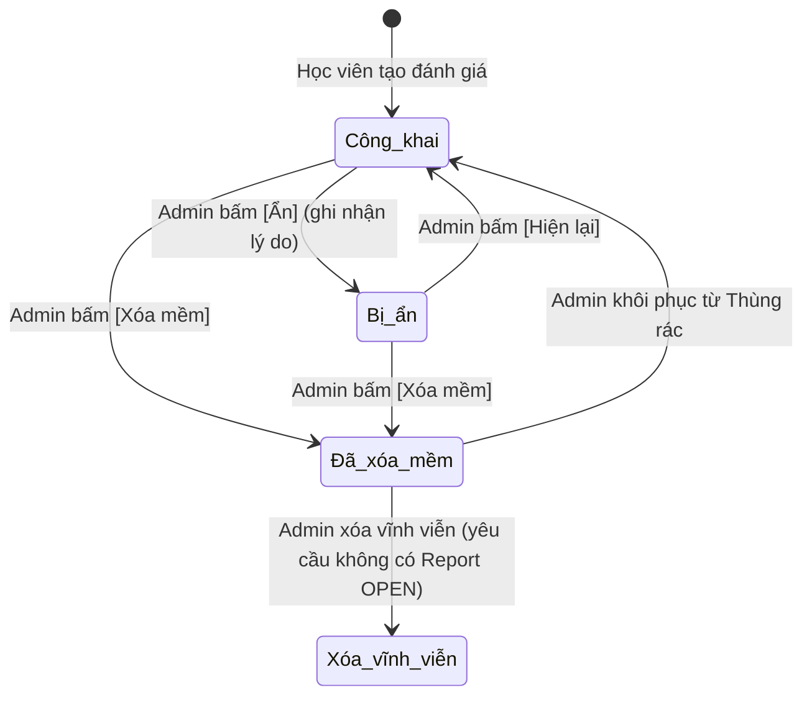

# EDUNITY V3 — MODERATION LIFECYCLE POLICY

**Task ID:** `EDUNITY-ADMIN-REVIEW-COMMENT-MODERATION-V1`  
**Workspace:** `D:\Dự Án\Edunity`  
**Branch:** `feature/teacher-admin`  

---

## 1. Moderation States & Distinction

Ba trạng thái kiểm duyệt độc lập và tách bạch rõ ràng:
$$\text{Ẩn (Hide)} \neq \text{Xóa mềm (Soft Delete)} \neq \text{Xóa vĩnh viễn (Permanent Delete)}$$

---

## 2. Chi tiết từng trạng thái & Hành vi

### A. Ẩn (Hide)
- **Mục đích:** Tạm gỡ bỏ hiển thị đánh giá độc hại, phản cảm, xúc phạm hoặc đang chờ xác minh khiếu nại.
- **Dữ liệu:**
  - `isHidden: true`
  - `hiddenAt: new Date()`
  - `hiddenBy: adminUser._id`
  - `hideReason: "Lý do do admin cung cấp"`
- **Tác động:**
  - Lập tức biến mất khỏi danh sách đánh giá công khai của lớp học và giáo viên.
  - Loại điểm rating của đánh giá này khỏi công thức tính `ratingAverage` và `ratingCount`.
  - **Dữ liệu đánh giá gốc và nội dung bình luận KHÔNG bị xóa, vẫn hiển thị đầy đủ trong trang quản trị Admin.**
  - Ghi vết `AuditLog` với action `REVIEW_HIDDEN`.

### B. Hiện lại (Unhide)
- **Mục đích:** Phục hồi hiển thị bình thường khi khiếu nại được chứng minh là sai hoặc nội dung đánh giá hợp lệ.
- **Dữ liệu:**
  - `isHidden: false`
- **Tác động:**
  - Hiển thị trở lại trên trang công khai.
  - Tính điểm sao của đánh giá này trở lại vào `ratingAverage` và `ratingCount` của lớp và giáo viên.
  - Ghi vết `AuditLog` với action `REVIEW_UNHIDDEN`.

### C. Xóa mềm (Soft Delete)
- **Mục đích:** Đánh giá bị vi phạm nghiêm trọng cần đưa vào Thùng rác hệ thống để theo dõi theo chu kỳ lưu trữ.
- **Dữ liệu:**
  - `isDeleted: true`
  - `deletedAt: new Date()`
  - `deletedBy: adminUser._id`
  - `deleteReason: "Lý do xóa"`
- **Tác động:**
  - Đánh giá chuyển sang Thùng rác (`/admin/trash`, loại: `REVIEW`).
  - Lập tức loại khỏi danh sách công khai và công thức tính xếp hạng sao.
  - Hỗ trợ Khôi phục (`restoreReview`) với khả năng tính toán lại xếp hạng đầy đủ.

### D. Xóa vĩnh viễn (Permanent Delete)
- **Mục đích:** Dọn dẹp dữ liệu rác triệt để khỏi cơ sở dữ liệu.
- **Điều kiện ràng buộc nghiêm ngặt:**
  - Quyền hạn: Chỉ Admin có quyền `PERMANENT_DELETE` (hoặc Super Admin) mới được thực hiện.
  - **Bảo vệ bằng chứng khiếu nại:** Nếu đánh giá vẫn còn liên kết với `Report` ở trạng thái mở (`OPEN` hoặc `IN_REVIEW`), hệ thống chặn hoàn toàn việc xóa vĩnh viễn và trả về lỗi `DEPENDENCY_CONFLICT (409)`.
