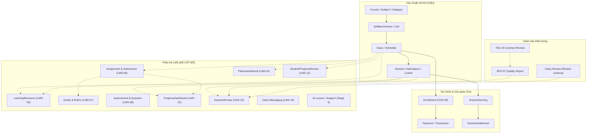
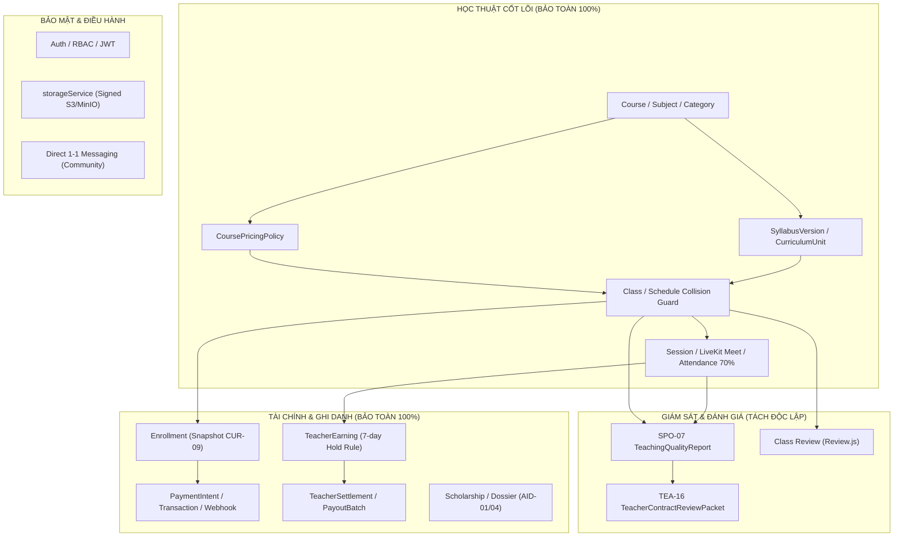

# BÁO CÁO 02: BIỂU ĐỒ PHỤ THUỘC VÀ RANH GIỚI CÁCH LY (DEPENDENCY GRAPH)

- **Dự án:** Edunity V3
- **Chế độ:** ARCHITECTURAL ISOLATION & DEPENDENCY ANALYSIS
- **Người thực hiện:** Châu (Principal Backend Engineer + Software Architect)
- **Thời gian lập:** 13/11/2026

---

## 1. TỔNG QUAN KIẾN TRÚC VÀ RANH GIỚI CẮT BỎ

Trước khi loại bỏ, các module LMS kết nối như một phân hệ "lá" (leaf subsystem) phụ thuộc vào thực thể lõi (`Course`, `Class`, `Session`, `User`). Tuy nhiên, trong quá trình phát triển giai đoạn trước, một số điểm giao thoa (intersection points) xuất hiện ở cấp độ Service và Schema.

Mục tiêu kiến trúc của việc cắt bỏ là:
1. **Xóa bỏ hoàn toàn nhánh lá LMS** mà không làm đứt gãy luồng điều hướng của các thực thể lõi.
2. **Cách ly ranh giới (Boundary Isolation):** Đảm bảo không có chuỗi phụ thuộc ngược (circular/reverse dependency) từ Core Academic hay Finance vào LMS.

---

## 2. BIỂU ĐỒ KIẾN TRÚC TRƯỚC VÀ SAU KHI CẮT BỎ

### 2.1. Kiến trúc trước khi cắt bỏ (LMS Intermingled)

### 2.2. Kiến trúc sau khi cô lập hoàn toàn (Edunity V3 Lean Architecture)

---

## 3. PHÂN TÍCH CÁC ĐIỂM GIAO THOA ĐÃ XỬ LÝ (DECOUPLING POINTS)

### 3.1. Giao thoa `teachingQualityReportService.js` (SPO-07)
- **Hiện trạng trước:** Service import `SessionReview` và thực hiện aggregate rating theo từng buổi học song song với Class Review.
- **Ranh giới xử lý:** 
  - Gỡ bỏ import `SessionReview`.
  - Giữ nguyên cấu trúc trả về của API cho Frontend/Admin: trả về `sessionReviews: []` rỗng an toàn.
  - SPO-07 chỉ tập trung vào các chỉ số cốt lõi: Session attendance, vi phạm buổi học (TeacherViolation), biên bản sự cố (TeacherIncidentReport), kỷ luật (TeacherDisciplineCase), hoàn tiền (SessionRefundReview), và đánh giá tổng quan lớp học (`Review`).

### 3.2. Giao thoa `reviewService.js` (LMS-10 vs Review cốt lõi)
- **Hiện trạng trước:** File gộp chung cả đánh giá Session (`SessionReview`) và đánh giá Class (`Review`).
- **Ranh giới xử lý:** 
  - Loại bỏ hoàn toàn model `SessionReview.js` và 3 hàm: `createSessionReview`, `getSessionReviews`, `summarizeSessionReviews`.
  - Giữ nguyên vẹn model `Review.js` và các nghiệp vụ: `createReview`, `getClassReviews`, `getTeacherReviews`, `getMyReviews`.

### 3.3. Giao thoa `messagingService.js` (LMS-13 vs Chat 1-1)
- **Hiện trạng trước:** Gộp chat 1-1 người dùng và chat group lớp học, report tin nhắn lớp học (`MessageModerationReport`).
- **Ranh giới xử lý:** 
  - Gỡ bỏ toàn bộ code xử lý Class channel, message report, moderation logs.
  - Bảo toàn 100% nghiệp vụ chat trực tiếp 1-1 giữa Student và Teacher theo Enrollment.

### 3.4. Giao thoa `Session.contents` và Học liệu (LMS-03)
- **Hiện trạng trước:** LMS-03 dự kiến chuyển dịch tài liệu từ `Session.contents` sang model `LearningResource`.
- **Ranh giới xử lý:**
  - Không động chạm hay xóa trường `Session.contents` trong `BackEnd/src/models/Session.js`.
  - Toàn bộ link tài liệu, file đính kèm lưu trực tiếp trong Session vẫn tồn tại nguyên vẹn.

---

## 4. KẾT LUẬN RANH GIỚI AN TOÀN

Ranh giới cô lập đã được thiết lập chặt chẽ:
1. Nhánh LMS đã bị ngắt hoàn toàn.
2. Không còn bất kỳ file nào trong hệ thống import hoặc tham chiếu tới các model LMS đã xóa.
3. Không có bất kỳ sự gián đoạn luồng nghiệp vụ nào đối với Core Academic, Finance, Security hay Quality Governance.

