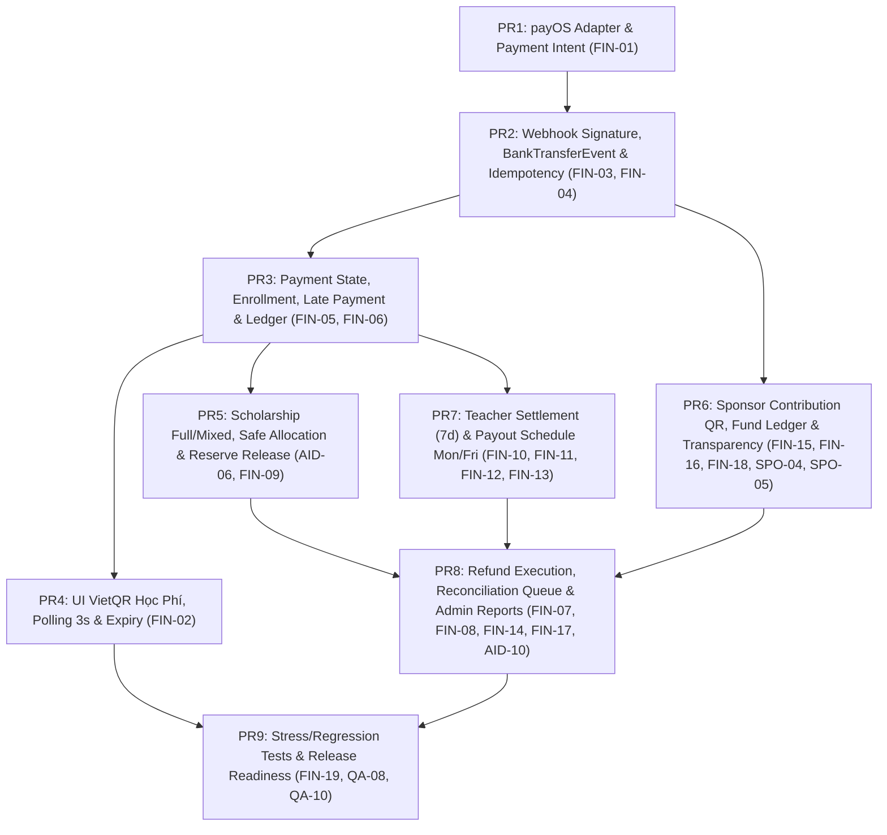

# 03 — KẾ HOẠCH TRIỂN KHAI PAYMENT & FINANCE THEO 9 PR (EDUNITY V3)

- **Mã nhiệm vụ:** `TIN-G0-01`
- **Người phụ trách (Owner):** Tin (Team Leader — Toàn bộ Payment & Finance EDUNITY V3)
- **Nhánh dự kiến của Tin:** `feature/v3-payment-tin` (tách từ base commit ổn định trên `dev` / `feature/teacher-admin`)
- **Ngày lập kế hoạch:** 09/11/2026

---

## Tổng quan lộ trình 9 Pull Requests (PR1 → PR9)

---

## PR1: payOS Adapter và Payment Intent

- **1. Mã task EDUNITY:** `FIN-01` (liên quan `G0-01`, `G0-10`)
- **2. Mục tiêu:**
  - Cài đặt/tích hợp `@payos/node` (CommonJS) thông qua lớp bọc `payosService.js` hỗ trợ cả 2 chế độ: **payOS thật/sandbox API** (khi có `PAYOS_CLIENT_ID`, `PAYOS_API_KEY`, `PAYOS_CHECKSUM_KEY`) và **Local Mock/Sandbox fallback** (cho Jest test / môi trường local offline).
  - Sinh mã `orderCode` kiểu số nguyên dương duy nhất (chuẩn Safe Integer của payOS, ví dụ tiền tố `1` + timestamp/counter cho Học phí, tiền tố `2` cho Tài trợ).
  - Mở rộng `POST /api/enrollments/:id/payments` để tạo Payment Intent chuẩn payOS với thời hạn hết hạn QR (`expiredAt` tính bằng Unix timestamp giây) khớp với `Enrollment.holdExpiresAt` (15 phút).
  - Đảm bảo tạo QR **không** làm `Enrollment` chuyển sang `CONFIRMED` và chống tạo trùng nhiều `Payment` `PENDING` cho cùng 1 `Enrollment`.
- **3. File dự kiến sửa / tạo mới:**
  - `BackEnd/package.json` (thêm dependency `@payos/node` nếu dùng SDK, hoặc dùng native `crypto` + `fetch` chuẩn Node 22 kèm tương thích SDK)
  - `BackEnd/.env.example` & `BackEnd/src/config/env.js` (khai báo biến `PAYOS_CLIENT_ID`, `PAYOS_API_KEY`, `PAYOS_CHECKSUM_KEY`, `PAYOS_EXPECTED_ACCOUNT_NUMBER`, `PAYMENT_PROVIDER_MODE`)
  - `BackEnd/src/services/payosService.js` *(tạo mới — Adapter tạo link thanh toán, hủy link, lấy thông tin link, verify signature)*
  - `BackEnd/src/models/Payment.js` (bổ sung trường `orderCode`, `paymentLinkId`, `checkoutUrl`, `qrCode`, `expiredAt`, `providerRawStatus`)
  - `BackEnd/src/services/paymentService.js` (nâng cấp `createSandboxPayment` → `createPaymentIntent` hỗ trợ cả `PAYOS` và `SANDBOX`, dùng transaction/unique guard chống race condition khi bấm đúp)
  - `BackEnd/src/controllers/paymentController.js` & `BackEnd/src/routes/paymentRoutes.js`
- **4. Model / API thay đổi:**
  - **Model `Payment`:**
    - Thêm `orderCode: { type: Number, unique: true, sparse: true }`
    - Thêm `paymentLinkId: { type: String, default: null }`
    - Thêm `checkoutUrl: { type: String, default: null }`
    - Thêm `qrCode: { type: String, default: null }`
    - Thêm `expiredAt: { type: Date, default: null }`
    - Thêm Partial Unique Index `{ enrollmentId: 1 }` với `partialFilterExpression: { paymentStatus: "PENDING" }`.
  - **API `POST /api/enrollments/:id/payments` & `GET /api/payments/:id`:**
    - Trả thêm `orderCode`, `paymentLinkId`, `checkoutUrl`, `qrCode`, `expiredAt`, `gateway` trong `data`.
- **5. Dependency:** Không phụ thuộc thành viên khác; là PR nền tảng đầu tiên.
- **6. Test cần có:**
  - Unit & Integration test tạo Payment Intent cho lớp PAID: kiểm tra `orderCode` là số nguyên dương duy nhất, `expiredAt` khớp `holdExpiresAt` (15 phút), `Enrollment.enrollmentStatus` giữ nguyên `PENDING_PAYMENT`.
  - Test gọi lặp `POST /api/enrollments/:id/payments` (tuần tự và 5 requests đồng thời): chỉ trả về đúng 1 `Payment` `PENDING`, không tạo 2 link payOS trùng.
- **7. Tiêu chí nghiệm thu (`FIN-01`):**
  - Tạo được Payment Intent chứa `qrCode`, `checkoutUrl`, `orderCode`, `holdExpiresAt` mà không làm `Enrollment` thành `CONFIRMED`.
  - Tương thích ngược 100% với các test hiện hữu trong `payment.test.js`.
- **8. Nguy cơ conflict với thành viên khác:**
  - Rất thấp (chỉ chạm `Payment.js`, `paymentService.js`, `paymentController.js` do Tin sở hữu; thông báo cho Bảo khi thêm biến tên môi trường trong `env.js`).

---

## PR2: Webhook Signature, `BankTransferEvent` & Idempotency

- **1. Mã task EDUNITY:** `FIN-03`, `FIN-04`
- **2. Mục tiêu:**
  - Triển khai xác thực chữ ký HMAC-SHA256 chuẩn của payOS (`PAYOS_CHECKSUM_KEY`) trên dữ liệu `req.body.data` và `req.body.signature`.
  - Giữ endpoint `/api/payments/sandbox/webhook` (chỉ mở ở `development`/`test`) cho kiểm thử nội bộ, đồng thời nâng cấp `/api/payments/webhook` để nhận payload chuẩn của payOS (và hỗ trợ header `x-webhook-secret` cho các bài test tích hợp cũ thông qua nhánh tương thích rõ ràng).
  - Tạo model `BankTransferEvent` lưu toàn bộ sự kiện webhook đến và model `PaymentReconciliation` lưu các trường hợp bất thường:
    - Sai số tiền (`UNDERPAID` / `OVERPAID`)
    - Sai tài khoản ngân hàng đích (`WRONG_RECEIVER_ACCOUNT` khi so với `PAYOS_EXPECTED_ACCOUNT_NUMBER`)
    - Không tìm thấy `orderCode` (`UNMATCHED_ORDER_CODE`)
    - Giao dịch thành công đến sau khi đơn đã `FAILED` (`LATE_SUCCESS_AFTER_FAILED`)
- **3. File dự kiến sửa / tạo mới:**
  - `BackEnd/src/models/BankTransferEvent.js` *(tạo mới)*
  - `BackEnd/src/models/PaymentReconciliation.js` *(tạo mới)*
  - `BackEnd/src/models/index.js` (export 2 model mới)
  - `BackEnd/src/services/payosService.js` (hàm `verifyWebhookSignature(body)` dùng `crypto.createHmac("sha256", checksumKey)` + `crypto.timingSafeEqual`)
  - `BackEnd/src/controllers/paymentController.js`
- **4. Model / API thay đổi:**
  - **Model `BankTransferEvent`:** `provider` (`PAYOS` | `SANDBOX`), `eventKey` (unique), `orderCode`, `paymentLinkId`, `reference`, `amount`, `accountNumber`, `counterAccountNumber`, `counterAccountName`, `transactionDateTime`, `rawCode`, `signatureVerified`, `processingStatus` (`PROCESSED`, `IDEMPOTENT`, `FLAGGED_RECONCILIATION`, `REJECTED`), `payloadSnapshot`.
  - **Model `PaymentReconciliation`:** `eventId` (ref `BankTransferEvent`), `paymentId`, `contributionId`, `enrollmentId`, `orderCode`, `expectedAmount`, `actualAmount`, `reason` (`UNDERPAID`, `OVERPAID`, `LATE_PAYMENT_EXPIRED_HOLD`, `LATE_SUCCESS_AFTER_FAILED`, `UNMATCHED_ORDER_CODE`, `WRONG_RECEIVER_ACCOUNT`), `status` (`OPEN`, `IN_REVIEW`, `RESOLVED_REFUNDED`, `RESOLVED_IGNORED`), `resolvedBy`, `resolvedAt`, `resolutionNote`.
  - **API `POST /api/payments/webhook`:** Chấp nhận và xác minh payload payOS; từ chối `401` khi chữ ký giả mạo.
- **5. Dependency:** Phụ thuộc **PR1** (`payosService.js` và `Payment.orderCode`). Cần **Bảo** review bảo mật chữ ký HMAC (`FIN-03`, `QA-06`).
- **6. Test cần có:**
  - Test chữ ký HMAC-SHA256 hợp lệ vs giả mạo (sửa `amount` hoặc `orderCode` trong body mà giữ nguyên `signature` → phải bị chặn `401`).
  - Test `accountNumber` trong webhook khác `PAYOS_EXPECTED_ACCOUNT_NUMBER` → không xác nhận Payment, sinh `PaymentReconciliation` (`WRONG_RECEIVER_ACCOUNT`).
  - Test `amount` trong webhook nhỏ hơn hoặc lớn hơn `Payment.amount` → không xác nhận Enrollment, sinh `PaymentReconciliation` (`UNDERPAID` / `OVERPAID`).
  - Test `orderCode` không tồn tại → sinh `BankTransferEvent` + `PaymentReconciliation` (`UNMATCHED_ORDER_CODE`).
- **7. Tiêu chí nghiệm thu (`FIN-03`, `FIN-04`):**
  - Không thể giả mạo trạng thái thanh toán nếu không có `PAYOS_CHECKSUM_KEY`.
  - Mọi giao dịch lệch tiền / sai nội dung / sai tài khoản nhận đều vào hàng đợi `PaymentReconciliation`, tuyệt đối không tự mở quyền học.
- **8. Nguy cơ conflict với thành viên khác:**
  - Thấp (`BackEnd/src/models/index.js` chỉ thêm 2 dòng export; phối hợp khi merge).

---

## PR3: Payment State, Enrollment, Late Payment (`BR-49`) & Ledger Idempotency

- **1. Mã task EDUNITY:** `FIN-05`, `FIN-06`
- **2. Mục tiêu:**
  - Chuẩn hóa luồng chuyển trạng thái nguyên tử giữa `Payment`, `Enrollment`, `Transaction`, `TeacherEarning` và `PaymentReconciliation`.
  - Bổ sung Partial Unique Index trên `Transaction` (`{ relatedPaymentId: 1, transactionType: 1 }`) kèm script preflight kiểm tra dữ liệu trùng.
  - Bổ sung trường `commissionRate` snapshot vào `TeacherEarning` (`BUG-P2-01`).
  - Xử lý chuẩn xác giao dịch tiền về muộn sau khi `Enrollment` đã `EXPIRED` (`FIN-06` / `BR-49`):
    - Ghi nhận tiền vào `Payment` (`COMPLETED`) và `Transaction` (`ENROLLMENT_PAYMENT` + `REFUND` `PENDING` hoặc trạng thái chờ đối soát).
    - Tạo bản ghi `PaymentReconciliation` (`reason: "LATE_PAYMENT_EXPIRED_HOLD"`).
    - **Không** tự khôi phục `Enrollment` đã `EXPIRED` (tránh vượt `Class.capacity`).
    - **Không** tạo `TeacherEarning`.
    - **Không** tự động cộng Xu (chỉ chuẩn bị interface dự phòng chờ chính sách chính thức).
- **3. File dự kiến sửa / tạo mới:**
  - `BackEnd/src/models/Transaction.js` (thêm `relatedContributionId`, `relatedPayoutId`, partial unique index)
  - `BackEnd/src/models/TeacherEarning.js` (thêm `commissionRate: { type: Number, default: 0.1 }`)
  - `BackEnd/src/services/paymentService.js`
  - `BackEnd/src/services/settlementService.js`
- **4. Model / API thay đổi:**
  - **Model `Transaction`:** Thêm `relatedContributionId`, `relatedPayoutId`, Partial Unique Index `{ relatedPaymentId: 1, transactionType: 1 }` khi `relatedPaymentId != null`.
  - **Model `TeacherEarning`:** Lưu `commissionRate` snapshot.
  - **Response của `processWebhook`:** Phân biệt rõ `LATE_PAYMENT_PENDING_REVIEW` (hết hạn giữ chỗ) và `AMOUNT_MISMATCH_PENDING_REVIEW` (đóng thiếu/thừa tiền khi còn hạn).
- **5. Dependency:** Phụ thuộc **PR1** và **PR2**.
- **6. Test cần có:**
  - Test 10 webhook payOS đồng thời (`FIN-05`, `FIN-19`): chỉ tạo đúng 1 `Transaction` `ENROLLMENT_PAYMENT`, 1 `TeacherEarning`, 1 `Enrollment` `CONFIRMED`.
  - Test webhook đến muộn sau khi `Enrollment` đã `EXPIRED` (`FIN-06`): tiền được ghi nhận + tạo `PaymentReconciliation`, `Enrollment` giữ nguyên `EXPIRED`, `TeacherEarning` = `0`, không tự cộng Xu.
  - Test webhook `SUCCESS` đến sau khi `Payment` đã `FAILED`: tạo `PaymentReconciliation` (`LATE_SUCCESS_AFTER_FAILED`) trong DB.
- **7. Tiêu chí nghiệm thu (`FIN-05`, `FIN-06`):**
  - Sổ cái cân bằng 100%, không sinh bút toán trùng ở cả tầng ứng dụng và tầng DB index.
  - Mọi giao dịch muộn đều có bản ghi `PaymentReconciliation` trong DB.
- **8. Nguy cơ conflict với thành viên khác:**
  - Thấp (chỉ nằm trong phạm vi file tài chính của Tin).

---

## PR4: Giao diện VietQR Học Phí, Đếm Ngược 15 Phút & Polling 3s/lần

- **1. Mã task EDUNITY:** `FIN-02`
- **2. Mục tiêu:**
  - Nâng cấp `CheckoutPage.tsx` để hiển thị mã **VietQR** (từ `qrCode` / `checkoutUrl` của payOS), số tiền cần chuyển, mã đơn hàng `orderCode`, và đồng hồ đếm ngược 15 phút theo `holdExpiresAt`.
  - Thiết lập cơ chế **Polling Backend 3 giây/lần** (`refetchInterval: 3000` trên `GET /api/payments/:id`) khi `paymentStatus === "PENDING"` và chưa hết hạn.
  - Tự động chuyển hướng sang `/checkout/:enrollmentId/success` ngay khi polling nhận thấy `paymentStatus === "COMPLETED"` và `enrollmentStatus === "CONFIRMED"`.
  - Xử lý đầy đủ các trạng thái trên UI: đang chờ thanh toán (`PENDING`), hết hạn giữ chỗ (`EXPIRED`), thanh toán thất bại (`FAILED` — cho phép bấm tạo lại mã QR mới nếu thời gian giữ chỗ vẫn còn), và thanh toán muộn cần đối soát (`LATE_PAYMENT_PENDING_REVIEW`).
  - Ẩn các nút bấm giả lập webhook Sandbox khi chạy ở môi trường thật (`gateway === "PAYOS"`), chỉ hiển thị trong chế độ Sandbox dev/test.
- **3. File dự kiến sửa / tạo mới:**
  - `FrontEnd/src/types/payment.ts`
  - `FrontEnd/src/api/paymentAdapters.ts`
  - `FrontEnd/src/services/gatewayPayment.service.ts`
  - `FrontEnd/src/features/enrollment/CheckoutPage.tsx`
  - `FrontEnd/src/features/enrollment/PaymentSuccessPage.tsx`
- **4. Model / API thay đổi:**
  - Cập nhật DTO `CreatePaymentResponse` và `Payment` trên Frontend nhận thêm `orderCode`, `qrCode`, `checkoutUrl`, `paymentLinkId`, `expiredAt`, `gateway`.
- **5. Dependency:** Phụ thuộc **PR1**, **PR2**, **PR3**.
- **6. Test cần có:**
  - Kiểm tra `npx tsc -b` và `npm run build` trên `FrontEnd` đạt `0` lỗi.
  - Test luồng polling: khi Backend đổi trạng thái `Payment` sang `COMPLETED`, `CheckoutPage` tự động nhận biết trong <= 3 giây mà không cần người dùng bấm nút xác nhận giả.
- **7. Tiêu chí nghiệm thu (`FIN-02`):**
  - Giao diện hiển thị rõ mã VietQR, số tiền, mã tham chiếu, đếm ngược 15 phút, polling 3s/lần, có xử lý hết hạn & thử lại, tuyệt đối không cho phép fake success từ phía client.
- **8. Nguy cơ conflict với thành viên khác:**
  - Thấp: theo phân công V3 (Mục 0.1 & 5.1), Tin sở hữu toàn bộ giao diện tài chính (`CheckoutPage.tsx`, `paymentAdapters.ts`); Băng chỉ chạy E2E test trên trang này.

---

## PR5: Học bổng Full / Mixed, Cấp phát Quỹ An toàn & Hoàn trả Giữ chỗ 15 Phút

- **1. Mã task EDUNITY:** `AID-06`, `FIN-09`
- **2. Mục tiêu:**
  - Chuẩn hóa dịch vụ tài chính khi duyệt học bổng (`AID-06`): tách rõ hàm cấp phát tài chính (`allocateScholarshipFund`) để khi Châu hoàn tất quy trình duyệt hồ sơ 2 bản (bản mềm + bản cứng `AID-04`), hệ thống kiểm tra nguyên tử quỹ khả dụng (`fundedAmount - allocatedAmount >= awardAmountPerStudent`), tạo `Scholarship`, ghi `AuditLog` và không bao giờ vượt quỹ.
  - Khi `releaseReservation` chạy (do học viên hủy đơn hoặc hết hạn 15 phút): ngoài việc trả `Class.enrolledCount - 1` và hoàn `ScholarshipUsage` (`PENDING` → `RELEASED`, cộng lại `Scholarship.remainingAmount`), đồng thời **đóng tất cả `Payment` `PENDING` của đơn đó** (`paymentStatus = "FAILED"`) và gọi hủy link thanh toán trên payOS (`GAP-P1-03`).
  - Đảm bảo khi học viên áp dụng học bổng `MIXED`, lệnh tạo Payment Intent ở PR1 tạo đúng mã VietQR payOS cho phần đồng chi trả (`remainingDue`).
- **3. File dự kiến sửa / tạo mới:**
  - `BackEnd/src/services/scholarshipService.js`
  - `BackEnd/src/services/scholarshipPaymentService.js`
  - `BackEnd/src/services/reservationService.js`
  - `BackEnd/src/models/ScholarshipUsage.js` (bổ sung partial unique index `{ enrollmentId: 1 }` cho `status: { $in: ["PENDING", "CONFIRMED"] }`)
- **4. Model / API thay đổi:**
  - **Model `ScholarshipUsage`:** Thêm Partial Unique Index `{ enrollmentId: 1 }` khi `status` thuộc `["PENDING", "CONFIRMED"]` để chặn tuyệt đối việc áp 2 học bổng đồng thời vào cùng 1 Enrollment ở tầng DB.
  - **Service `reservationService.releaseReservation`:** Cập nhật thêm `Payment.updateMany({ enrollmentId, paymentStatus: "PENDING" }, { $set: { paymentStatus: "FAILED" } })` trong cùng transaction.
- **5. Dependency:** Phụ thuộc **PR1** và **PR3**. Phối hợp hợp đồng dữ liệu `ScholarshipApplication` với **Châu** (`AID-01`, `AID-04`).
- **6. Test cần có:**
  - Test `FULL` và `MIXED` scholarship với payOS Payment Intent (`FIN-09`).
  - Test hết hạn giữ chỗ 15 phút trên đơn `MIXED` đã tạo QR payOS: `Enrollment` → `EXPIRED`, `ScholarshipUsage` → `RELEASED`, `Scholarship.remainingAmount` hoàn 100%, `Class.enrolledCount` giảm 1, `Payment` → `FAILED`.
  - Test duyệt 2 hồ sơ học bổng đồng thời khi quỹ `ScholarshipCampaign` chỉ còn đủ cho 1 suất (`AID-06`): 1 thành công, 1 trả về `409 INSUFFICIENT_CAMPAIGN_FUND`.
- **7. Tiêu chí nghiệm thu (`AID-06`, `FIN-09`):**
  - Hủy hoặc hết hạn giữ chỗ 15 phút hoàn trả chính xác 100% số dư học bổng, chỗ trống lớp học và đóng phiên thanh toán đang chờ.
- **8. Nguy cơ conflict với thành viên khác:**
  - Trung bình trên `BackEnd/src/services/scholarshipService.js` (Châu làm phần hồ sơ `AID-01`/`AID-04`, Tin làm phần cấp phát quỹ `AID-06`). **Giải pháp:** Tách hàm cấp phát tài chính sang `scholarshipPaymentService.js` hoặc `settlementService.js` để `scholarshipService.approveApplication` chỉ gọi sang, tránh conflict trực tiếp.

---

## PR6: Sponsor Contribution QR, Sổ cái Quỹ & Báo cáo Minh bạch Nhà tài trợ

- **1. Mã task EDUNITY:** `FIN-15`, `FIN-16`, `FIN-18`, `SPO-04`, `SPO-05`
- **2. Mục tiêu:**
  - Nâng cấp `POST /api/campaigns/:id/contributions` (`FIN-15`) để tạo link thanh toán payOS + mã VietQR cho khoản đóng góp của Nhà tài trợ (`orderCode` dải `2...`), hỗ trợ header `Idempotency-Key` chống tạo intent rác khi bấm đúp.
  - Bổ sung `GET /api/sponsor/contributions/:id` để màn hình đóng góp của Nhà tài trợ polling trạng thái 3s/lần.
  - Chuẩn hóa sổ cái quỹ chiến dịch (`FIN-16`): trả về đầy đủ 5 chỉ số đối soát trên Campaign:
    - `receivedAmount` (`fundedAmount` — tổng tiền thực nhận qua webhook xác thực)
    - `reservedAmount` (tổng `ScholarshipUsage` đang giữ tạm `PENDING` trong 15 phút checkout)
    - `allocatedAmount` (tổng hạn mức học bổng đang cấp phát)
    - `usedAmount` (tổng học bổng đã giải ngân vào các Enrollment `CONFIRMED`)
    - `unallocatedAmount` (`fundedAmount - allocatedAmount`)
  - Cập nhật giao diện ủng hộ chiến dịch và Dashboard Nhà tài trợ (`SPO-04`, `SPO-05`): hiển thị VietQR payOS, chỉ hiển thị biên nhận thành công sau khi webhook xác thực, và hiển thị báo cáo tác động ẩn danh PII (`FIN-18`).
- **3. File dự kiến sửa / tạo mới:**
  - `BackEnd/src/models/SponsorContribution.js` (bổ sung `orderCode`, `paymentLinkId`, `checkoutUrl`, `qrCode`, `expiredAt`, `idempotencyKey`)
  - `BackEnd/src/services/contributionService.js`
  - `BackEnd/src/controllers/scholarshipController.js` & `BackEnd/src/routes/scholarshipRoutes.js`
  - `FrontEnd/src/services/sponsorContribution.service.ts`
  - `FrontEnd/src/features/campaign/CampaignDetailPage.tsx`
  - `FrontEnd/src/features/sponsor/home/SponsorHomePage.tsx` & `FrontEnd/src/features/sponsor/contributions/SponsorContributionsPage.tsx`
- **4. Model / API thay đổi:**
  - **Model `SponsorContribution`:** Thêm `orderCode` (unique, sparse), `paymentLinkId`, `checkoutUrl`, `qrCode`, `expiredAt`, `idempotencyKey`.
  - **API mới:** `GET /api/sponsor/contributions/:id` (kiểm tra quyền sở hữu `sponsorId` hoặc `ADMIN`).
  - **API `GET /api/sponsor/campaigns/:id/impact`:** Bổ sung `reservedAmount` và đối chiếu khớp với tổng `Transaction` `SPONSOR_CONTRIBUTION` & `SCHOLARSHIP_USAGE`.
- **5. Dependency:** Phụ thuộc **PR1** và **PR2** (`payosService` và webhook router). Phối hợp với **Bảo** về `BeneficiaryPublicProfile` (`AID-07`, `SPO-01`).
- **6. Test cần có:**
  - Test tạo `ContributionIntent` → trả về VietQR mà chưa cộng `fundedAmount`.
  - Test webhook payOS xác nhận khoản tài trợ → cộng `fundedAmount` đúng 1 lần, ghi `Transaction` `SPONSOR_CONTRIBUTION` có `relatedContributionId`.
  - Test 10 callbacks đồng thời vào cùng 1 `ContributionIntent` → quỹ không bị cộng trùng.
  - Test `getCampaignImpact` không rò rỉ email, CCCD, địa chỉ hay file gốc của học sinh.
- **7. Tiêu chí nghiệm thu (`FIN-15`, `FIN-16`, `FIN-18`, `SPO-04`, `SPO-05`):**
  - Quỹ chiến dịch chỉ tăng khi có webhook hợp lệ; số dư `received / reserved / allocated / used` khớp tuyệt đối với sổ cái `Transaction`; UI Sponsor hiển thị QR và biên nhận chuẩn xác.
- **8. Nguy cơ conflict với thành viên khác:**
  - Thấp trên Backend; trên Frontend cần phối hợp nhẹ với **Băng** nếu Băng sửa nút Share Facebook (`SPO-03`) trên `CampaignDetailPage.tsx`.

---

## PR7: `TeacherSettlement` (Chốt khóa + 7 ngày đối soát) & Lịch Rút tiền Thứ Hai / Batch Thứ Sáu

- **1. Mã task EDUNITY:** `FIN-10`, `FIN-11`, `FIN-12`, `FIN-13`
- **2. Mục tiêu:**
  - Tạo model `TeacherSettlement` và sửa logic giải phóng thu nhập trong `classLifecycleService.js` (`GAP-P0-05` / `FIN-10`):
    - Khi lớp học kết thúc (`Class.status = "COMPLETED"`), **không** chuyển ngay `TeacherEarning` sang `AVAILABLE`.
    - Kiểm tra điều kiện mở đối soát của lớp:
      1. Toàn bộ các buổi học (`Session`) của lớp đã ở trạng thái kết thúc.
      2. Không còn yêu cầu dạy bù (`SessionRescheduleRequest`) đang chờ hoặc buổi học bù chưa hoàn tất.
      3. Không còn sự cố buổi học (`TeacherIncidentReport` `PENDING`), yêu cầu hoàn phí (`SessionRefundReview` `NEEDS_FINANCIAL_REVIEW`) hoặc khiếu nại lớp học chưa đóng.
    - Khi đạt đủ 3 điều kiện trên, ghi nhận mốc bắt đầu đối soát `reconciliationStartedAt` và `availableEligibleAt = reconciliationStartedAt + 7 ngày` (mặc định 7 ngày theo cấu hình `SETTLEMENT_HOLD_DAYS = 7` trong `settings.js`, dễ dàng cấu hình ngày lịch/ngày làm việc khi chốt văn bản).
    - Chỉ khi `now >= availableEligibleAt` và không phát sinh tranh chấp mới, job bảo trì mới chuyển `TeacherEarning` từ `PENDING` sang `AVAILABLE`.
  - Áp dụng quy tắc lịch rút tiền (`FIN-11`, `FIN-13`):
    - `POST /api/teacher/payouts`: chỉ cho phép tạo yêu cầu rút tiền vào **Thứ Hai từ 08:00 đến 17:00** theo múi giờ `Asia/Ho_Chi_Minh` (có biến cấu hình `ENFORCE_PAYOUT_WINDOW` để Admin/test kiểm chứng linh hoạt).
    - Bổ sung bước Admin duyệt đưa vào đợt chi trả Thứ Sáu (`POST /api/admin/payouts/:id/process` → `status = "PROCESSING"`), và chỉ chuyển sang `COMPLETED` (`PAID_OUT`) khi Admin xác nhận ngân hàng đã thực chuyển tiền (`POST /api/admin/payouts/:id/complete`) hoặc đánh dấu `FAILED` kèm `failureReason` (`POST /api/admin/payouts/:id/fail`).
  - Kiểm soát tài khoản ngân hàng nhận thù lao (`FIN-12`):
    - Nếu Giáo viên đã có tài khoản ngân hàng xác minh trong hồ sơ (`TEA-13` của Bảo), lấy trực tiếp từ hồ sơ đã xác minh và đối chiếu tên chủ tài khoản trùng với họ tên giáo viên, không cho phép sửa lén sang chủ tài khoản khác.
- **3. File dự kiến sửa / tạo mới:**
  - `BackEnd/src/models/TeacherSettlement.js` *(tạo mới)*
  - `BackEnd/src/models/TeacherEarning.js` (bổ sung trạng thái `ON_HOLD` và `eligibleAt`)
  - `BackEnd/src/services/classLifecycleService.js`
  - `BackEnd/src/services/settlementService.js`
  - `BackEnd/src/services/payoutService.js`
  - `BackEnd/src/routes/financeRoutes.js`
  - `FrontEnd/src/features/teacher/revenue/TeacherPayoutSection.tsx`
  - `FrontEnd/src/features/admin/finance/AdminPayoutsPage.tsx`
- **4. Model / API thay đổi:**
  - **Model `TeacherSettlement`:** `classId` (unique), `teacherId`, `classCompletedAt`, `blockers` (`openIncidentsCount`, `openReschedulesCount`, `openRefundReviewsCount`), `reconciliationStartedAt`, `availableEligibleAt`, `status` (`WAITING_ACADEMIC_CLOSURE`, `RECONCILING_7_DAYS`, `SETTLED`, `ON_HOLD`).
  - **API mới cho Admin Payout:**
    - `POST /api/admin/payouts/:id/process` (`PENDING` → `PROCESSING` cho batch Thứ Sáu)
    - `POST /api/admin/payouts/:id/fail` (`PROCESSING` → `FAILED`, trả lại `TeacherEarning` để rút kỳ sau)
- **5. Dependency:** Phụ thuộc **PR3**. Phối hợp với **Bảo** về cấu trúc `TeacherBankAccount` (`TEA-13`) và với **Châu** về trạng thái `Session` / `SessionRescheduleRequest`.
- **6. Test cần có:**
  - Test lớp vừa `COMPLETED` nhưng chưa đủ 7 ngày → `TeacherEarning` vẫn là `PENDING`, gọi `POST /api/teacher/payouts` trả về `409 NO_AVAILABLE_EARNINGS`.
  - Test lớp đã `COMPLETED` nhưng còn 1 `SessionRefundReview` ở trạng thái `NEEDS_FINANCIAL_REVIEW` hoặc 1 buổi học bù chưa dạy → chưa bắt đầu đếm 7 ngày đối soát.
  - Test sau khi đóng mọi học bù/khiếu nại và qua 7 ngày → `runMaintenanceJob` chuyển `TeacherEarning` sang `AVAILABLE`.
  - Test gọi `POST /api/teacher/payouts` ngoài khung giờ Thứ Hai 08:00–17:00 (`Asia/Ho_Chi_Minh`) → trả về `409 PAYOUT_OUTSIDE_REQUEST_WINDOW`.
  - Test luồng `PENDING` → `PROCESSING` (chưa ghi `PAID_OUT`) → `COMPLETED` (mới ghi `PAID_OUT` và `Transaction` `TEACHER_PAYOUT`).
- **7. Tiêu chí nghiệm thu (`FIN-10`, `FIN-11`, `FIN-12`, `FIN-13`):**
  - Không mở payout khi lớp còn học bù/tranh chấp hoặc chưa đủ 7 ngày đối soát.
  - Không hiển thị `PAID_OUT` / `COMPLETED` khi mới lập lệnh thanh toán (`PROCESSING`).
- **8. Nguy cơ conflict với thành viên khác:**
  - Thấp (nằm trong `classLifecycleService.js`, `payoutService.js`, `TeacherPayoutSection.tsx`, `AdminPayoutsPage.tsx` do Tin phụ trách).

---

## PR8: Quản lý Hoàn phí (`Refund`), Đối soát (`Reconciliation`) & Báo cáo Tài chính Admin

- **1. Mã task EDUNITY:** `FIN-07`, `FIN-08`, `FIN-14`, `FIN-17`, `AID-10`
- **2. Mục tiêu:**
  - Sửa lỗi lọc loại giao dịch trong `financeService.getAdminTransactions` (`filter.transactionType = type`, `BUG-P1-01`) và chuẩn hóa tham số phân trang `limit` / `pageSize` (`BUG-P2-02`).
  - Xây dựng bộ API quản lý đối soát và hoàn phí cho Admin (`FIN-07`, `FIN-14`):
    - `GET /api/admin/reconciliations`: Danh sách hàng đợi `PaymentReconciliation` (lọc theo `status`, `reason`).
    - `POST /api/admin/reconciliations/:id/resolve`: Admin xử lý bản ghi đối soát (chọn tạo lệnh hoàn tiền `REFUND` hoặc đóng kèm ghi chú `resolutionNote`, ghi `AuditLog`).
    - `POST /api/admin/refunds/:transactionId/complete`: Admin xác nhận đã hoàn tiền cho bút toán `Transaction` `REFUND` đang `PENDING` → chuyển `Transaction.status = "COMPLETED"`, cập nhật `Payment.paymentStatus = "REFUNDED"` (chống double refund), ghi `AuditLog`.
  - Liên thông hoàn phí buổi học sự cố (`SessionRefundReview` từ `TIN-05E`) với học bổng (`FIN-14`): nếu đơn ghi danh trả bằng `SCHOLARSHIP` hoặc `MIXED`, phân bổ rõ phần hoàn về hạn mức học bổng/quỹ chiến dịch và phần hoàn tiền mặt cho học viên.
  - Bổ sung báo cáo đối soát quỹ học bổng & xuất dữ liệu đối chiếu cho bên thứ ba độc lập (`AID-10`, `FIN-17`) — phân tách rõ quyền người duyệt học bổng và người đối soát sổ ngân hàng.
  - Cập nhật giao diện Admin Finance (`FIN-08`): thêm tab/trang quản lý Đối soát (`PaymentReconciliation`) và nút xử lý Hoàn tiền (`REFUND`) trên `AdminPaymentsPage.tsx` / `AdminTransactionsPage.tsx`.
- **3. File dự kiến sửa / tạo mới:**
  - `BackEnd/src/services/financeService.js`
  - `BackEnd/src/services/settlementService.js`
  - `BackEnd/src/controllers/financeController.js`
  - `BackEnd/src/routes/financeRoutes.js`
  - `FrontEnd/src/services/finance.service.ts`
  - `FrontEnd/src/features/admin/finance/AdminPaymentsPage.tsx`
  - `FrontEnd/src/features/admin/finance/AdminTransactionsPage.tsx`
- **4. Model / API thay đổi:**
  - Thêm các API Admin:
    - `GET /api/admin/reconciliations`
    - `POST /api/admin/reconciliations/:id/resolve`
    - `POST /api/admin/refunds/:transactionId/complete`
    - `GET /api/admin/fund-reconciliation-report` (`AID-10`, `FIN-17`)
    - `GET /api/teacher/transactions` (`FR-TEA-18`)
- **5. Dependency:** Phụ thuộc **PR2**, **PR5**, **PR6**, **PR7**.
- **6. Test cần có:**
  - Test `GET /api/admin/transactions?type=REFUND` trả về đúng các giao dịch `REFUND` (`BUG-P1-01`).
  - Test hoàn tất `REFUND`: gọi `POST /api/admin/refunds/:transactionId/complete` 2 lần liên tiếp → lần 1 chuyển sang `COMPLETED` & `Payment.paymentStatus = "REFUNDED"`, lần 2 trả về `409 REFUND_ALREADY_PROCESSED` (chống double refund).
  - Test liên thông `SessionRefundReview` → `Transaction` `REFUND` (`PENDING`) → Admin hoàn tất `REFUND` (`COMPLETED`).
  - Test đối soát tổng quỹ Campaign (`AID-10`): `fundedAmount == sum(SPONSOR_CONTRIBUTION COMPLETED)` và `usedAmount == sum(SCHOLARSHIP_USAGE COMPLETED)`.
- **7. Tiêu chí nghiệm thu (`FIN-07`, `FIN-08`, `FIN-14`, `FIN-17`, `AID-10`):**
  - Admin lọc, tra cứu, đối soát và xử lý hoàn phí có đầy đủ `AuditLog`, trạng thái rõ ràng và chống hoàn tiền 2 lần.
- **8. Nguy cơ conflict với thành viên khác:**
  - Thấp (toàn bộ nằm trong `financeService.js`, `financeController.js`, `financeRoutes.js` và thư mục `FrontEnd/src/features/admin/finance/` do Tin sở hữu).

---

## PR9: Stress Tests, Regression Toàn Chuỗi & Release Readiness

- **1. Mã task EDUNITY:** `FIN-19`, `QA-08`, `QA-10`
- **2. Mục tiêu:**
  - Xây dựng bộ test tải và bất변 thức kế toán (`FIN-19`, `QA-08`) kiểm tra toàn bộ chuỗi tiền tệ từ đầu đến cuối:
    - `Student Tuition (payOS)` + `Scholarship FULL/MIXED` + `Sponsor Contribution` + `Session Refund` + `Teacher Settlement (7d)` + `Teacher Payout`.
    - Kiểm chứng bất biến sổ cái (Ledger Invariant): không có giao dịch âm, không có bản ghi nhân đôi khi bắn 20 callbacks song song/trễ/lệch tiền, tổng quỹ Campaign khớp tuyệt đối với các bút toán `Transaction`.
  - Khắc phục cảnh báo buffering timeout 10s trong 3 unit test mock của `BackEnd/tests/payment.test.js` (`GAP-P3-01`).
  - Cập nhật tài liệu API Contract (`BackEnd/docs/api-contract-finance.md`, `BackEnd/docs/api-contract-enrollment.md`), kịch bản preflight/migration index và Release Checklist (`QA-10`).
  - Phối hợp cùng **Băng** chạy nghiệm thu Browser E2E (`QA-05`).
- **3. File dự kiến sửa / tạo mới:**
  - `BackEnd/tests/payment.test.js`
  - `BackEnd/tests/paymentV3Reconciliation.test.js` *(tạo mới)*
  - `BackEnd/docs/api-contract-finance.md`
  - `BackEnd/docs/api-contract-enrollment.md`
  - `docs/payment-v3/04_RELEASE_AND_MIGRATION_CHECKLIST.md` *(tạo mới ở giai đoạn PR9)*
- **4. Model / API thay đổi:** Không thay đổi model/API mới; chỉ tập trung kiểm thử, tối ưu hóa và tài liệu bàn giao.
- **5. Dependency:** Phụ thuộc hoàn tất **PR1 → PR8**.
- **6. Test cần có:**
  - Toàn bộ Jest suites của Backend (`npx jest --runInBand`) đạt 100% PASS.
  - TypeScript & Vite build của Frontend (`npx tsc -b && npm run build`) đạt 100% PASS.
  - Kịch bản E2E `QA-05` phối hợp với Băng PASS.
- **7. Tiêu chí nghiệm thu (`FIN-19`, `QA-08`, `QA-10`):**
  - 0 lỗi P0/P1 tồn đọng; sổ cái cân bằng tuyệt đối; tài liệu cấu hình biến môi trường (chỉ tên biến, không lộ secret) và hướng dẫn migration hoàn chỉnh.
- **8. Nguy cơ conflict với thành viên khác:**
  - Không có nguy cơ conflict code nghiệp vụ.

