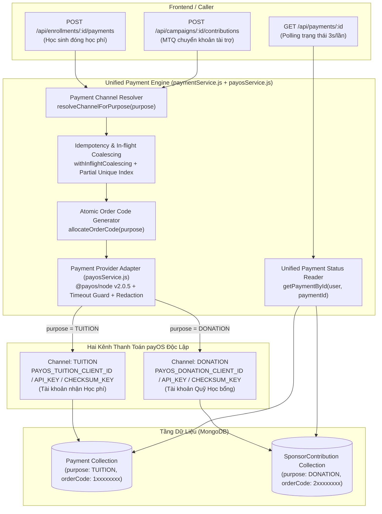

# 04 — BÁO CÁO TRIỂN KHAI PR1: UNIFIED PAYOS PAYMENT INTENT ENGINE (`TUITION` & `DONATION`)

- **Dự án:** EDUNITY V3
- **Mã nhiệm vụ:** `TIN-FIN-PR1` (`FIN-01`, `FIN-15`)
- **Người phụ trách (Owner):** Tin (Team Leader — Payment & Finance Architect)
- **Ngày hoàn thành:** 09/11/2026
- **Nhánh làm việc:** `feature/teacher-admin`

---

## 1. Kiến trúc Payment Intent Dùng Chung (Unified Payment Engine)

Hệ thống thanh toán của EDUNITY V3 được thiết kế theo mô hình **Single Unified Payment Engine** phục vụ đồng thời hai mục đích thanh toán (`purpose`) trên hai kênh payOS (`channelKey`) độc lập, nhận tiền vào hai tài khoản ngân hàng khác nhau mà **không tách thành hai hệ thống Payment rời rạc**:



### 7 thành phần cốt lõi trong Engine dùng chung:
1. **Payment Channel Resolver (`payosService.resolveChannelForPurpose`):**
   - Ánh xạ cố định ở phía Backend: `TUITION -> channelKey: "TUITION"`, `DONATION -> channelKey: "DONATION"`.
   - Tuyệt đối không cho phép Frontend truyền `channelKey`, `purpose`, `accountNumber` hay merchant credentials để ghi đè kênh nhận tiền.
2. **Payment Provider Adapter (`payosService.createPaymentLink`):**
   - Tích hợp SDK chính thức `@payos/node` (`v2.0.5`, CommonJS `const { PayOS } = require("@payos/node")`).
   - Khởi tạo và cache 2 instance `PayOS` tách biệt cho 2 kênh `TUITION` và `DONATION`.
   - Hỗ trợ chế độ **Deterministic Mock/Sandbox** (chỉ bật khi `NODE_ENV` thuộc `["development", "test"]` và `ENABLE_PAYMENT_SANDBOX !== "false"`) khi chưa cấu hình hoặc chưa bật `PAYOS_ENABLED=true`.
   - Trên môi trường `production`/`staging`, nếu chưa bật `PAYOS_ENABLED=true` thì từ chối an toàn với `403 FORBIDDEN`.
3. **Atomic Order Code Generator (`paymentService.allocateOrderCode`):**
   - Cấp phát số nguyên dương an toàn (`Number.isSafeInteger(orderCode) && orderCode > 0`) bằng lệnh nguyên tử `findOneAndUpdate(..., { $inc: { seq: 1 } }, { upsert: true, returnDocument: "after" })` trên collection `joblocks`.
   - Phân tách không gian mã đơn hàng không chồng lấn giữa hai luồng:
     - `TUITION`: `100_000_000 + seq` (dải `100000001+`)
     - `DONATION`: `200_000_000 + seq` (dải `200000001+`)
4. **Payment Intent Creator (`createTuitionPaymentIntent` & `createDonationPaymentIntent`):**
   - **Luồng `TUITION`:** Kiểm tra quyền sở hữu `Enrollment`, từ chối lớp `FREE`, kiểm tra `enrollmentStatus === "PENDING_PAYMENT"` và `holdExpiresAt > now`, tính đúng phần học phí còn thiếu (`Enrollment.tuitionAmount - scholarshipHeld`), giữ nguyên `expiredAt = Enrollment.holdExpiresAt` (không tự động gia hạn khi bấm tạo lại QR).
   - **Luồng `DONATION`:** Kiểm tra chiến dịch `ScholarshipCampaign` đang `OPEN_FOR_FUNDING` và trong thời hạn nhận tài trợ, validate số tiền `amount > 0`, hỗ trợ cờ ẩn danh `isAnonymous: true` (ẩn danh tính nhà tài trợ trên response và public view, giữ `sponsorId` nội bộ để đối soát/audit), thiết lập hạn QR 15 phút độc lập với `Enrollment`.
   - **Không gọi mạng trong Transaction DB:** Lệnh gọi `payosService.createPaymentLink` luôn nằm ngoài MongoDB transaction để không giữ lock DB khi chờ mạng.
5. **Idempotency & Concurrency Protection (`withInflightCoalescing` + Partial Unique Index):**
   - Hợp nhất các request đồng thời trong cùng tiến trình bằng khóa in-flight (`TUITION:<enrollmentId>` hoặc `DONATION:<sponsorId>:<campaignId>:<amount>:<isAnonymous>`), kết hợp với Partial Unique Index dưới DB.
   - Nếu người dùng nhấn tạo QR nhiều lần khi intent cũ vẫn đang `PENDING` và còn hạn `expiredAt > now`, hệ thống tái sử dụng ngay intent hiện hữu thay vì tạo đơn mới trên payOS.
6. **Provider Error Handler & Secret Redaction (`redactSafeMessage`):**
   - Bảo vệ timeout bằng `Promise.race` (`PAYOS_TIMEOUT_MS`, mặc định `10000ms`), trả mã lỗi `504 PAYOS_TIMEOUT`.
   - Mọi lỗi từ cổng thanh toán được chuẩn hóa về `502 PAYOS_PROVIDER_ERROR` và tự động cắt bỏ (`[REDACTED]`) toàn bộ `clientId`, `apiKey`, `checksumKey` của cả 2 kênh nếu vô tình xuất hiện trong chuỗi lỗi.
7. **Unified Payment Status Reader (`paymentService.getPaymentById`):**
   - Phục vụ `GET /api/payments/:id` choทั้ง `TUITION` (đọc từ `Payment`) và `DONATION` (đọc từ `SponsorContribution`), kiểm tra nghiêm ngặt quyền sở hữu (`STUDENT` / `SPONSOR` tạo giao dịch hoặc `ADMIN`), tính toán `remainingSeconds` theo thời gian thực để Frontend polling 3 giây/lần mà không bao giờ trả trạng thái thành công giả.

---

## 2. Hai Kênh payOS & Cách Cấu Hình

Trong kiến trúc của payOS, **mỗi kênh thanh toán (Payment Channel) được gắn cố định với một tài khoản ngân hàng thụ hưởng đã xác minh trên cổng Merchant của payOS** và được cấp một bộ 3 khóa riêng biệt (`Client ID`, `API Key`, `Checksum Key`). API tạo link thanh toán (`paymentRequests.create`) **không cho phép** gửi số tài khoản ngân hàng nhận tiền tùy ý từ request để đổi đích nhận tiền. Do đó, để nhận tiền vào 2 tài khoản ngân hàng khác nhau (1 tài khoản Học phí và 1 tài khoản Quỹ học bổng), Backend cấu hình 2 kênh độc lập trong `BackEnd/.env.example`:

```dotenv
# Công tắc tổng hoặc theo từng kênh (PAYOS_TUITION_ENABLED / PAYOS_DONATION_ENABLED)
PAYOS_ENABLED=false
PAYOS_TIMEOUT_MS=10000
PAYOS_RETURN_URL=http://localhost:5173/payment/return
PAYOS_CANCEL_URL=http://localhost:5173/payment/cancel

# Kênh 1: TUITION (Học sinh đóng học phí — Tài khoản nhận học phí)
PAYOS_TUITION_CLIENT_ID=
PAYOS_TUITION_API_KEY=
PAYOS_TUITION_CHECKSUM_KEY=
PAYOS_TUITION_RETURN_URL=http://localhost:5173/payment/return
PAYOS_TUITION_CANCEL_URL=http://localhost:5173/payment/cancel

# Kênh 2: DONATION (Mạnh Thường Quân tài trợ — Tài khoản quỹ học bổng)
PAYOS_DONATION_CLIENT_ID=
PAYOS_DONATION_API_KEY=
PAYOS_DONATION_CHECKSUM_KEY=
PAYOS_DONATION_RETURN_URL=http://localhost:5173/sponsor/contributions/return
PAYOS_DONATION_CANCEL_URL=http://localhost:5173/sponsor/contributions/cancel
```

- Toàn bộ credentials chỉ nằm ở biến môi trường Backend, tuyệt đối không lưu secrets thật vào Git và không bao giờ trả về trong API response.

---

## 3. Danh Sách Các File Đã Tạo Mới / Chỉnh Sửa

| STT | File | Trạng thái | Mô tả thay đổi |
|:---:|---|:---:|---|
| 1 | [BackEnd/package.json](file:///d:/D%E1%BB%B1%20%C3%81n/Edunity/BackEnd/package.json) | Modified | Cài đặt SDK chính thức `@payos/node` (`^2.0.5`). |
| 2 | [BackEnd/.env.example](file:///d:/D%E1%BB%B1%20%C3%81n/Edunity/BackEnd/.env.example) | Modified | Khai báo biến môi trường mẫu cho 2 kênh `PAYOS_TUITION_*` và `PAYOS_DONATION_*`. |
| 3 | [BackEnd/src/services/payosService.js](file:///d:/D%E1%BB%B1%20%C3%81n/Edunity/BackEnd/src/services/payosService.js) | **Created** | Adapter payOS 2 kênh (`TUITION`, `DONATION`), Channel Resolver, Timeout Guard, Error Classifier, Secret Redaction & Deterministic EMVCo VietQR Mock. |
| 4 | [BackEnd/src/models/Payment.js](file:///d:/D%E1%BB%B1%20%C3%81n/Edunity/BackEnd/src/models/Payment.js) | Modified | Mở rộng schema lưu `purpose`, `channelKey`, `provider`, `orderCode`, `paymentLinkId`, `qrCode`, `checkoutUrl`, `expiredAt`, `providerStatus`, `providerCreatedAt`, `providerMetadata`, `currency`; bổ sung Partial Unique Index cho `orderCode` và `{ enrollmentId: 1 }` khi `paymentStatus: "PENDING"`. |
| 5 | [BackEnd/src/models/SponsorContribution.js](file:///d:/D%E1%BB%B1%20%C3%81n/Edunity/BackEnd/src/models/SponsorContribution.js) | Modified | Mở rộng schema lưu `purpose: "DONATION"`, `channelKey: "DONATION"`, `provider`, `gateway`, `orderCode` (partial unique), `paymentLinkId`, `qrCode`, `checkoutUrl`, `expiredAt`, `providerStatus`, `currency`, `isAnonymous`, `donorDisplayName`. |
| 6 | [BackEnd/src/services/paymentService.js](file:///d:/D%E1%BB%B1%20%C3%81n/Edunity/BackEnd/src/services/paymentService.js) | Modified | Triển khai `allocateOrderCode`, `createTuitionPaymentIntent`, `createDonationPaymentIntent`, `formatPaymentIntentResponse`, `getPaymentById` dùng chung cho cả `TUITION` và `DONATION`, và guard chặn nhầm `purpose` trong `processWebhook`. |
| 7 | [BackEnd/src/controllers/paymentController.js](file:///d:/D%E1%BB%B1%20%C3%81n/Edunity/BackEnd/src/controllers/paymentController.js) | Modified | Cập nhật `createSandboxPayment` / `createPaymentIntent` trả về đầy đủ DTO VietQR & Payment Intent chuẩn hóa. |
| 8 | [BackEnd/src/services/contributionService.js](file:///d:/D%E1%BB%B1%20%C3%81n/Edunity/BackEnd/src/services/contributionService.js) | Modified | Kết nối `createContribution` vào Unified Payment Engine (`createDonationPaymentIntent`) trên kênh `DONATION`, hỗ trợ `isAnonymous` và đồng bộ `providerStatus` khi xử lý webhook. |
| 9 | [BackEnd/tests/payosUnifiedIntent.pr1.test.js](file:///d:/D%E1%BB%B1%20%C3%81n/Edunity/BackEnd/tests/payosUnifiedIntent.pr1.test.js) | **Created** | Bộ test tích hợp toàn diện cho luồng `TUITION`, `DONATION`, 2 kênh payOS độc lập, 20 request đồng thời, timeout & chống rò rỉ secret. |

---

## 4. Hợp Đồng API (API Contracts)

### 4.1. Tạo Payment Intent Học Phí (`TUITION`)
- **Endpoint:** `POST /api/enrollments/:id/payments`
- **Quyền truy cập:** `STUDENT` (chủ sở hữu `Enrollment`)
- **Kênh thanh toán:** Server tự động gán `purpose = "TUITION"`, `channelKey = "TUITION"`. Mọi trường `amount`, `channelKey`, `purpose`, `accountNumber` từ `req.body` đều bị bỏ qua.
- **Response (`201 Created`):**
```json
{
  "success": true,
  "data": {
    "paymentId": "672f10a1...",
    "purpose": "TUITION",
    "channelKey": "TUITION",
    "provider": "PAYOS",
    "gateway": "PAYOS",
    "gatewayReference": "PAYOS-T-100000001",
    "orderCode": 100000001,
    "paymentLinkId": "plink_tuition_100000001",
    "qrCode": "00020101021238570010A000000727...",
    "checkoutUrl": "https://pay.payos.vn/web/...",
    "amount": "600000",
    "currency": "VND",
    "expiredAt": "2026-11-09T04:00:00.000Z",
    "holdExpiresAt": "2026-11-09T04:00:00.000Z",
    "remainingSeconds": 899,
    "paymentStatus": "PENDING",
    "providerStatus": "PENDING",
    "enrollmentId": "672f1090...",
    "campaignId": null,
    "contributionId": null,
    "isAnonymous": false
  }
}
```

### 4.2. Tạo Payment Intent Tài Trợ Quỹ Học Bổng (`DONATION`)
- **Endpoint:** `POST /api/campaigns/:id/contributions`
- **Quyền truy cập:** `SPONSOR`
- **Request Body:**
```json
{
  "amount": 500000,
  "isAnonymous": true,
  "donorDisplayName": "Nhà hảo tâm"
}
```
- **Kênh thanh toán:** Server tự động gán `purpose = "DONATION"`, `channelKey = "DONATION"`.
- **Response (`201 Created`):**
```json
{
  "success": true,
  "data": {
    "paymentId": "672f11b2...",
    "contributionId": "672f11b2...",
    "purpose": "DONATION",
    "channelKey": "DONATION",
    "provider": "PAYOS",
    "gateway": "PAYOS",
    "gatewayReference": "CONTRIB-200000001",
    "orderCode": 200000001,
    "paymentLinkId": "plink_donation_200000001",
    "qrCode": "00020101021238570010A000000727...",
    "checkoutUrl": "https://pay.payos.vn/web/...",
    "amount": "500000",
    "currency": "VND",
    "expiredAt": "2026-11-09T04:00:00.000Z",
    "holdExpiresAt": "2026-11-09T04:00:00.000Z",
    "remainingSeconds": 899,
    "paymentStatus": "PENDING",
    "contributionStatus": "PENDING",
    "providerStatus": "PENDING",
    "enrollmentId": null,
    "campaignId": "672f0f00...",
    "isAnonymous": true,
    "donorDisplayName": "Nhà tài trợ ẩn danh"
  }
}
```

### 4.3. Truy Vấn / Polling Trạng Thái Payment Intent (`GET /api/payments/:id`)
- **Quyền truy cập:** Chủ sở hữu giao dịch (`STUDENT` đối với `TUITION`, `SPONSOR` đối với `DONATION`) hoặc `ADMIN`. Người dùng khác bị từ chối với `404 PAYMENT_NOT_FOUND` (chống IDOR).
- **Cơ chế Polling:** Cho phép Frontend gọi định kỳ ~3 giây/lần; trả về `paymentStatus` thực tế từ DB (`PENDING`, `COMPLETED`, `FAILED`, `REFUNDED`) cùng `remainingSeconds`, tuyệt đối không bao giờ tự xác nhận thành công từ thao tác polling hay `returnUrl`.

---

## 5. Thay Đổi Database, Preflight Dữ Liệu & Kế Hoạch Migration

### 5.1. Đánh giá tương thích dữ liệu Legacy
- Giữ nguyên bảng `Payment` cho giao dịch Học phí (`TUITION`) và bảng `SponsorContribution` cho giao dịch Tài trợ (`DONATION`) để không tạo bảng trùng lặp và không làm sai lệch bất kỳ truy vấn báo cáo/đối soát hiện hữu nào.
- Tất cả các trường mới thêm vào `Payment` và `SponsorContribution` đều có giá trị `default` an toàn (`purpose: "TUITION"` / `"DONATION"`, `orderCode: undefined/null`, `currency: "VND"`).
- Các bản ghi cũ trong DB không có trường `orderCode` vẫn hoạt động bình thường nhờ **Partial Unique Index** chỉ đánh index khi `{ orderCode: { $type: "number" } }`.

### 5.2. Bước Preflight dữ liệu & Migration Plan (Không tự ý chạy trên Production DB)
Trước khi triển khai index mới lên môi trường Staging/Production, Admin/DevOps chạy câu lệnh kiểm tra preflight (Read-Only) sau trên `mongosh`:
```javascript
// 1. Kiểm tra xem có Enrollment nào đang có > 1 Payment ở trạng thái PENDING hay không
db.payments.aggregate([
  { $match: { paymentStatus: "PENDING", enrollmentId: { $type: "objectId" } } },
  { $group: { _id: "$enrollmentId", count: { $sum: 1 }, ids: { $push: "$_id" } } },
  { $match: { count: { $gt: 1 } } }
]);

// 2. Kiểm tra xem có orderCode kiểu số nào bị trùng trong payments hoặc sponsorcontributions không
db.payments.aggregate([
  { $match: { orderCode: { $type: "number" } } },
  { $group: { _id: "$orderCode", count: { $sum: 1 } } },
  { $match: { count: { $gt: 1 } } }
]);
```
- Nếu bước (1) phát hiện bản ghi `PENDING` trùng lặp từ dữ liệu cũ, chỉ giữ lại bản ghi mới nhất (`createdAt` lớn nhất) và chuyển các bản ghi `PENDING` cũ hơn sang `FAILED` trước khi bật index.

---

## 6. Xử Lý Concurrency & Idempotency

1. **20 yêu cầu tạo QR đồng thời cho cùng 1 `Enrollment`:**
   - Lớp bảo vệ 1 (In-process): `withInflightCoalescing("TUITION:<enrollmentId>")` gom toàn bộ 20 request đồng thời trong cùng worker về 1 lời gọi hàm duy nhất.
   - Lớp bảo vệ 2 (Cross-process / Multi-instance): Partial Unique Index `{ enrollmentId: 1 }` với `partialFilterExpression: { paymentStatus: "PENDING", enrollmentId: { $type: "objectId" } }`. Nếu 2 instance cùng insert, instance thứ 2 bắt lỗi `E11000 duplicate key` và truy vấn trả về bản ghi thắng cuộc.
   - Kết quả: Chỉ gọi payOS **đúng 1 lần**, cấp phát **đúng 1 `orderCode`** và lưu **đúng 1 bản ghi `PENDING`**.
2. **20 yêu cầu cấp phát `orderCode` đồng thời giữa 2 luồng `TUITION` và `DONATION`:**
   - Sử dụng `$inc: { seq: 1 }` nguyên tử trong MongoDB kết hợp dải cơ sở tách biệt (`100_000_000` cho `TUITION`, `200_000_000` cho `DONATION`). Đảm bảo 100% không trùng lặp giữa các request và không bao giờ va chạm giữa 2 kênh.

---

## 7. Kết Quả Kiểm Thử Thực Tế (Isolated In-Memory MongoDB)

Toàn bộ kiểm thử được chạy trên `MongoMemoryReplSet` cô lập, không chạm tới cơ sở dữ liệu thật và không phát sinh giao dịch tiền thật:

| Bộ kiểm thử (Test Suite) | Số lượng Test | Kết quả | Thời gian |
|---|:---:|:---:|---:|
| [tests/payosUnifiedIntent.pr1.test.js](file:///d:/D%E1%BB%B1%20%C3%81n/Edunity/BackEnd/tests/payosUnifiedIntent.pr1.test.js) *(Mới — PR1)* | **10 / 10** | **PASS** | `7.87 s` |
| [tests/payment.test.js](file:///d:/D%E1%BB%B1%20%C3%81n/Edunity/BackEnd/tests/payment.test.js) | **49 / 49** | **PASS** | `56.05 s` |
| [tests/platform.test.js](file:///d:/D%E1%BB%B1%20%C3%81n/Edunity/BackEnd/tests/platform.test.js) | **15 / 15** | **PASS** | `10.34 s` |
| [tests/authorization.test.js](file:///d:/D%E1%BB%B1%20%C3%81n/Edunity/BackEnd/tests/authorization.test.js) | **66 / 66** | **PASS** | `6.83 s` |
| [tests/security.test.js](file:///d:/D%E1%BB%B1%20%C3%81n/Edunity/BackEnd/tests/security.test.js) | **25 / 25** | **PASS** | `13.93 s` |
| [tests/enrollment.test.js](file:///d:/D%E1%BB%B1%20%C3%81n/Edunity/BackEnd/tests/enrollment.test.js) | **14 / 14** | **PASS** | `4.12 s` |
| [tests/maintenanceAndFinance.test.js](file:///d:/D%E1%BB%B1%20%C3%81n/Edunity/BackEnd/tests/maintenanceAndFinance.test.js) | **5 / 5** | **PASS** | `6.53 s` |
| [tests/jobs.test.js](file:///d:/D%E1%BB%B1%20%C3%81n/Edunity/BackEnd/tests/jobs.test.js) | **7 / 7** | **PASS** | `3.95 s` |
| 10 bộ test còn lại của toàn hệ thống (`session*`, `catalog*`, `community*`, `rateLimit*`, `teacherVerification*`, `videoProvider*`) | **177 / 177** | **PASS** | `86.85 s` |
| **TỔNG CỘNG TOÀN BỘ BACKEND (`18 / 18` suites)** | **368 / 368** | **100% PASS** | `196.48 s` |

---

## 8. Những Phần Còn Thiếu (Theo Đúng Phạm Vi Giới Hạn Của PR1)

Theo đúng yêu cầu của PR1, các hạng mục sau **chưa triển khai trong PR1** và được giữ cho các PR tiếp theo:
1. **Xác thực chữ ký HMAC-SHA256 Webhook thật của payOS & bảng đối soát `BankTransferEvent` / `PaymentReconciliation`:** Sẽ triển khai trong **PR2** (`FIN-03`, `FIN-04`).
2. **Giao diện hiển thị VietQR, đếm ngược 15 phút và tự động polling 3s/lần trên Frontend:** Sẽ triển khai trong **PR4** (`FIN-02`) và **PR6** (`SPO-04`).
3. **Ví Xu, hoàn tiền tự động hoặc giải ngân Payout theo lịch Thứ Hai / Thứ Sáu:** Thuộc các PR sau (`PR7`, `PR8`).

---

## 9. Các Blocker Tích Hợp Thực Tế Từ Phía payOS

1. **Cần đăng ký 2 Kênh Thanh Toán (Payment Channels) trên payOS Merchant Portal:**
   - Vì payOS gắn mỗi cặp khóa (`Client ID`, `API Key`, `Checksum Key`) với **1 tài khoản ngân hàng thụ hưởng cố định**, chủ dự án cần tạo 2 kênh thanh toán trên dashboard `my.payos.vn`:
     - Kênh 1 liên kết tài khoản ngân hàng nhận **Học phí** -> điền vào `PAYOS_TUITION_*`.
     - Kênh 2 liên kết tài khoản ngân hàng nhận **Quỹ tài trợ học bổng** -> điền vào `PAYOS_DONATION_*`.
2. **Lưu ý về Tài khoản ảo / Tài khoản định danh (Virtual Account — VA) của payOS:**
   - Khi tạo VietQR động, payOS thường trả về số tài khoản ảo định danh theo giao dịch (ví dụ đầu số `VQR...` hoặc `CAS...` của ngân hàng trung gian/ngân hàng liên kết) trong `response.accountNumber` và trong payload webhook `data.accountNumber`, thay vì số tài khoản ngân hàng gốc của Merchant.
   - Do đó, ở PR1 hệ thống đã lưu `providerMetadata.accountNumber` và `providerMetadata.bin` trực tiếp từ phản hồi tạo link của kênh payOS tương ứng để ở PR2 đối chiếu chính xác với tài khoản của kênh đã xác minh, **không so sánh máy móc với số tài khoản gốc nếu kênh dùng Virtual Account**.

---

## 10. Đề Xuất Thiết Kế Kiến Trúc Webhook Dùng Chung Cho PR2

Trong PR2, chúng ta sẽ xây dựng **Unified payOS Webhook Processor** cho cả 2 kênh `TUITION` và `DONATION` theo luồng 5 bước an toàn sau:

1. **Nhận diện kênh thanh toán từ DB / Dải `orderCode` (Không tin dữ liệu tự khai từ request):**
   - Đọc `req.body.data.orderCode` (số nguyên dương).
   - Tra cứu bản ghi gốc trong DB (`Payment.findOne({ orderCode })` nếu thuộc dải `1xxxxxxxx`, hoặc `SponsorContribution.findOne({ orderCode })` nếu thuộc dải `2xxxxxxxx`) để lấy `purpose` và `channelKey` đã được server lưu lúc tạo Intent.
   - Nếu `orderCode` không tồn tại trong DB: thử xác minh chữ ký lần lượt với `PAYOS_TUITION_CHECKSUM_KEY` và `PAYOS_DONATION_CHECKSUM_KEY`. Nếu chữ ký hợp lệ với 1 trong 2 kênh -> ghi nhận `BankTransferEvent` (`status: "UNMATCHED"`) + tạo `PaymentReconciliation` (`reason: "UNMATCHED_ORDER_CODE"`). Nếu cả 2 đều sai chữ ký -> trả `401 UNAUTHORIZED`.
2. **Xác minh chữ ký bằng đúng `Checksum Key` của kênh đã xác định:**
   - Sử dụng `payosService.getPayosClient(channelKey).client.webhooks.verify(req.body)` (hoặc HMAC-SHA256 timing-safe với `checksumKey` của đúng kênh đó).
   - Chặn tuyệt đối trường hợp dùng chữ ký của kênh `DONATION` để xác nhận đơn `TUITION` hoặc ngược lại.
3. **Đối chiếu 3 chiều (`orderCode`, `amount`, `accountNumber` / `paymentLinkId`):**
   - Kiểm tra `webhookData.amount === toNum(intent.amount)`. Nếu lệch (`UNDERPAID` / `OVERPAID`) -> lưu `BankTransferEvent` + tạo `PaymentReconciliation` (`status: "OPEN"`), **không** xác nhận `Enrollment` hay cộng quỹ `ScholarshipCampaign`.
   - Kiểm tra `webhookData.accountNumber` khớp với `intent.providerMetadata.accountNumber` (tài khoản nhận/VA đã được payOS cấp lúc tạo link trên kênh đó) hoặc `PAYOS_<CHANNEL>_EXPECTED_ACCOUNT`.
4. **Idempotency ở tầng sự kiện ngân hàng (`BankTransferEvent`):**
   - Unique index trên `(provider, reference, orderCode)` đảm bảo mọi callback lặp lại đều trả về `IDEMPOTENT` ngay lập tức.
5. **Định tuyến hậu xác thực (Post-Verification Dispatch):**
   - Nếu `intent.purpose === "TUITION"`: Gọi `paymentService` cập nhật nguyên tử `Payment` -> `Enrollment` (`CONFIRMED`) -> `Transaction` (`ENROLLMENT_PAYMENT`) -> `TeacherEarning`.
   - Nếu `intent.purpose === "DONATION"`: Gọi `contributionService` cập nhật nguyên tử `SponsorContribution` (`COMPLETED`) -> cộng `ScholarshipCampaign.fundedAmount` -> tạo `Transaction` (`SPONSOR_CONTRIBUTION`).

---

## 11. Trạng Thái Git Cuối Cùng

- **Nhánh hiện tại:** `feature/teacher-admin`
- **Không thực hiện:** `git commit`, `git push`, `git merge`, `git checkout`, `git reset`, `git rebase`.
- **Các file thay đổi/mới của PR1:**
  - `M BackEnd/.env.example`
  - `M BackEnd/package.json`
  - `M BackEnd/package-lock.json`
  - `M BackEnd/src/models/Payment.js`
  - `M BackEnd/src/models/SponsorContribution.js`
  - `M BackEnd/src/services/paymentService.js`
  - `M BackEnd/src/services/contributionService.js`
  - `M BackEnd/src/controllers/paymentController.js`
  - `?? BackEnd/src/services/payosService.js`
  - `?? BackEnd/tests/payosUnifiedIntent.pr1.test.js`
  - `?? docs/payment-v3/04_PR1_UNIFIED_PAYOS_PAYMENT_INTENT.md`

