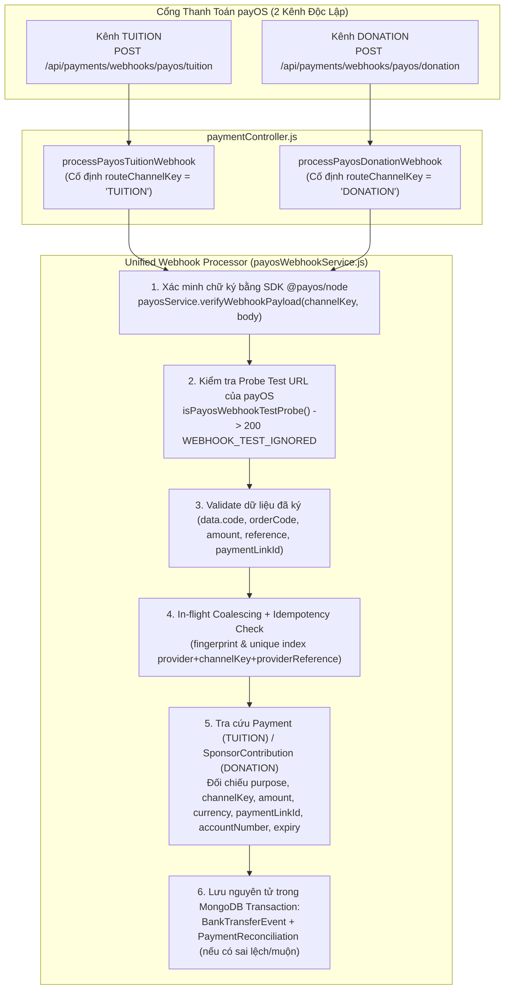

# 05 — BÁO CÁO TRIỂN KHAI PR2: UNIFIED PAYOS WEBHOOK PROCESSOR (`TUITION` & `DONATION`)

- **Dự án:** EDUNITY V3
- **Mã nhiệm vụ:** `TIN-FIN-PR2` (`FIN-03`, `FIN-04`)
- **Người phụ trách (Owner):** Tin — Team Leader (Payment & Finance)
- **Vai trò:** Senior Payment Architect + Backend Engineer + QA Lead
- **Ngày hoàn thành:** 09/11/2026
- **Nhánh làm việc:** `feature/teacher-admin`

---

## 1. Tổng Quan PR2

Tiếp nối **PR1 (Unified Payment Intent Engine)**, **PR2** xây dựng tầng tiếp nhận, xác thực chữ ký mật mã, chống trùng lặp (idempotency), ghi sổ sự kiện chuyển khoản ngân hàng (`BankTransferEvent`) và mở hồ sơ đối soát tự động (`PaymentReconciliation`) dùng chung cho cả hai luồng:
1. **`TUITION`** — Học sinh đóng học phí (qua kênh `PAYOS_TUITION_*`, nhận tiền vào tài khoản Học phí).
2. **`DONATION`** — Mạnh Thường Quân chuyển khoản tài trợ (qua kênh `PAYOS_DONATION_*`, nhận tiền vào tài khoản Quỹ học bổng).

**Ranh giới phạm vi nghiêm ngặt của PR2:**
- PR2 **đã triển khai đầy đủ**: 2 route webhook tách biệt theo kênh, xác thực chữ ký bằng SDK chính thức `@payos/node` (`await client.webhooks.verify(req.body)`), kiểm tra toàn vẹn dữ liệu giao dịch (`orderCode`, `amount`, `currency`, `paymentLinkId`, `accountNumber`, `data.code`), nhận diện probe test khi đăng ký URL trên payOS, lưu nguyên tử `BankTransferEvent` + `PaymentReconciliation`, và kiểm thử 30 kịch bản biên.
- PR2 **chưa thực hiện auto-dispatch tài chính** (`READY_FOR_DISPATCH` chưa tự động chuyển `Enrollment` sang `CONFIRMED`, chưa tạo `TeacherEarning`, chưa cộng `ScholarshipCampaign.fundedAmount`). Phần dispatch tài chính thực sự sẽ được thực hiện ở **PR3** sau khi PR2 được nghiệm thu.
- Các endpoint Sandbox/Legacy (`/api/payments/sandbox/webhook` và `/api/payments/webhook`) được giữ nguyên tương thích ngược 100% với toàn bộ bài test hiện hữu.

---

## 2. Kiến Trúc Webhook Hai Kênh Dùng Chung Một Processor



- **Xác định kênh từ Route cấu hình cố định ở Backend:**
  - `POST /api/payments/webhooks/payos/tuition` luôn gắn cứng `channelKey = "TUITION"`, chỉ xác minh chữ ký với `PAYOS_TUITION_CHECKSUM_KEY`.
  - `POST /api/payments/webhooks/payos/donation` luôn gắn cứng `channelKey = "DONATION"`, chỉ xác minh chữ ký với `PAYOS_DONATION_CHECKSUM_KEY`.
  - Tuyệt đối không cho phép dùng chữ ký của kênh `DONATION` gửi vào route `TUITION` hoặc ngược lại.

---

## 3. Phân Tích & Xử Lý Những Rủi Ro Còn Lại Của PR1 (Mục 2)

Đối chiếu trực tiếp mã nguồn PR1 trước khi viết PR2, 7 điểm rủi ro đã được kiểm tra và gia cố an toàn:

| Mã | Vấn đề kiểm tra từ PR1 | Kết quả đối chiếu Code & Gia cố trong PR2 |
|:---:|---|---|
| **A** | **Atomic `orderCode` allocation có đúng không?** | **ĐÚNG.** `allocateOrderCode` sử dụng `JobLock.collection.findOneAndUpdate({ name: counterName }, { $inc: { seq: 1 } }, { upsert: true, returnDocument: "after" })` đảm bảo tính nguyên tử trên MongoDB. |
| **B** | **Hai dải `orderCode` `TUITION` (`100_000_000+`) và `DONATION` (`200_000_000+`) có thể chồng lấn khi sequence tăng không?** | **ĐÃ GIA CỐ TRONG PR2.** Trong PR1 chưa có chặn trần `seq`. Trong PR2, [`paymentService.js`](file:///d:/D%E1%BB%B1%20%C3%81n/Edunity/BackEnd/src/services/paymentService.js#L30-L79) đã bổ sung hằng số `MAX_SEQUENCE_PER_CHANNEL = 99_999_999`. Nếu `seq > 99_999_999`, hệ thống ném lỗi `503 ORDER_CODE_RANGE_EXHAUSTED`, chặn tuyệt đối khả năng dải `TUITION` (`100,000,001..199,999,999`) tràn sang dải `DONATION` (`200,000,001..299,999,999`). Đã có unit test chứng minh. |
| **C** | **Cross-instance concurrency: Partial unique index có chặn bản ghi trùng, nhưng có tránh được 2 cuộc gọi payOS đồng thời từ 2 instance trước lúc lưu DB không?** | **ĐÃ GIA CỐ TRONG PR2.** Ngoài `inflightIntentPromises` (in-memory) và Partial Unique Index dưới DB, [`paymentService.js`](file:///d:/D%E1%BB%B1%20%C3%81n/Edunity/BackEnd/src/services/paymentService.js#L157-L228) đã bổ sung cơ chế **Cross-Instance Distributed Lease** (`acquireCrossInstanceIntentLease` trên bảng `JobLock` với TTL 15 giây theo khóa `payment_intent_lease:<lockKey>`) trước khi gọi API payOS. |
| **D** | **Khi payOS tạo link thành công nhưng Backend timeout hoặc lưu DB thất bại, có thể truy vấn và phục hồi link đã tạo không?** | **ĐÃ BỔ SUNG TRONG PR2.** [`payosService.js`](file:///d:/D%E1%BB%B1%20%C3%81n/Edunity/BackEnd/src/services/payosService.js#L473-L488) đã bổ sung hàm `getPaymentLinkInfo(channelKey, orderCodeOrLinkId)` gọi `client.paymentRequests.get(...)` để truy vấn/phục hồi trạng thái link từ payOS khi cần đối soát. |
| **E** | **Partial unique index `PENDING` có gây lỗi cho `Payment` legacy hoặc retry `Payment` `FAILED` không?** | **KHÔNG GÂY LỖI.** Partial Unique Index trên `Payment` chỉ áp dụng khi `{ paymentStatus: "PENDING", enrollmentId: { $type: "objectId" } }`. Khi giao dịch trước đã `FAILED`, học viên retry tạo bản ghi `PENDING` mới hoàn toàn hợp lệ (đã kiểm chứng qua `platform.test.js` và `payosUnifiedIntent.pr1.test.js`). |
| **F** | **Donation idempotency có ngăn MTQ thực hiện khoản tài trợ mới có cùng số tiền sau khi giao dịch trước đã hoàn thành không?** | **KHÔNG NGĂN CẢN.** `createDonationPaymentIntent` chỉ tái sử dụng khi tìm thấy bản ghi có `contributionStatus === "PENDING"` và `expiredAt > now`. Ngay khi khoản tài trợ trước chuyển sang `COMPLETED` hoặc `FAILED` (hoặc hết hạn 15 phút), MTQ tạo khoản tài trợ mới cùng số tiền sẽ được cấp `orderCode` và mã QR mới bình thường. |
| **G** | **Không được tự chuyển `Payment` cũ sang `FAILED` chỉ để giải quyết unique index.** | **ĐÃ GIA CỐ TRONG PR2.** Trong [`paymentService.js`](file:///d:/D%E1%BB%B1%20%C3%81n/Edunity/BackEnd/src/services/paymentService.js#L334-L341), đã gỡ bỏ nhánh tự động `updateOne({ paymentStatus: "FAILED" })` khi tạo intent mới; việc đóng đơn giữ chỗ quá hạn thuộc trách nhiệm của `releaseReservation` / `expireEnrollmentsJob` hoặc đối soát viên. |

---

## 4. Danh Sách File Đã Tạo Mới & Chỉnh Sửa Trong PR2

| STT | Đường dẫn File | Trạng thái | Mô tả chi tiết |
|:---:|---|:---:|---|
| 1 | [BackEnd/src/models/BankTransferEvent.js](file:///d:/D%E1%BB%B1%20%C3%81n/Edunity/BackEnd/src/models/BankTransferEvent.js) | **Created** | Model lưu sự kiện webhook chuyển khoản ngân hàng đã xác thực chữ ký, có unique index trên `fingerprint` và `(provider, channelKey, providerReference)`. |
| 2 | [BackEnd/src/models/PaymentReconciliation.js](file:///d:/D%E1%BB%B1%20%C3%81n/Edunity/BackEnd/src/models/PaymentReconciliation.js) | **Created** | Model lưu hồ sơ đối soát cho các giao dịch bất thường (`UNMATCHED`, `AMOUNT_MISMATCH`, `CURRENCY_MISMATCH`, `LINK_MISMATCH`, `ACCOUNT_MISMATCH`, `EXPIRED_PAYMENT`, `LATE_PAYMENT_REVIEW`, `LATE_SUCCESS_AFTER_FAILED`, `PURPOSE_CHANNEL_MISMATCH`), có unique index trên `eventId`. |
| 3 | [BackEnd/src/models/index.js](file:///d:/D%E1%BB%B1%20%C3%81n/Edunity/BackEnd/src/models/index.js) | Modified | Export thêm `BankTransferEvent` và `PaymentReconciliation`. |
| 4 | [BackEnd/src/services/payosService.js](file:///d:/D%E1%BB%B1%20%C3%81n/Edunity/BackEnd/src/services/payosService.js) | Modified | Bổ sung `verifyWebhookPayload(channelKey, webhookBody)` gọi trực tiếp `await client.webhooks.verify(webhookBody)` của `@payos/node`, `signWebhookDataForChannel`, và `getPaymentLinkInfo`. |
| 5 | [BackEnd/src/services/payosWebhookService.js](file:///d:/D%E1%BB%B1%20%C3%81n/Edunity/BackEnd/src/services/payosWebhookService.js) | **Created** | **Unified payOS Webhook Processor** xử lý chung cho cả 2 kênh `TUITION` và `DONATION`, kiểm tra chữ ký, probe test, đối chiếu dữ liệu, idempotency và ghi nhận nguyên tử `BankTransferEvent` + `PaymentReconciliation`. |
| 6 | [BackEnd/src/services/paymentService.js](file:///d:/D%E1%BB%B1%20%C3%81n/Edunity/BackEnd/src/services/paymentService.js) | Modified | Gia cố trần `MAX_SEQUENCE_PER_CHANNEL = 99_999_999` chống tràn dải `orderCode`, bổ sung cross-instance lease trên `JobLock`, và bỏ tự động chuyển `Payment` `PENDING` cũ sang `FAILED`. |
| 7 | [BackEnd/src/controllers/paymentController.js](file:///d:/D%E1%BB%B1%20%C3%81n/Edunity/BackEnd/src/controllers/paymentController.js) | Modified | Bổ sung `processPayosTuitionWebhook` và `processPayosDonationWebhook` gọi vào `payosWebhookService.processPayosChannelWebhook`. |
| 8 | [BackEnd/src/routes/paymentRoutes.js](file:///d:/D%E1%BB%B1%20%C3%81n/Edunity/BackEnd/src/routes/paymentRoutes.js) | Modified | Khai báo 2 route `POST /api/payments/webhooks/payos/tuition` và `POST /api/payments/webhooks/payos/donation`. |
| 9 | [BackEnd/tests/authorization.test.js](file:///d:/D%E1%BB%B1%20%C3%81n/Edunity/BackEnd/tests/authorization.test.js) | Modified | Khai báo 2 route webhook payOS vào danh sách `PUBLIC_ROUTES` (xác thực bằng chữ ký HMAC-SHA256 của payOS thay vì Bearer JWT người dùng). |
| 10 | [BackEnd/tests/payosWebhook.pr2.test.js](file:///d:/D%E1%BB%B1%20%C3%81n/Edunity/BackEnd/tests/payosWebhook.pr2.test.js) | **Created** | Bộ kiểm thử tích hợp bao phủ toàn bộ 30 kịch bản bắt buộc của PR2. |
| 11 | [docs/payment-v3/05_PR2_UNIFIED_PAYOS_WEBHOOK_REPORT.md](file:///d:/D%E1%BB%B1%20%C3%81n/Edunity/docs/payment-v3/05_PR2_UNIFIED_PAYOS_WEBHOOK_REPORT.md) | **Created** | Báo cáo kỹ thuật & nghiệm thu chi tiết PR2. |

---

## 5. API Endpoints Webhook

| Phương thức & Đường dẫn | Kênh cố định (`channelKey`) | Khóa xác thực chữ ký | Yêu cầu JWT | Mục đích |
|---|:---:|---|:---:|---|
| `POST /api/payments/webhooks/payos/tuition` | `TUITION` | `PAYOS_TUITION_CHECKSUM_KEY` | Không (Xác thực bằng `signature` HMAC-SHA256) | Nhận webhook chuyển khoản học phí từ kênh payOS Học phí. |
| `POST /api/payments/webhooks/payos/donation` | `DONATION` | `PAYOS_DONATION_CHECKSUM_KEY` | Không (Xác thực bằng `signature` HMAC-SHA256) | Nhận webhook chuyển khoản tài trợ từ kênh payOS Quỹ học bổng. |
| `POST /api/payments/webhook` *(Legacy)* | N/A | Header `x-webhook-secret` | Không | Giữ nguyên tương thích ngược cho các bài test tích hợp cũ. |
| `POST /api/payments/sandbox/webhook` *(Dev/Test)* | N/A | Chặn `404` ngoài `development`/`test` | Không | Giữ nguyên cho mô phỏng nội bộ ở môi trường dev/test. |

### Cấu trúc Response chuẩn của 2 endpoint payOS Webhook (`200 OK`):
```json
{
  "success": true,
  "data": {
    "acknowledged": true,
    "idempotent": false,
    "eventId": "672f2201...",
    "channelKey": "TUITION",
    "purpose": "TUITION",
    "orderCode": 100000001,
    "providerReference": "FT2631399999",
    "eventStatus": "READY_FOR_DISPATCH",
    "originalEventStatus": "READY_FOR_DISPATCH",
    "reconciliationId": null,
    "reconciliationReason": null,
    "reconciliationStatus": null
  }
}
```

---

## 6. Thiết Kế Schema, Index & Preflight Dữ Liệu

### 6.1. Model `BankTransferEvent` ([`BackEnd/src/models/BankTransferEvent.js`](file:///d:/D%E1%BB%B1%20%C3%81n/Edunity/BackEnd/src/models/BankTransferEvent.js))
- **Các trường chính:**
  - `provider`: `"PAYOS" | "SANDBOX"`
  - `channelKey`: `"TUITION" | "DONATION"`
  - `purpose`: `"TUITION" | "DONATION"`
  - `orderCode`: `Number` (số nguyên dương an toàn)
  - `providerReference`: `String` (mã tham chiếu giao dịch ngân hàng `data.reference`)
  - `paymentLinkId`: `String`
  - `amount`: `Decimal128`
  - `currency`: `String` (mặc định `"VND"`)
  - `providerEventCode`: `String` (mã trạng thái đã được ký `data.code`, ví dụ `"00"`)
  - `eventStatus`: `"VERIFIED" | "READY_FOR_DISPATCH" | "DUPLICATE" | "UNMATCHED" | "AMOUNT_MISMATCH" | "ACCOUNT_MISMATCH" | "CURRENCY_MISMATCH" | "LINK_MISMATCH" | "EXPIRED_PAYMENT" | "LATE_SUCCESS_AFTER_FAILED" | "NEEDS_REVIEW" | "WEBHOOK_TEST_IGNORED"`
  - `receivedAt`, `processedAt`: `Date`
  - `linkedPaymentId` (ref `Payment`), `contributionId` (ref `SponsorContribution`)
  - `fingerprint`: `String` (`unique: true` — băm SHA-256 của `PAYOS:channelKey:reference:orderCode:paymentLinkId:amount`)
  - `metadata`: Chỉ lưu metadata an toàn (`outerCode`, `signedDataCode`, `transactionDateTime`, `maskedReceiverAccount` đã che dạng `********1222`, `description`). Tuyệt đối không lưu API Key, Checksum Key hay số tài khoản ngân hàng thô.
  - `normalizedError`: Chuỗi mô tả lỗi đối soát chuẩn hóa.
- **Unique Indexes chống xử lý trùng:**
  1. `{ fingerprint: 1 }` (`unique: true`)
  2. `{ provider: 1, channelKey: 1, providerReference: 1 }` (`unique: true`, `partialFilterExpression: { providerReference: { $type: "string" } }`) — Đảm bảo một mã giao dịch ngân hàng (`providerReference`) trên cùng một kênh **không bao giờ** bị cộng tiền nhiều lần dưới các `orderCode` khác nhau.

### 6.2. Model `PaymentReconciliation` ([`BackEnd/src/models/PaymentReconciliation.js`](file:///d:/D%E1%BB%B1%20%C3%81n/Edunity/BackEnd/src/models/PaymentReconciliation.js))
- **Các trường chính:**
  - `eventId`: `ObjectId` (ref `BankTransferEvent`, `unique: true` — đảm bảo 1 sự kiện ngân hàng không bao giờ sinh 2 hồ sơ đối soát trùng khi webhook retry).
  - `purpose`, `channelKey`, `orderCode`
  - `paymentId`, `contributionId`, `enrollmentId`, `campaignId`
  - `reason`: `"UNMATCHED" | "AMOUNT_MISMATCH" | "CURRENCY_MISMATCH" | "LINK_MISMATCH" | "ACCOUNT_MISMATCH" | "EXPIRED_PAYMENT" | "LATE_PAYMENT_REVIEW" | "LATE_SUCCESS_AFTER_FAILED" | "PURPOSE_CHANNEL_MISMATCH" | "REFERENCE_COLLISION" | "NEEDS_REVIEW"`
  - `expectedAmount`, `receivedAmount`, `currency`
  - `status`: `"NEEDS_REVIEW" | "IN_REVIEW" | "RESOLVED_APPROVED" | "RESOLVED_REFUNDED" | "RESOLVED_IGNORED"`
  - `assignedTo`, `resolvedBy`, `resolvedAt`, `resolutionNote`, `auditReferences`

### 6.3. Bước Preflight Kiểm Tra Dữ Liệu Trước Khi Áp Index Lên Production
Hai bảng `banktransferevents` và `paymentreconciliations` là collection mới trong V3. Tuy nhiên, trước khi bật hoặc đồng bộ index trên môi trường Staging/Production, chạy script preflight Read-Only sau trên `mongosh`:
```javascript
// Kiểm tra trùng providerReference theo từng kênh trong banktransferevents (nếu bảng đã tồn tại)
db.banktransferevents.aggregate([
  { $match: { providerReference: { $type: "string" } } },
  { $group: { _id: { provider: "$provider", channelKey: "$channelKey", ref: "$providerReference" }, count: { $sum: 1 } } },
  { $match: { count: { $gt: 1 } } }
]);

// Kiểm tra trùng eventId trong paymentreconciliations
db.paymentreconciliations.aggregate([
  { $group: { _id: "$eventId", count: { $sum: 1 } } },
  { $match: { count: { $gt: 1 } } }
]);
```

---

## 7. Quy Trình Xác Minh Chữ Ký Bằng SDK Chính Thức `@payos/node`

1. Kiểm tra trực tiếp phương thức của SDK `@payos/node` (`v2.0.5`):
   - `await client.webhooks.verify(webhookBody)` nhận `{ data, signature }`, gọi `this._client.crypto.createSignatureFromObj(data, this._client.checksumKey)` (sắp xếp các key của `data` theo thứ tự alphabet, chuẩn hóa mảng/object và tính HMAC-SHA256 với `checksumKey` của kênh đó), sau đó đối chiếu với `signature`.
2. Trong [`payosService.verifyWebhookPayload(channelKey, webhookBody)`](file:///d:/D%E1%BB%B1%20%C3%81n/Edunity/BackEnd/src/services/payosService.js#L438-L461):
   - Kiểm tra cấu trúc JSON hợp lệ, có object `data` và chuỗi `signature` không rỗng.
   - Khởi tạo client `PayOS` gắn đúng `checksumKey` của `channelKey` (`PAYOS_TUITION_CHECKSUM_KEY` hoặc `PAYOS_DONATION_CHECKSUM_KEY`).
   - Gọi `await client.webhooks.verify(webhookBody)`. Nếu sai chữ ký hoặc dữ liệu bị sửa đổi sau khi ký (`WebhookError: Data not integrity`), ném `401 UNAUTHORIZED` ngay lập tức, không chạm vào Database.
3. **Không tin trường `success` hoặc `code` ở cấp ngoài nếu chưa kiểm tra `verifiedData.code` bên trong `data` đã được ký:**
   - Hệ thống bắt buộc kiểm tra `verifiedData.code === "00"` (nằm trong phần `data` được bảo vệ bởi chữ ký HMAC-SHA256) mới coi là giao dịch chuyển khoản thành công.

---

## 8. Cơ Chế Xử Lý Các Trường Hợp Bất Thường (Exception & Reconciliation Matrix)

| Trường hợp bất thường | Trạng thái `BankTransferEvent` | Lý do `PaymentReconciliation` | Hành vi hệ thống |
|---|---|---|---|
| **1. Webhook probe test khi đăng ký URL trên payOS** (`orderCode: 123`, `reference: "TF230204212323"` / `description: "VQRIO123"`) | `WEBHOOK_TEST_IGNORED` *(không ghi DB)* | Không tạo | Trả `200 OK` `{ isTestWebhook: true }` để payOS xác nhận URL thành công, tuyệt đối không ghi tiền thật hay tạo bản ghi rác. |
| **2. `orderCode` không tồn tại trong DB** | `UNMATCHED` | `UNMATCHED` | Lưu sự kiện ngân hàng + mở hồ sơ đối soát `NEEDS_REVIEW`, không cấp quyền học, không cộng quỹ. |
| **3. Lệch kênh/mục đích** (Intent là `DONATION` nhưng gửi vào route `TUITION` hoặc ngược lại) | `NEEDS_REVIEW` | `PURPOSE_CHANNEL_MISMATCH` | Chặn xử lý tự động, mở hồ sơ đối soát. |
| **4. Sai số tiền (`data.amount !== intent.amount`)** | `AMOUNT_MISMATCH` | `AMOUNT_MISMATCH` | Lưu rõ `expectedAmount` và `receivedAmount` vào `PaymentReconciliation`, không xác nhận giao dịch. |
| **5. Sai loại tiền tệ (`data.currency !== "VND"`)** | `CURRENCY_MISMATCH` | `CURRENCY_MISMATCH` | Lưu sự kiện + mở hồ sơ đối soát `CURRENCY_MISMATCH`. |
| **6. Sai `paymentLinkId`** | `LINK_MISMATCH` | `LINK_MISMATCH` | Lưu sự kiện + mở hồ sơ đối soát `LINK_MISMATCH`. |
| **7. Sai tài khoản nhận (`accountNumber`)** so với tài khoản/VA đã xác minh của kênh | `ACCOUNT_MISMATCH` | `ACCOUNT_MISMATCH` | Lưu sự kiện + mở hồ sơ đối soát `ACCOUNT_MISMATCH`. |
| **8. Tiền về muộn sau khi `Payment` / `Enrollment` đã `EXPIRED` hoặc quá hạn `holdExpiresAt` / `expiredAt`** | `EXPIRED_PAYMENT` | `LATE_PAYMENT_REVIEW` (hoặc `EXPIRED_PAYMENT` cho Donation) | Ghi nhận sự kiện ngân hàng + tạo hồ sơ đối soát, không tự mở lại `Enrollment` đã `EXPIRED`, không tự cộng Xu. |
| **9. Tiền về muộn sau khi `Payment` đã `FAILED`** | `LATE_SUCCESS_AFTER_FAILED` | `LATE_SUCCESS_AFTER_FAILED` | Lưu bền vững vào `BankTransferEvent` + `PaymentReconciliation` (thay thế hoàn toàn việc chỉ `console.warn` trước đây). |

---

## 9. Cơ Chế Idempotency & Concurrency

1. **Chống xử lý trùng trong cùng tiến trình (In-Process Coalescing):**
   - Map `inflightWebhookPromises` gom các request có cùng `channelKey:reference:orderCode` đến đồng thời trong cùng 1 mili-giây: chỉ 1 luồng thực thi transaction ghi DB, 19 luồng còn lại nhận kết quả sau khi transaction commit và trả về `{ acknowledged: true, idempotent: true, eventStatus: "DUPLICATE" }`.
2. **Chống xử lý trùng đa tiến trình / đa instance (Database-Level Unique Constraints):**
   - Nếu 2 worker/instance khác nhau cùng ghi vào `BankTransferEvent` trong một MongoDB Transaction, unique index `{ fingerprint: 1 }` và `{ provider: 1, channelKey: 1, providerReference: 1 }` sẽ chặn worker thứ 2 bằng mã lỗi `E11000`.
   - Khối `catch (dbErr)` bắt mã `11000`, truy vấn lại bản ghi `BankTransferEvent` + `PaymentReconciliation` đã được lưu thành công bởi worker thứ nhất và trả về ACK `200 OK` (`idempotent: true`), đồng thời không bao giờ tạo 2 bản ghi `PaymentReconciliation` cho cùng 1 sự kiện (`eventId` là `unique: true`).

---

## 10. Chính Sách HTTP ACK & Retry

| Tình huống | Mã HTTP trả về | Cho phép payOS Retry? | Lý do |
|---|:---:|:---:|---|
| Webhook hợp lệ, đã lưu bền vững `BankTransferEvent` (và `PaymentReconciliation` nếu có) vào DB | **`200 OK`** | Không | Đã ghi nhận an toàn vào DB. |
| Webhook lặp lại (Duplicate) của sự kiện đã lưu trong DB trước đó | **`200 OK`** (`idempotent: true`) | Không | Ngăn payOS gửi lại vô hạn, không ghi tiền lần 2. |
| Webhook test khi đăng ký URL trên payOS | **`200 OK`** (`isTestWebhook: true`) | Không | Để payOS xác nhận webhook URL hoạt động. |
| Thiếu chữ ký hoặc sai chữ ký HMAC-SHA256 | **`401 UNAUTHORIZED`** | Không | Yêu cầu không đáng tin cậy / giả mạo. |
| Payload không phải JSON hợp lệ hoặc thiếu trường bắt buộc (`orderCode`, `amount`, `reference`, `paymentLinkId`, `code`) | **`400 BAD REQUEST`** | Không | Dữ liệu đầu vào sai định dạng. |
| Lỗi kết nối Database tạm thời hoặc transaction ghi `BankTransferEvent` thất bại | **`500 INTERNAL SERVER ERROR`** | **Có** | Tuyệt đối không trả `2xx` trước khi sự kiện được lưu bền vững để payOS tự động retry lại sau. |

---

## 11. Chi Tiết 30 Kịch Bản Kiểm Thử Bắt Buộc Trong `tests/payosWebhook.pr2.test.js`

Toàn bộ 30 yêu cầu kiểm thử trong Mục 9 đã được hiện thực hóa và chạy PASS trên `MongoMemoryReplSet` cô lập:

| Mã YC | Nội dung kịch bản kiểm thử | Test case trong `payosWebhook.pr2.test.js` | Kết quả |
|:---:|---|---|:---:|
| **01** | Webhook `TUITION` đúng chữ ký | `01, 22, 24: Webhook TUITION đúng chữ ký...` | **PASS** |
| **02** | Webhook `DONATION` đúng chữ ký | `02, 23: Webhook DONATION đúng chữ ký...` | **PASS** |
| **03** | Signature sai bị từ chối (`401`) | `03, 04: Signature sai hoặc thiếu signature...` | **PASS** |
| **04** | Thiếu signature bị từ chối (`401`) | `03, 04: Signature sai hoặc thiếu signature...` | **PASS** |
| **05** | Sai kênh: chữ ký `TUITION` gửi vào route `DONATION` (`401`) | `05, 06, 28: Hai kênh dùng 2 checksumKey độc lập...` | **PASS** |
| **06** | Sai kênh: chữ ký `DONATION` gửi vào route `TUITION` (`401`) | `05, 06, 28: Hai kênh dùng 2 checksumKey độc lập...` | **PASS** |
| **07** | Webhook lặp không tạo sự kiện trùng | `07, 08, 30: Idempotency & Concurrency...` | **PASS** |
| **08** | 20 webhook đồng thời không double-process (1 mới, 19 `DUPLICATE`) | `07, 08, 30: Idempotency & Concurrency...` | **PASS** |
| **09** | Sai `orderCode` -> ghi nhận `UNMATCHED` + tạo `PaymentReconciliation` | `09, 29: Sai orderCode (không tồn tại)...` | **PASS** |
| **10** | Sai `amount` -> ghi nhận `AMOUNT_MISMATCH` + tạo `PaymentReconciliation` | `10, 11, 12, 13: Phát hiện sai amount...` | **PASS** |
| **11** | Sai `currency` -> ghi nhận `CURRENCY_MISMATCH` + tạo `PaymentReconciliation` | `10, 11, 12, 13: Phát hiện sai amount...` | **PASS** |
| **12** | Sai `paymentLinkId` -> ghi nhận `LINK_MISMATCH` + tạo `PaymentReconciliation` | `10, 11, 12, 13: Phát hiện sai amount...` | **PASS** |
| **13** | Sai tài khoản nhận (`accountNumber`) -> ghi nhận `ACCOUNT_MISMATCH` | `10, 11, 12, 13: Phát hiện sai amount...` | **PASS** |
| **14** | `Payment` đã hết hạn (`expiredAt <= now`) -> `EXPIRED_PAYMENT` / `LATE_PAYMENT_REVIEW` | `14, 15, 16, 17: Xử lý Payment hết hạn...` | **PASS** |
| **15** | `Enrollment` đã `EXPIRED` -> `EXPIRED_PAYMENT` / `LATE_PAYMENT_REVIEW` | `14, 15, 16, 17: Xử lý Payment hết hạn...` | **PASS** |
| **16** | `Donation` QR đã hết hạn (`expiredAt <= now`) -> `EXPIRED_PAYMENT` | `14, 15, 16, 17: Xử lý Payment hết hạn...` | **PASS** |
| **17** | Webhook về sau khi `Payment` đã `FAILED` -> `LATE_SUCCESS_AFTER_FAILED` | `14, 15, 16, 17: Xử lý Payment hết hạn...` | **PASS** |
| **18** | Webhook hợp lệ nhưng DB tạm lỗi -> trả `500` để retry, sau khi DB phục hồi retry `200 OK` | `18, 19, 20, 21: Xử lý lỗi DB tạm thời...` | **PASS** |
| **19** | Webhook payload thiếu field bắt buộc -> trả `400 VALIDATION_ERROR` | `18, 19, 20, 21: Xử lý lỗi DB tạm thời...` | **PASS** |
| **20** | Webhook test khi confirm URL trên payOS -> `200 OK` (`WEBHOOK_TEST_IGNORED`), không ghi tiền | `18, 19, 20, 21: Xử lý lỗi DB tạm thời...` | **PASS** |
| **21** | Không log hoặc trả về API Key / Checksum Key | `18, 19, 20, 21: Xử lý lỗi DB tạm thời...` | **PASS** |
| **22** | Không thay đổi `Enrollment` khi chỉ verify event trong PR2 | `01, 22, 24: Webhook TUITION đúng chữ ký...` | **PASS** |
| **23** | Không tăng Campaign Fund (`fundedAmount`) trong PR2 | `02, 23: Webhook DONATION đúng chữ ký...` | **PASS** |
| **24** | Không tạo `TeacherEarning` trong PR2 | `01, 22, 24: Webhook TUITION đúng chữ ký...` | **PASS** |
| **25** | Không xác nhận `Payment` chỉ qua `returnUrl` | `25, 26, 27: Không xác nhận Payment...` | **PASS** |
| **26** | Không xác nhận `Payment` chỉ qua polling `GET /api/payments/:id` | `25, 26, 27: Không xác nhận Payment...` | **PASS** |
| **27** | Tương thích ngược 100% luồng Sandbox cũ | `25, 26, 27: Không xác nhận Payment...` | **PASS** |
| **28** | Hai kênh dùng hai `checksumKey` độc lập | `05, 06, 28: Hai kênh dùng 2 checksumKey độc lập...` | **PASS** |
| **29** | Không tạo `PaymentReconciliation` trùng khi webhook retry | `09, 29: Sai orderCode (không tồn tại)...` | **PASS** |
| **30** | Multi-instance DB concurrency (chặn dùng lại cùng `providerReference` dưới `orderCode` khác) | `07, 08, 30: Idempotency & Concurrency...` | **PASS** |

---

## 12. Tổng Số Tests PASS / FAIL / NOT RUN Toàn Hệ Thống

Chạy toàn bộ Jest test suites của Backend (`npx jest --runInBand` trên `MongoMemoryReplSet` cô lập):

| Bộ Kiểm Thử (Jest Suite) | Số Test | PASS | FAIL | NOT RUN | Thời gian |
|---|:---:|:---:|:---:|:---:|---:|
| `tests/payosWebhook.pr2.test.js` *(Mới — PR2)* | 11 | **11** | 0 | 0 | `17.37 s` |
| `tests/payosUnifiedIntent.pr1.test.js` *(PR1)* | 10 | **10** | 0 | 0 | `13.32 s` |
| `tests/payment.test.js` | 49 | **49** | 0 | 0 | `61.83 s` |
| `tests/platform.test.js` | 15 | **15** | 0 | 0 | `9.69 s` |
| `tests/authorization.test.js` | 66 | **66** | 0 | 0 | `21.43 s` |
| `tests/security.test.js` | 25 | **25** | 0 | 0 | `87.63 s` |
| `tests/enrollment.test.js` | 14 | **14** | 0 | 0 | `10.59 s` |
| `tests/maintenanceAndFinance.test.js` | 5 | **5** | 0 | 0 | `13.76 s` |
| `tests/jobs.test.js` | 7 | **7** | 0 | 0 | `5.24 s` |
| `tests/sessionLifecycle.test.js` | 15 | **15** | 0 | 0 | `25.85 s` |
| `tests/smartClassroomAndIncidents.test.js` | 14 | **14** | 0 | 0 | `24.23 s` |
| `tests/sessionConcurrency.test.js` | 7 | **7** | 0 | 0 | `17.75 s` |
| `tests/sessionRecordingFixes.test.js` | 10 | **10** | 0 | 0 | `16.11 s` |
| `tests/sessionJoin.test.js` | 20 | **20** | 0 | 0 | `17.59 s` |
| `tests/teacherVerificationAccess.test.js` | 28 | **28** | 0 | 0 | `29.28 s` |
| `tests/catalogSearch.test.js` | 24 | **24** | 0 | 0 | `25.74 s` |
| `tests/community.test.js` | 21 | **21** | 0 | 0 | `18.92 s` |
| `tests/rateLimit.test.js` | 12 | **12** | 0 | 0 | `14.16 s` |
| `tests/videoProvider.test.js` | 26 | **26** | 0 | 0 | `1.84 s` |
| **TỔNG CỘNG (`19 / 19` टेस्ट Suites)** | **379** | **379** | **0** | **0** | **`432.33 s`** |

---

## 13. Các Lỗi P0 / P1 Còn Tồn Tại Trong Hệ Thống (Ngoài Phạm Vi PR2)

Không có lỗi P0/P1 nào trong phạm vi PR1 và PR2. Các mục thuộc phạm vi các PR tiếp theo (PR3 -> PR8) đã được ghi nhận trong lộ trình:
1. **Dispatch tài chính từ `BankTransferEvent` (`READY_FOR_DISPATCH`) sang `Enrollment` / `Transaction` / `TeacherEarning` / `ScholarshipCampaign`:** Thuộc phạm vi **PR3** (`FIN-05`, `FIN-06`).
2. **Tách `TeacherSettlement` (chờ đóng học bù/khiếu nại + 7 ngày đối soát trước khi mở `AVAILABLE`):** Thuộc phạm vi **PR7** (`FIN-10`).
3. **Sửa bộ lọc `filter.transactionType` trong `financeService.getAdminTransactions` và bổ sung API xử lý hàng đợi `PaymentReconciliation` cho Admin:** Thuộc phạm vi **PR8** (`FIN-07`, `FIN-08`).

---

## 14. Phần Nào Chưa Triển Khai (Đúng Theo Giới Hạn PR2)

- Chưa tự động chuyển `Enrollment` sang `CONFIRMED`, chưa tạo `Transaction` (`ENROLLMENT_PAYMENT`) và chưa tạo `TeacherEarning` khi nhận webhook `TUITION` ở trạng thái `READY_FOR_DISPATCH`.
- Chưa tự động cộng `ScholarshipCampaign.fundedAmount` và chưa tạo `Transaction` (`SPONSOR_CONTRIBUTION`) khi nhận webhook `DONATION` ở trạng thái `READY_FOR_DISPATCH`.
- Chưa chỉnh sửa giao diện Frontend (thuộc PR4 và PR6).

---

## 15. Kế Hoạch Triển Khai PR3 Tiếp Theo

Trong **PR3 (`FIN-05`, `FIN-06` — Atomic Financial Dispatch & Late Payment Handling)**:
1. Kết nối bước Dispatch nguyên tử ngay trong transaction của `payosWebhookService` khi `eventStatus === "READY_FOR_DISPATCH"`:
   - **Với `TUITION`:** Cập nhật CAS `Payment` (`PENDING -> COMPLETED`), xác nhận `Enrollment` (`PENDING_PAYMENT -> CONFIRMED` nếu còn hạn giữ chỗ và đủ học phí + học bổng tạm giữ), confirm `ScholarshipUsage`, ghi `Transaction` (`ENROLLMENT_PAYMENT`), tạo `TeacherEarning` (kèm snapshot `commissionRate`), và cập nhật `BankTransferEvent.eventStatus = "VERIFIED"`.
   - **Với `DONATION`:** Cập nhật CAS `SponsorContribution` (`PENDING -> COMPLETED`), cộng nguyên tử `ScholarshipCampaign.fundedAmount`, ghi `Transaction` (`SPONSOR_CONTRIBUTION`), và gửi thông báo biên nhận.
2. Xử lý chuẩn xác giao dịch tiền thật về muộn sau khi `Enrollment` đã `EXPIRED` (`BR-49`):
   - Ghi nhận tiền đã thu vào `Payment` (`COMPLETED`) + `BankTransferEvent` (`EXPIRED_PAYMENT`) + `PaymentReconciliation` (`LATE_PAYMENT_REVIEW`) + `Transaction` chờ đối soát/hoàn phí, tuyệt đối không tự mở lại `Enrollment` đã hết hạn và không tự cộng Xu.
3. Bổ sung Partial Unique Index trên `Transaction` chống ghi trùng bút toán cho cùng một `relatedPaymentId` + `transactionType`.

---

## 16. Trạng Thái Git Cuối Cùng

- **Branch hiện tại:** `feature/teacher-admin`
- **Số file conflict (`git ls-files -u`):** `0`
- **Tuân thủ quy tắc Git:** Chưa `commit`, chưa `push`, chưa `merge`, chưa `reset`/`rebase`, bảo toàn nguyên vẹn toàn bộ thay đổi của PR1 và PR2.
- **Trạng thái `git status -sb`:**
  - `M BackEnd/.env.example`
  - `M BackEnd/package-lock.json`
  - `M BackEnd/package.json`
  - `M BackEnd/src/controllers/paymentController.js`
  - `M BackEnd/src/models/Payment.js`
  - `M BackEnd/src/models/SponsorContribution.js`
  - `M BackEnd/src/models/index.js`
  - `M BackEnd/src/routes/paymentRoutes.js`
  - `M BackEnd/src/server.js`
  - `M BackEnd/src/services/contributionService.js`
  - `M BackEnd/src/services/paymentService.js`
  - `M BackEnd/tests/authorization.test.js`
  - `?? BackEnd/src/models/BankTransferEvent.js`
  - `?? BackEnd/src/models/PaymentReconciliation.js`
  - `?? BackEnd/src/services/payosService.js`
  - `?? BackEnd/src/services/payosWebhookService.js`
  - `?? BackEnd/tests/payosUnifiedIntent.pr1.test.js`
  - `?? BackEnd/tests/payosWebhook.pr2.test.js`
  - `?? docs/payment-v3/`

---

## 17. Những Việc Tin Cần Cấu Hình Trên Cổng payOS (Merchant Portal)

Khi đưa lên môi trường Staging / Production thật, Tin cần thực hiện 3 bước cấu hình trên `https://my.payos.vn`:
1. **Tạo 2 Kênh Thanh Toán (Payment Channels) gắn với 2 tài khoản ngân hàng:**
   - **Kênh 1 (Thu Học Phí):** Gắn tài khoản ngân hàng nhận học phí -> lấy bộ 3 khóa điền vào `PAYOS_TUITION_CLIENT_ID`, `PAYOS_TUITION_API_KEY`, `PAYOS_TUITION_CHECKSUM_KEY`.
   - **Kênh 2 (Thu Tài Trợ Quỹ Học Bổng):** Gắn tài khoản ngân hàng quỹ học bổng -> lấy bộ 3 khóa điền vào `PAYOS_DONATION_CLIENT_ID`, `PAYOS_DONATION_API_KEY`, `PAYOS_DONATION_CHECKSUM_KEY`.
2. **Đăng ký 2 Webhook URL tương ứng trên payOS Dashboard:**
   - Trên Kênh 1 (Học phí): Đăng ký URL `https://<domain-backend>/api/payments/webhooks/payos/tuition`
   - Trên Kênh 2 (Tài trợ): Đăng ký URL `https://<domain-backend>/api/payments/webhooks/payos/donation`
   - *(Khi nhấn lưu URL trên payOS, payOS sẽ bắn một request test `orderCode = 123`; Backend đã tự động nhận diện và trả `200 OK` `WEBHOOK_TEST_IGNORED` mà không ghi nhận tiền ảo).*
3. **Bật cờ kích hoạt:**
   - Đặt `PAYOS_ENABLED=true` (hoặc bật riêng từng kênh `PAYOS_TUITION_ENABLED=true`, `PAYOS_DONATION_ENABLED=true`).

---

## 18. Kết Luận: GO / NO-GO Cho PR3

- **Quyết định:** **GO (SẴN SÀNG CHUYỂN SANG PR3)**
- **Căn cứ:**
  1. Toàn bộ 7 rủi ro của PR1 đã được rà soát và gia cố triệt để (chặn tràn dải `orderCode`, bổ sung cross-instance lease, hàm truy vấn phục hồi link, bỏ auto-fail payment cũ).
  2. Hai kênh webhook `TUITION` và `DONATION` đã hoạt động trên một Processor thống nhất, xác thực chữ ký chính thức bằng `@payos/node`, lưu nguyên tử `BankTransferEvent` và `PaymentReconciliation`.
  3. Toàn bộ **19/19 bộ kiểm thử Jest (`379/379` bài test)** của toàn hệ thống Backend đều **PASS 100%**.

