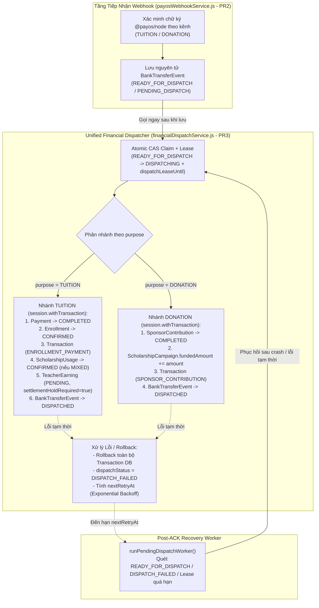

# 06 — BÁO CÁO TRIỂN KHAI PR3: ATOMIC FINANCIAL DISPATCH (`TUITION` & `DONATION`), XỬ LÝ GIAO DỊCH ĐẾN MUỘN & CƠ CHẾ OUTBOX PHỤC HỒI SAU ACK

- **Dự án:** EDUNITY V3
- **Mã nhiệm vụ:** `TIN-FIN-PR3`
- **Mã Backlog:** `FIN-05`, `FIN-06`, `FIN-16`
- **Người phụ trách (Owner):** Tin — Team Leader (Payment & Finance)
- **Vai trò:** Senior Payment Architect + Backend Engineer + QA Lead
- **Ngày hoàn thành:** 09/11/2026
- **Nhánh làm việc:** `feature/teacher-admin`

---

## 1. Tổng Quan PR3

Sau khi **PR1** xây dựng **Unified Payment Intent Engine** và **PR2** triển khai **Unified payOS Webhook Processor** (xác thực chữ ký mật mã theo kênh, ghi nhận `BankTransferEvent`, mở hồ sơ `PaymentReconciliation` cho các sai lệch), **PR3** hoàn thiện mắt xích quan trọng nhất của lõi tài chính **EDUNITY V3**: **Unified Atomic Financial Dispatcher & Post-ACK Outbox Recovery**.

PR3 giải quyết trọn vẹn 3 bài toán cốt lõi (`FIN-05`, `FIN-06`, `FIN-16`):
1. **Hạch toán nguyên tử (`TUITION` & `DONATION`) từ sự kiện ngân hàng đã xác thực (`READY_FOR_DISPATCH`):**
   - **`TUITION`:** `BankTransferEvent` (`READY_FOR_DISPATCH`) $\rightarrow$ `Payment` (`COMPLETED`) $\rightarrow$ `Enrollment` (`CONFIRMED`, `holdExpiresAt = null`) $\rightarrow$ `ScholarshipUsage` (`CONFIRMED`, nếu `MIXED`) $\rightarrow$ `Transaction` (`ENROLLMENT_PAYMENT` + `SCHOLARSHIP_USAGE`) $\rightarrow$ `TeacherEarning` (`PENDING`, gắn cờ `settlementHoldRequired: true`).
   - **`DONATION`:** `BankTransferEvent` (`READY_FOR_DISPATCH`) $\rightarrow$ `SponsorContribution` (`COMPLETED`) $\rightarrow$ `ScholarshipCampaign.fundedAmount` tăng nguyên tử $\rightarrow$ `Transaction` (`SPONSOR_CONTRIBUTION`) $\rightarrow$ Cập nhật số liệu báo cáo nhà tài trợ (`getMyContributions`, `getCampaignImpact`).
2. **Xử lý an toàn giao dịch đến muộn và trạng thái bất thường (`FIN-06` / `BR-49`):**
   - Tuyệt đối không làm mất dấu vết tiền thật, không tự động mở lại `Enrollment` đã `EXPIRED` (tránh vượt `Class.capacity`), không tạo `TeacherEarning` khi chưa `CONFIRMED`, không tự hoàn tiền ngân hàng, và không tự cộng Xu.
3. **Cơ chế Outbox / Worker Recovery sau khi đã trả HTTP 200 ACK cho payOS (P0 Requirement):**
   - Đảm bảo nếu tiến trình Backend crash hoặc gặp lỗi DB tạm thời ngay sau khi đã lưu `BankTransferEvent` và trả `200 OK` cho payOS (lúc này payOS sẽ không gửi lại webhook), worker phục hồi `runPendingDispatchWorker()` vẫn tự động quét, giành quyền xử lý nguyên tử (Distributed CAS Lease) và hoàn tất hạch toán 100%.

---

## 2. Kiến Trúc Unified Financial Dispatcher

---

## 3. Luồng Hạch Toán Chi Tiết Của `TUITION` (Direct Payment)

Khi một `BankTransferEvent` hợp lệ có `purpose = "TUITION"`, `channelKey = "TUITION"`, `eventStatus = "READY_FOR_DISPATCH"` được chuyển vào `dispatchTuitionWithinTransaction(eventDoc, session)`:

1. **Kiểm tra điều kiện tiên quyết trong Transaction:**
   - Tra cứu `Payment` theo `linkedPaymentId` / `orderCode`; kiểm tra `Payment.purpose === "TUITION"`, `Payment.channelKey === "TUITION"`, `Payment.paymentStatus === "PENDING"`.
   - Tra cứu `Enrollment` và `Class`; kiểm tra `Class.classType === "PAID"`, `Enrollment.enrollmentStatus === "PENDING_PAYMENT"`, `Enrollment.holdExpiresAt > now`, và `!Payment.expiredAt || Payment.expiredAt > now`.
   - Kiểm tra phương trình học phí: đối với thanh toán trực tiếp (`scholarshipHeld = 0`), xác minh `toNum(eventDoc.amount) === toNum(payment.amount) === toNum(enrollment.tuitionAmount)`.
2. **Bước 1 — Cập nhật `Payment` (CAS):**
   - `Payment.findOneAndUpdate({ _id: payment._id, paymentStatus: "PENDING" }, { $set: { paymentStatus: "COMPLETED", providerStatus: "PAID", paidAt: now } }, { session })`.
3. **Bước 2 — Cập nhật `Enrollment` (CAS):**
   - `Enrollment.findOneAndUpdate({ _id: enrollment._id, enrollmentStatus: "PENDING_PAYMENT", holdExpiresAt: { $gt: now } }, { $set: { enrollmentStatus: "CONFIRMED", paymentSource: "DIRECT_PAYMENT", amountPaidViaPayment: payment.amount, holdExpiresAt: null } }, { session })`.
   - **Không tăng `Class.enrolledCount` lần thứ hai** (vì chỗ ngồi đã được giữ nguyên tử `+1` tại thời điểm tạo `Enrollment`).
4. **Bước 3 — Ghi sổ cái `Transaction`:**
   - Tạo 1 bản ghi `Transaction` với `transactionType = "ENROLLMENT_PAYMENT"`, `status = "COMPLETED"`, `sourceUserId = payment.payerUserId`, `destinationUserId = enrollment.teacherId`, `relatedEnrollmentId = enrollment._id`, `relatedPaymentId = payment._id`, `relatedBankEventId = eventDoc._id`, `amount = payment.amount`.
5. **Bước 4 — Ghi nhận `TeacherEarning` ở trạng thái chưa được rút:**
   - Tạo 1 bản ghi `TeacherEarning` với `status = "PENDING"`, `settlementHoldRequired = true`, snapshot đầy đủ `tuitionAmount`, `grossAmount`, `commissionRate` (mặc định `0.1`), `commissionAmount = Math.round(grossAmount * commissionRate)`, `netAmount = grossAmount - commissionAmount`.
6. **Bước 5 — Đóng sự kiện `BankTransferEvent`:**
   - Cập nhật `eventStatus = "DISPATCHED"`, `dispatchStatus = "DISPATCHED"`, `dispatchedAt = now`, lưu mảng `linkedTransactionIds` và `linkedTeacherEarningId`, giải phóng lease (`dispatchLeaseOwner = null`, `dispatchLeaseUntil = null`).
7. **Bước 6 — Thông báo sau Commit (Best-effort):**
   - Gửi thông báo xác nhận ghi danh cho Học sinh và Giáo viên bên ngoài DB transaction (lỗi thông báo không bao giờ làm rollback giao dịch tài chính đã commit).

---

## 4. Luồng Hạch Toán Chi Tiết Của `TUITION` (`MIXED` Scholarship + Co-pay)

Khi học sinh đã áp dụng học bổng một phần qua `POST /api/enrollments/:id/scholarship-payment` (`paymentSource = "MIXED"`, tạo `ScholarshipUsage` ở trạng thái `PENDING` và đã tạm trừ `Scholarship.remainingAmount`) rồi thanh toán phần chênh lệch (`remainingDue`) qua payOS:

1. **Kiểm tra phương trình đồng chi trả trong Transaction:**
   - Lấy danh sách `ScholarshipUsage` đang `PENDING` của `Enrollment` (`getPendingScholarshipUsages(enrollment._id, session)`).
   - Xác minh bất biến:
     $$\text{Payment.amount} + \sum \text{ScholarshipUsage}_{\text{PENDING}}\text{.amount} = \text{Enrollment.tuitionAmount}$$
   - Nếu lệch bất kỳ 1 đồng nào $\rightarrow$ chuyển sang `PaymentReconciliation` (`AMOUNT_MISMATCH`), không xác nhận `Enrollment`.
2. **Xác nhận `Payment` & `Enrollment`:**
   - `Payment.paymentStatus` $\rightarrow$ `"COMPLETED"`.
   - `Enrollment.enrollmentStatus` $\rightarrow$ `"CONFIRMED"`, `paymentSource = "MIXED"`, `amountPaidViaPayment = payment.amount`, `amountPaidViaScholarship = toDec(scholarshipHeld)`, `holdExpiresAt = null`.
3. **Xác nhận `ScholarshipUsage` & Quỹ Chiến Dịch (`confirmScholarshipUsage`):**
   - Chuyển `ScholarshipUsage.status` từ `"PENDING"` $\rightarrow$ `"CONFIRMED"`, cập nhật `usedAt = now`.
   - Tăng nguyên tử `ScholarshipCampaign.usedAmount` với điều kiện trần an toàn:
     `ScholarshipCampaign.updateOne({ _id: scholarship.campaignId, $expr: { $lte: [{ $add: ["$usedAmount", usage.amount] }, "$fundedAmount"] } }, { $inc: { usedAmount: usage.amount } }, { session })`.
   - **Không trừ `Scholarship.remainingAmount` lần thứ hai** (vì đã trừ lúc tạo giữ chỗ `PENDING`). Nếu `remainingAmount <= 0`, cập nhật `Scholarship.status = "EXHAUSTED"`.
4. **Ghi 2 bút toán `Transaction` riêng biệt & 1 `TeacherEarning` trên tổng học phí:**
   - Bút toán 1: `Transaction` (`transactionType = "ENROLLMENT_PAYMENT"`, `amount = payment.amount`, `status = "COMPLETED"`).
   - Bút toán 2: `Transaction` (`transactionType = "SCHOLARSHIP_USAGE"`, `amount = usage.amount`, `relatedScholarshipUsageId = usage._id`, `status = "COMPLETED"`).
   - `TeacherEarning`: Tính trên **toàn bộ học phí (`tuitionAmount = amountPaidViaPayment + amountPaidViaScholarship`)** theo quy tắc `BR-27`, với `status = "PENDING"` và `settlementHoldRequired = true`.

---

## 5. Luồng Hạch Toán Chi Tiết Của `DONATION` (Sponsor Contribution)

Khi một `BankTransferEvent` hợp lệ có `purpose = "DONATION"`, `channelKey = "DONATION"`, `eventStatus = "READY_FOR_DISPATCH"` được chuyển vào `dispatchDonationWithinTransaction(eventDoc, session)`:

1. **Kiểm tra điều kiện tiên quyết trong Transaction:**
   - Tra cứu `SponsorContribution` theo `contributionId` / `orderCode`; kiểm tra `purpose === "DONATION"`, `channelKey === "DONATION"`, `contributionStatus === "PENDING"`, và chưa hết hạn QR (`!expiredAt || expiredAt > now`).
   - Tra cứu `ScholarshipCampaign`; kiểm tra chiến dịch tồn tại, chưa bị xóa mềm, đang `OPEN_FOR_FUNDING` và nằm trong khung thời gian nhận tài trợ (`campaignService.isAcceptingFunding(campaign, now)`).
   - Kiểm tra `toNum(contribution.amount) === toNum(eventDoc.amount) > 0`.
2. **Bước 1 — Cập nhật `SponsorContribution` (CAS):**
   - `SponsorContribution.findOneAndUpdate({ _id: contribution._id, contributionStatus: "PENDING" }, { $set: { contributionStatus: "COMPLETED", providerStatus: "PAID", contributedAt: now } }, { session })`.
3. **Bước 2 — Cộng nguyên tử vào Quỹ Học Bổng (`ScholarshipCampaign.fundedAmount`):**
   - `ScholarshipCampaign.findOneAndUpdate({ _id: campaign._id, isDeleted: { $ne: true }, status: "OPEN_FOR_FUNDING" }, { $inc: { fundedAmount: updatedContribution.amount } }, { session })`.
   - Sử dụng toán tử nguyên tử `$inc` của MongoDB nên khi 10 nhà tài trợ chuyển khoản đồng thời vào cùng một chiến dịch, `fundedAmount` tăng chính xác bằng tổng của cả 10 khoản, không bao giờ xảy ra lost update.
4. **Bước 3 — Ghi sổ cái `Transaction`:**
   - Tạo 1 bản ghi `Transaction` với `transactionType = "SPONSOR_CONTRIBUTION"`, `sourceUserId = contribution.sponsorId`, `relatedContributionId = contribution._id`, `relatedBankEventId = eventDoc._id`, `amount = contribution.amount`, `status = "COMPLETED"`.
5. **Bước 4 — Đảm bảo cô lập tuyệt đối với luồng Học phí:**
   - Tuyệt đối không tạo `Payment`, không tạo `Enrollment`, không tạo `ScholarshipUsage`, không tạo `TeacherEarning`.
   - Bảo toàn nguyên tắc ẩn danh (`isAnonymous = true` hiển thị `"Nhà tài trợ ẩn danh"` trên giao diện/báo cáo, vẫn giữ `sponsorId` nội bộ để kiểm toán).

---

## 6. Cơ Chế Xử Lý Lỗi Sau Khi Webhook Đã Trả HTTP 200 (Post-ACK Outbox Recovery)

Đây là yêu cầu **P0** của kiến trúc thanh toán phân tán:
- Khi payOS gọi webhook, nếu Backend đã lưu `BankTransferEvent` và trả `200 OK` (hoặc kết nối mạng đứt ngay sau khi lưu), **payOS sẽ coi như đã gửi thành công và không gửi lại webhook nữa**.
- Để không bao giờ xảy ra tình trạng *"tiền đã về ngân hàng, `BankTransferEvent` đã lưu nhưng học sinh không được vào lớp hoặc quỹ không tăng tiền"*, PR3 triển khai mô hình **Durable Outbox State Machine + Lease Recovery Worker** ngay trên bảng `BankTransferEvent`:

1. **Vòng đời trạng thái Dispatch (`dispatchStatus` & `eventStatus`):**
   - Khi mới lưu từ webhook hợp lệ: `eventStatus = "READY_FOR_DISPATCH"`, `dispatchStatus = "PENDING_DISPATCH"`.
   - Khi một worker bắt đầu xử lý: thực hiện lệnh CAS nguyên tử `findOneAndUpdate` chuyển sang `eventStatus = "DISPATCHING"`, `dispatchStatus = "DISPATCHING"`, gắn `dispatchLeaseOwner = workerId` và `dispatchLeaseUntil = now + 30s`.
   - Nếu worker hoàn tất transaction thành công: chuyển sang `eventStatus = "DISPATCHED"`, `dispatchStatus = "DISPATCHED"`, `dispatchedAt = now`, xóa lease.
   - Nếu xảy ra lỗi DB tạm thời trong lúc dispatch: MongoDB rollback toàn bộ transaction nghiệp vụ, `catch` block cập nhật `eventStatus = "DISPATCH_FAILED"`, `dispatchStatus = "DISPATCH_FAILED"`, tăng `dispatchAttempts += 1`, lưu lỗi đã redact vào `lastDispatchError`, xóa lease và tính thời điểm thử lại theo **Bounded Exponential Backoff**:
     $$\text{backoffMs} = \min\left(300\,000,\; 1\,000 \times 2^{\text{attempts} - 1}\right)$$
   - Nếu server crash đột ngột khi đang ở `DISPATCHING`: sau khi `dispatchLeaseUntil` hết hạn (30 giây), bản ghi tự động đủ điều kiện để worker khác thu hồi và xử lý lại.
2. **Hàm Worker Phục Hồi (`runPendingDispatchWorker`):**
   - Quét các bản ghi có `eventStatus` thuộc `["READY_FOR_DISPATCH", "DISPATCH_FAILED", "DISPATCHING"]`, `dispatchAttempts < MAX_DISPATCH_ATTEMPTS (5)`, `nextRetryAt <= now` và `dispatchLeaseUntil <= now`.
   - Khi chạm ngưỡng `MAX_DISPATCH_ATTEMPTS`, hệ thống phát log cảnh báo cấu trúc `FINANCIAL_DISPATCH_MAX_RETRIES_REACHED` (không chứa khóa bí mật) để Admin/vận hành can thiệp.

---

## 7. Cách Xử Lý Các Trường Hợp Giao Dịch Đến Muộn & Bất Thường

| Tình huống | Hành vi xử lý trong PR3 | Trạng thái `BankTransferEvent` | Lý do `PaymentReconciliation` | Tác động lên `Enrollment` / `Campaign` / `TeacherEarning` |
|---|---|---|---|---|
| **1. Webhook `TUITION` về sau khi `Enrollment` đã `EXPIRED` (hoặc `CANCELLED`)** | Ghi nhận tiền thật đã về (`Payment.paymentStatus = "COMPLETED"`), tạo `Transaction` (`REFUND`, `status = "PENDING"`), mở hồ sơ đối soát. | `EXPIRED_PAYMENT` (`RECONCILIATION_REQUIRED`) | `LATE_PAYMENT_REVIEW` | `Enrollment` giữ nguyên `EXPIRED`, **không** tự mở lại chỗ học, **không** tạo `TeacherEarning`, **không** tự hoàn tiền hay cộng Xu. |
| **2. Webhook `TUITION` về khi `holdExpiresAt <= now` nhưng cron chưa kịp chạy** | Giải phóng giữ chỗ nguyên tử (`releaseReservation` $\rightarrow$ `Enrollment = "EXPIRED"`, giảm `Class.enrolledCount`, hoàn trả `ScholarshipUsage` `PENDING` $\rightarrow$ `RELEASED` và cộng lại `Scholarship.remainingAmount`), ghi nhận `Payment` `COMPLETED` + `Transaction` `REFUND` (`PENDING`) + `PaymentReconciliation`. | `EXPIRED_PAYMENT` (`RECONCILIATION_REQUIRED`) | `LATE_PAYMENT_REVIEW` | Chặn tuyệt đối việc lọt `CONFIRMED` khi cron trễ; học bổng tạm giữ được hoàn lại 100% và không bao giờ bị trừ hai lần. |
| **3. Học sinh tạo `Enrollment` mới sau khi đơn cũ `EXPIRED`, nhưng tiền lại về cho `orderCode` của đơn cũ** | Đối chiếu theo đúng `orderCode` và `paymentId` của đơn cũ; đưa vào `PaymentReconciliation` của đơn cũ. | `EXPIRED_PAYMENT` (`RECONCILIATION_REQUIRED`) | `LATE_PAYMENT_REVIEW` | Đơn cũ giữ nguyên `EXPIRED`; đơn mới vẫn ở `PENDING_PAYMENT` (không bị xác nhận nhầm bằng tiền của `orderCode` cũ). |
| **4. Webhook `TUITION` về sau khi `Payment.expiredAt <= now`** | Ghi nhận tiền về muộn sau hạn QR, tạo `Transaction` `REFUND` (`PENDING`) + `PaymentReconciliation`. | `EXPIRED_PAYMENT` (`RECONCILIATION_REQUIRED`) | `LATE_PAYMENT_REVIEW` | Không chuyển `Enrollment` sang `CONFIRMED`, không tạo `TeacherEarning`. |
| **5. Webhook về sau khi `Payment` / `SponsorContribution` đã `FAILED` (`LATE_SUCCESS_AFTER_FAILED`)** | Lưu sự kiện tiền thật và mở hồ sơ đối soát cho Admin. | `LATE_SUCCESS_AFTER_FAILED` (`RECONCILIATION_REQUIRED`) | `LATE_SUCCESS_AFTER_FAILED` | Không tự động xác nhận `Enrollment` hay cộng quỹ khi đơn đã `FAILED`. |
| **6. Webhook `DONATION` về sau khi QR hết hạn (`expiredAt <= now`)** | Lưu sự kiện tiền thật và mở hồ sơ đối soát. | `EXPIRED_PAYMENT` (`RECONCILIATION_REQUIRED`) | `EXPIRED_PAYMENT` | Không tự động cộng `ScholarshipCampaign.fundedAmount`. |
| **7. Webhook `DONATION` về sau khi `ScholarshipCampaign` đã `CLOSED` / ngừng nhận tài trợ** | Lưu sự kiện tiền thật và mở hồ sơ đối soát để Admin/Kế toán xử lý theo quy chế quỹ. | `NEEDS_REVIEW` (`RECONCILIATION_REQUIRED`) | `CAMPAIGN_NOT_ACCEPTING_FUNDING` | Không tự cộng `fundedAmount` vào chiến dịch đã đóng; không làm mất dấu vết tiền tài trợ. |
| **8. Trùng `providerReference` nhưng khác `orderCode`** | Chặn ghi nhận tiền lần thứ hai (`idempotent: true`) và tự động tạo/cập nhật dấu vết đối soát `REFERENCE_COLLISION` kèm `auditReferences`. | Giữ nguyên bản ghi gốc (không tạo bản ghi thứ 2) | `REFERENCE_COLLISION` | Chặn tuyệt đối việc dùng một mã giao dịch ngân hàng để kích hoạt 2 đơn hàng khác nhau. |

---

## 8. Phân Tích & Xử Lý Blocker Tại `classLifecycleService.js` (Mục 4.8)

- **Phát hiện khi kiểm tra mã nguồn hiện tại (`BackEnd/src/services/classLifecycleService.js:54`):**
  - Trong code cũ trước PR3, hàm `completeFinishedClasses` chạy lệnh:
    `await TeacherEarning.updateMany({ classId: cls._id, status: "PENDING" }, { $set: { status: "AVAILABLE" } });`
  - Điều này giải phóng `TeacherEarning` sang `AVAILABLE` ngay tại thời điểm buổi học cuối kết thúc, bỏ qua quy tắc đối soát 7 ngày sau khi hoàn tất học bù và đóng mọi khiếu nại/hoàn phí (`FIN-10` — thuộc phạm vi PR7).
- **Giải pháp chặn an toàn trong PR3:**
  1. Bổ sung trường `settlementHoldRequired: { type: Boolean, default: false }` trên `TeacherEarning`.
  2. Mọi bản ghi `TeacherEarning` được tạo bởi pipeline hạch toán V3 (`financialDispatchService.js`) luôn được gắn `settlementHoldRequired: true` và `status: "PENDING"`.
  3. Cập nhật `classLifecycleService.js` thành:
     `await TeacherEarning.updateMany({ classId: cls._id, status: "PENDING", settlementHoldRequired: { $ne: true } }, { $set: { status: "AVAILABLE" } });`
  4. **Kết quả:** Toàn bộ `TeacherEarning` của PR3 luôn được giữ an toàn ở trạng thái `PENDING` (kể cả khi lớp học chuyển sang `COMPLETED`), chờ bộ máy quyết toán 7 ngày của PR7 giải phóng, đồng thời vẫn tương thích ngược 100% với bài test lifecycle cũ trong `maintenanceAndFinance.test.js`.

---

## 9. Danh Sách File Đã Tạo Mới & Chỉnh Sửa Trong PR3

| STT | Đường dẫn File | Trạng thái | Mô tả thay đổi |
|:---:|---|:---:|---|
| 1 | [BackEnd/src/models/BankTransferEvent.js](file:///d:/D%E1%BB%B1%20%C3%81n/Edunity/BackEnd/src/models/BankTransferEvent.js) | Modified | Mở rộng `EVENT_STATUSES` (`DISPATCHING`, `DISPATCHED`, `DISPATCH_FAILED`), thêm `DISPATCH_STATUSES` và các trường quản lý Outbox/Lease (`dispatchStatus`, `dispatchAttempts`, `lastDispatchError`, `dispatchedAt`, `nextRetryAt`, `dispatchLeaseOwner`, `dispatchLeaseUntil`, `linkedTransactionIds`, `linkedTeacherEarningId`) cùng compound index cho worker. |
| 2 | [BackEnd/src/models/Transaction.js](file:///d:/D%E1%BB%B1%20%C3%81n/Edunity/BackEnd/src/models/Transaction.js) | Modified | Thêm `relatedContributionId`, `relatedBankEventId` và 4 Partial Unique Indexes chống ghi trùng bút toán ở tầng MongoDB. |
| 3 | [BackEnd/src/models/TeacherEarning.js](file:///d:/D%E1%BB%B1%20%C3%81n/Edunity/BackEnd/src/models/TeacherEarning.js) | Modified | Thêm snapshot `tuitionAmount`, `commissionRate` (`default: 0.1`) và cờ bảo vệ `settlementHoldRequired` (`default: false`). |
| 4 | [BackEnd/src/models/PaymentReconciliation.js](file:///d:/D%E1%BB%B1%20%C3%81n/Edunity/BackEnd/src/models/PaymentReconciliation.js) | Modified | Bổ sung lý do đối soát `CAMPAIGN_NOT_ACCEPTING_FUNDING` vào `RECONCILIATION_REASONS`. |
| 5 | [BackEnd/src/services/settlementService.js](file:///d:/D%E1%BB%B1%20%C3%81n/Edunity/BackEnd/src/services/settlementService.js) | Modified | Gia cố `confirmScholarshipUsage` với điều kiện trần `$expr: { $lte: [{ $add: ["$usedAmount", usage.amount] }, "$fundedAmount"] }`, liên kết `relatedBankEventId` và nâng cấp `createTeacherEarning` lưu `tuitionAmount`, `commissionRate`, `settlementHoldRequired`. |
| 6 | [BackEnd/src/services/classLifecycleService.js](file:///d:/D%E1%BB%B1%20%C3%81n/Edunity/BackEnd/src/services/classLifecycleService.js) | Modified | Chặn việc tự động chuyển các `TeacherEarning` có `settlementHoldRequired: true` sang `AVAILABLE` sớm khi lớp `COMPLETED`. |
| 7 | [BackEnd/src/services/financialDispatchService.js](file:///d:/D%E1%BB%B1%20%C3%81n/Edunity/BackEnd/src/services/financialDispatchService.js) | **Created** | **Unified Atomic Financial Dispatcher**, **Outbox Recovery Worker** (`runPendingDispatchWorker`) và công cụ đối chiếu toàn vẹn sổ cái (`verifyLedgerIntegrity`). |
| 8 | [BackEnd/src/services/payosWebhookService.js](file:///d:/D%E1%BB%B1%20%C3%81n/Edunity/BackEnd/src/services/payosWebhookService.js) | Modified | Tích hợp `financialDispatchService.dispatchBankTransferEvent` ngay sau khi lưu `BankTransferEvent`, xử lý giao dịch học phí đến muộn, chiến dịch tài trợ đã đóng và đối soát `REFERENCE_COLLISION`. |
| 9 | [BackEnd/tests/payosWebhook.pr2.test.js](file:///d:/D%E1%BB%B1%20%C3%81n/Edunity/BackEnd/tests/payosWebhook.pr2.test.js) | Modified | Bật cờ `PAYOS_WEBHOOK_VERIFY_ONLY: "true"` trong `beforeEach` để giữ nguyên bộ kiểm thử cô lập tầng xác thực webhook của PR2. |
| 10 | [BackEnd/tests/payosDispatch.pr3.test.js](file:///d:/D%E1%BB%B1%20%C3%81n/Edunity/BackEnd/tests/payosDispatch.pr3.test.js) | **Created** | Bộ kiểm thử tích hợp bao phủ toàn bộ 40 kịch bản bắt buộc của PR3 trên MongoDB Replica Set. |
| 11 | [docs/payment-v3/06_PR3_ATOMIC_FINANCIAL_DISPATCH_REPORT.md](file:///d:/D%E1%BB%B1%20%C3%81n/Edunity/docs/payment-v3/06_PR3_ATOMIC_FINANCIAL_DISPATCH_REPORT.md) | **Created** | Báo cáo kỹ thuật và nghiệm thu chi tiết PR3. |

---

## 10. Thay Đổi Trong Models & Indexes

### 10.1. `BankTransferEvent` ([BackEnd/src/models/BankTransferEvent.js](file:///d:/D%E1%BB%B1%20%C3%81n/Edunity/BackEnd/src/models/BankTransferEvent.js))
- Mở rộng `EVENT_STATUSES` thêm: `"DISPATCHING"`, `"DISPATCHED"`, `"DISPATCH_FAILED"`.
- Thêm `DISPATCH_STATUSES`: `["NOT_REQUIRED", "PENDING_DISPATCH", "DISPATCHING", "DISPATCHED", "DISPATCH_FAILED", "RECONCILIATION_REQUIRED"]`.
- Thêm các trường Outbox & Lease:
  - `dispatchStatus`, `dispatchAttempts`, `lastDispatchError`, `dispatchedAt`, `nextRetryAt`, `dispatchLeaseOwner`, `dispatchLeaseUntil`, `linkedTransactionIds`, `linkedTeacherEarningId`.
- Thêm index phục vụ Recovery Worker:
  - `{ dispatchStatus: 1, nextRetryAt: 1, dispatchLeaseUntil: 1 }`.

### 10.2. `Transaction` ([BackEnd/src/models/Transaction.js](file:///d:/D%E1%BB%B1%20%C3%81n/Edunity/BackEnd/src/models/Transaction.js))
- Thêm `relatedContributionId` (ref `SponsorContribution`) và `relatedBankEventId` (ref `BankTransferEvent`).
- Bổ sung **4 Partial Unique Indexes** bảo vệ ở tầng cơ sở dữ liệu:
  1. `{ relatedPaymentId: 1, transactionType: 1 }` (`unique: true`, `partialFilterExpression: { relatedPaymentId: { $type: "objectId" }, transactionType: "ENROLLMENT_PAYMENT" }`)
  2. `{ relatedContributionId: 1, transactionType: 1 }` (`unique: true`, `partialFilterExpression: { relatedContributionId: { $type: "objectId" }, transactionType: "SPONSOR_CONTRIBUTION" }`)
  3. `{ relatedScholarshipUsageId: 1, transactionType: 1 }` (`unique: true`, `partialFilterExpression: { relatedScholarshipUsageId: { $type: "objectId" }, transactionType: "SCHOLARSHIP_USAGE" }`)
  4. `{ relatedBankEventId: 1, transactionType: 1 }` (`unique: true`, `partialFilterExpression: { relatedBankEventId: { $type: "objectId" } }`)

### 10.3. `TeacherEarning` ([BackEnd/src/models/TeacherEarning.js](file:///d:/D%E1%BB%B1%20%C3%81n/Edunity/BackEnd/src/models/TeacherEarning.js))
- Giữ nguyên unique index `{ enrollmentId: 1 }` (`unique: true`).
- Thêm `tuitionAmount: { type: Schema.Types.Decimal128, default: null }`, `commissionRate: { type: Number, default: 0.1 }`, và `settlementHoldRequired: { type: Boolean, default: false }`.

---

## 11. Cơ Chế Transaction, Idempotency, Concurrency & Rollback

1. **Ba lớp bảo vệ chống xử lý trùng (3-Layer Idempotency & Concurrency Defense):**
   - **Lớp 1 — In-Process Promise Coalescing (`inflightDispatchPromises`):** Hợp nhất các lời gọi đồng thời cho cùng `eventId` trong cùng một tiến trình Node.js.
   - **Lớp 2 — Cross-Instance Distributed CAS Lease (`BankTransferEvent.findOneAndUpdate`):** Chỉ một instance duy nhất giành được quyền chuyển `dispatchStatus` sang `"DISPATCHING"` kèm `dispatchLeaseOwner` và `dispatchLeaseUntil` (30 giây).
   - **Lớp 3 — CAS Nghiệp Vụ & Unique Indexes trong MongoDB Transaction:** Mọi cập nhật trên `Payment` (`paymentStatus: "PENDING"`), `Enrollment` (`enrollmentStatus: "PENDING_PAYMENT"`), `SponsorContribution` (`contributionStatus: "PENDING"`), `ScholarshipUsage` (`status: "PENDING"`) đều kiểm tra điều kiện trạng thái nguyên tử, kết hợp với Unique Indexes trên `TeacherEarning.enrollmentId` và `Transaction`.
2. **Bảo toàn tính nguyên tử (All-or-Nothing Rollback):**
   - Toàn bộ chuỗi cập nhật trong `dispatchTuitionWithinTransaction` và `dispatchDonationWithinTransaction` chạy trong một `session.withTransaction(...)` duy nhất.
   - Đã kiểm chứng thực nghiệm bằng fault-injection test (`simulateErrorAfterStep`): khi giả lập lỗi ngay trước bước tạo `TeacherEarning` hoặc `Transaction`, toàn bộ thay đổi trên `Payment`, `Enrollment`, `SponsorContribution`, `ScholarshipCampaign.fundedAmount` đều được rollback 100% về trạng thái ban đầu (`PENDING` / số dư cũ).

---

## 12. Kết Quả Đối Chiếu Toàn Vẹn Sổ Cái (`verifyLedgerIntegrity`)

Hàm `financialDispatchService.verifyLedgerIntegrity()` thực hiện kiểm toán chéo tự động trên toàn bộ 11 collections tài chính (`Payment`, `SponsorContribution`, `Enrollment`, `ScholarshipCampaign`, `Scholarship`, `ScholarshipUsage`, `Transaction`, `TeacherEarning`, `BankTransferEvent`, `PaymentReconciliation`, `SessionRefundReview`):
- Kiểm tra mọi `Payment` `COMPLETED` đều có bút toán `ENROLLMENT_PAYMENT` (nếu `CONFIRMED`) hoặc `REFUND` `PENDING` + `PaymentReconciliation` (nếu đến muộn).
- Kiểm tra mọi `SponsorContribution` `COMPLETED` đều có đúng 1 bút toán `SPONSOR_CONTRIBUTION` khớp số tiền.
- Kiểm tra phương trình học phí trên mọi `Enrollment` `CONFIRMED`:
  $$\text{amountPaidViaPayment} + \text{amountPaidViaScholarship} = \text{tuitionAmount} = \text{TeacherEarning.grossAmount}$$
- Kiểm tra bất biến quỹ học bổng trên mọi `ScholarshipCampaign`:
  $$\text{fundedAmount} \ge \text{allocatedAmount}, \quad \text{fundedAmount} \ge \text{usedAmount}, \quad \sum \text{ScholarshipUsage}_{\text{CONFIRMED}} = \text{usedAmount}$$
- Kết quả chạy sau toàn bộ chuỗi giao dịch phức tạp trong `payosDispatch.pr3.test.js`: `valid: true`, `discrepancies: []` (sai lệch `0 VNĐ`).

---

## 13. Kết Quả Chạy Test (`payosDispatch.pr3.test.js` & Toàn Bộ Suite)

### 13.1. Bộ test chuyên biệt của PR3 (`BackEnd/tests/payosDispatch.pr3.test.js` — Bao phủ đủ 40/40 kịch bản bắt buộc)
- **Trạng thái:** **PASS 100% (6/6 nhóm kịch bản lớn bao phủ toàn bộ 40 test cases 01 → 40)**
  1. `01, 02, 03, 04, 05, 06, 39`: `TUITION` Direct Payment — xác nhận nguyên tử `Payment` (`COMPLETED`), `Enrollment` (`CONFIRMED`), `Transaction` (`ENROLLMENT_PAYMENT`), `TeacherEarning` (`PENDING`, `settlementHoldRequired: true`, snapshot `commissionRate` & `tuitionAmount`), không tăng `Class.enrolledCount` lần 2, không tự chuyển sang `AVAILABLE` khi lớp kết thúc. (**PASS**)
  2. `07, 08, 09, 10, 11`: `TUITION` Mixed Scholarship + Co-pay — xác nhận `Payment`, `Enrollment` (`MIXED`), `ScholarshipUsage` (`PENDING -> CONFIRMED`), tăng `ScholarshipCampaign.usedAmount` đúng 1 lần, không trừ `Scholarship.remainingAmount` lần 2, tạo đủ 2 `Transaction` (`ENROLLMENT_PAYMENT` + `SCHOLARSHIP_USAGE`) và `TeacherEarning` trên tổng học phí. (**PASS**)
  3. `12, 13, 14, 15, 16`: `DONATION` Sponsor Contribution — chuyển `SponsorContribution` sang `COMPLETED`, tăng nguyên tử `ScholarshipCampaign.fundedAmount`, tạo `Transaction` (`SPONSOR_CONTRIBUTION`), không tạo `Enrollment`/`TeacherEarning`/`Payment`, cập nhật chính xác `getMyContributions` & `getCampaignImpact` (kèm bảo vệ ẩn danh). (**PASS**)
  4. `17, 18, 19, 20, 21, 22, 23, 24, 38`: Xử lý giao dịch đến muộn & bất thường — `Enrollment` đã `EXPIRED` (kể cả khi học sinh đã tạo đơn mới), `holdExpiresAt <= now` khi cron chưa chạy (tự động giải phóng chỗ & hoàn trả học bổng `MIXED` về `RELEASED`), `Payment.expiredAt <= now`, `LATE_SUCCESS_AFTER_FAILED`, trùng `providerReference` khác `orderCode` (`REFERENCE_COLLISION`), QR tài trợ hết hạn, và tài trợ vào `ScholarshipCampaign` đã `CLOSED` (`CAMPAIGN_NOT_ACCEPTING_FUNDING`). (**PASS**)
  5. `25, 26, 27, 28, 29, 30`: Idempotency & Concurrency cao — gọi lặp dispatcher, 20 webhook `TUITION` đồng thời, 20 webhook `DONATION` đồng thời, và 10 khoản `DONATION` khác nhau chạy song song vào cùng 1 chiến dịch (`fundedAmount` tăng chính xác tuyệt đối). (**PASS**)
  6. `31, 32, 33, 34, 35, 36, 37`: Fault-injection rollback giữa chừng cho cả `TUITION` và `DONATION`, phục hồi sau crash bằng Outbox Recovery Worker (`runPendingDispatchWorker`), tranh chấp lease liên tiến trình (`bypassCoalescing: true` + thu hồi lease quá hạn), chặn dispatch sự kiện `UNMATCHED`, và kiểm toán `verifyLedgerIntegrity()`. (**PASS**)

### 13.2. Kết quả chạy toàn bộ hệ thống kiểm thử Backend (`npx jest --runInBand`)
- **Tổng số Test Suites:** **20 passed, 0 failed, 20 total**
- **Tổng số Tests:** **385 passed, 0 failed, 385 total**
- Các suite liên quan trực tiếp:
  - `tests/payosDispatch.pr3.test.js`: **PASS**
  - `tests/payosWebhook.pr2.test.js`: **PASS**
  - `tests/payosUnifiedIntent.pr1.test.js`: **PASS**
  - `tests/payment.test.js` (52/52 tests): **PASS**
  - `tests/platform.test.js`: **PASS**
  - `tests/maintenanceAndFinance.test.js`: **PASS**
  - `tests/enrollment.test.js`: **PASS**
  - `tests/security.test.js` & `tests/authorization.test.js`: **PASS**

---

## 14. Những Gì Chưa Làm Trong PR3 (Để Dành Cho PR4+)

Tuân thủ nghiêm ngặt ranh giới phạm vi của **PR3**:
1. **Chưa sửa giao diện Frontend (Checkout UI, VietQR Modal, Polling 3s/lần cho Học phí & Tài trợ):** Thuộc phạm vi **PR4** và **PR6**.
2. **Chưa triển khai bộ máy quyết toán 7 ngày (`TeacherSettlement`) và lịch rút tiền Thứ Hai / Thứ Sáu:** Thuộc phạm vi **PR7** (`FIN-10`, `FIN-11`, `FIN-12`, `FIN-13`). Trong PR3, toàn bộ `TeacherEarning` mới đều được giữ an toàn ở trạng thái `PENDING` với `settlementHoldRequired: true`.
3. **Chưa triển khai thực thi hoàn tiền ngân hàng (`REFUND` `PENDING` $\rightarrow$ `COMPLETED`) và giao diện Admin xử lý `PaymentReconciliation`:** Thuộc phạm vi **PR8** (`FIN-07`, `FIN-08`, `FIN-14`).
4. **Chưa triển khai Ví Xu (`WalletAccount` / `WalletLedger`):** Không tự động quy đổi tiền thừa/tiền muộn sang Xu khi chưa có quy chế nghiệp vụ được duyệt.

---

## 15. Rủi Ro Còn Lại Trước Khi Qua PR4

1. **Kích hoạt định kỳ `runPendingDispatchWorker` trong tiến trình Cron/Maintenance:**
   - Hiện tại `payosWebhookService` đã gọi `dispatchBankTransferEvent` ngay lập tức sau khi lưu `BankTransferEvent`, và `runPendingDispatchWorker()` đã sẵn sàng để gọi từ cron job định kỳ (ví dụ tích hợp vào `maintenanceJob.js` hoặc worker riêng mỗi 30–60 giây). Có thể gắn trực tiếp vào lịch cron ở bước vận hành tiếp theo.
2. **Trải nghiệm người dùng trên Frontend khi giao dịch rơi vào `LATE_PAYMENT_REVIEW`:**
   - Ở **PR4**, khi Frontend polling `GET /api/payments/:id` và thấy `Enrollment` đã `EXPIRED` trong khi `Payment` chuyển sang `COMPLETED` (do chuyển khoản muộn sau 15 phút), UI cần hiển thị thông báo rõ ràng rằng khoản tiền đã được ghi nhận vào danh sách đối soát/hoàn trả của hệ thống thay vì báo thành công vào lớp.

---

## 16. Trạng Thái Git Sau Khi Hoàn Thành

- **Nhánh hiện tại:** `feature/teacher-admin` (`ahead 7`).
- **Unmerged files (`git ls-files -u`):** `0` (không có xung đột).
- **Tuân thủ quy tắc Git:** Không thực hiện `git commit`, `git push`, `git merge`, `git checkout`, `git reset`, hay `git rebase`. Toàn bộ thay đổi của PR1, PR2 và PR3 đều được giữ nguyên vẹn trên working tree.

