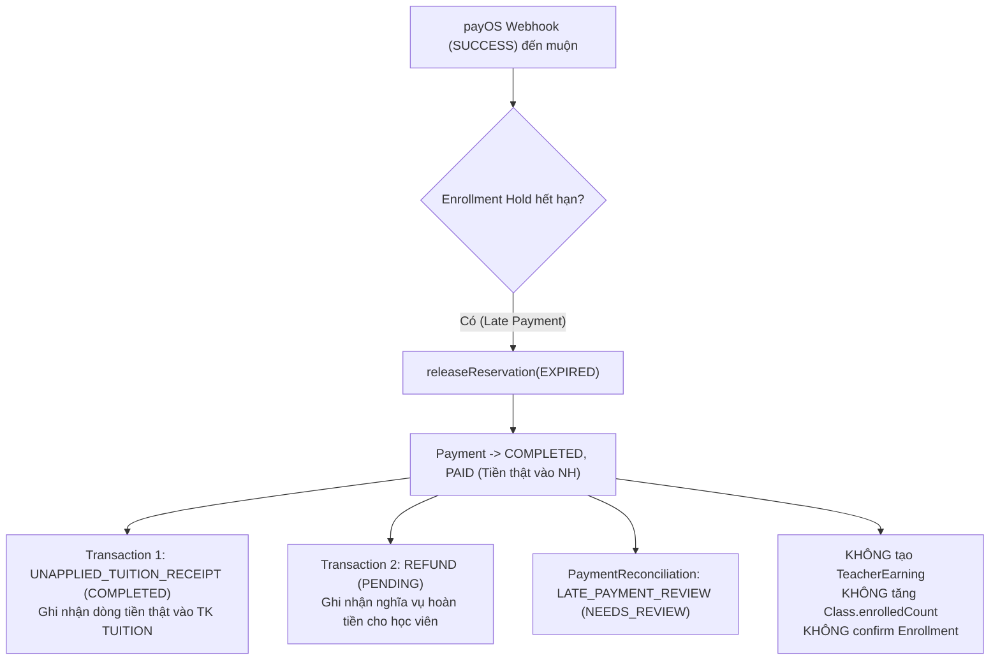
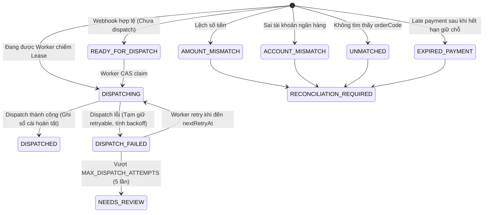

# EDUNITY V3 — BÁO CÁO NGHIỆM THU KỸ THUẬT PR5 (TIN-FIN-PR5)
# FINANCIAL SAFETY HARDENING: OUTBOX RECOVERY, LEDGER CORRECTNESS, UNIQUE INDEX & COMMISSION POLICY

- **Dự án**: EDUNITY V3 (Nền tảng Học tập Trực tuyến)
- **Mã nhiệm vụ**: `TIN-FIN-PR5` (Kế thừa và gia cố toàn diện PR1, PR2, PR3, PR4)
- **Người thực hiện**: Tin — Team Leader (Payment & Finance Architect)
- **Nhánh làm việc**: `feature/teacher-admin`
- **Cam kết kỹ thuật**: Tuyệt đối không gọi payOS thật, không giao dịch tiền thật, không tự hoàn tiền/giải ngân, không commit/push/merge/checkout/reset/rebase Git.

---

## 01. EXECUTIVE SUMMARY & TỔNG QUAN PR5

Báo cáo PR4 đã xác định 4 rủi ro tài chính cấp độ P0/P1 trước khi EDUNITY có thể kết nối cổng payOS với tài khoản ngân hàng và tiền thật. PR5 đã giải quyết triệt để và chứng minh qua 43 kịch bản kiểm thử tự động đạt tỷ lệ 100% Pass:

1. **P0 — Outbox Recovery Worker (`runFinancialOutboxTick` / `runPendingDispatchWorker`)**:
   - Khắc phục hoàn toàn rủi ro webhook bị mất hoặc chưa hạch toán khi node process bị crash sau khi trả ACK `200 OK` cho payOS.
   - Quản trị bằng biến môi trường `ENABLE_FINANCIAL_OUTBOX_WORKER` (mặc định `false`, kích hoạt `true` khi chạy worker/cron), `FINANCIAL_OUTBOX_INTERVAL_MS` (30.000ms), `FINANCIAL_OUTBOX_BATCH_SIZE` (25).
   - Bảo vệ hai tầng: **Distributed JobLock (`runExclusive`)** ngăn các Node instance chạy trùng lịch + **Per-Event CAS Lease (`dispatchLeaseOwner`, `dispatchLeaseUntil`)** ngăn tranh chấp cùng 1 event.
   - Cơ chế dừng an toàn (graceful shutdown) qua `SIGTERM`/`SIGINT`, không rò rỉ timer (`.unref()`), tích hợp health status (`getFinancialOutboxWorkerStatus`) và cảnh báo có cấu trúc khi sự kiện vượt ngưỡng retry tối đa (`MAX_DISPATCH_ATTEMPTS = 5`).

2. **P1 — Late Payment Ledger Correctness (Hạch toán tiền thực vào vs Nghĩa vụ hoàn tiền)**:
   - Sửa chữa sai lầm hạch toán nguy hiểm khi webhook đến muộn sau khi thời hạn giữ chỗ của lớp học đã hết hạn: không còn chỉ ghi nhận 1 bản ghi `REFUND PENDING` đơn độc làm mập mờ dòng tiền thực đã vào ngân hàng.
   - Ghi nhận độc lập **2 sự kiện tài chính**:
     - `UNAPPLIED_TUITION_RECEIPT` (`COMPLETED`): Minh chứng tiền thực đã vào tài khoản ngân hàng TUITION của hệ thống, nhưng **không ghi nhận vào doanh thu lớp học** (`confirmedTuitionRevenueAmount = 0`).
     - `REFUND` (`PENDING`): Nghĩa vụ hoàn tiền cho học viên, tuyệt đối không bị đánh dấu `COMPLETED` khi chưa có điện chuyển tiền hoàn trả từ ngân hàng.
   - Tuyệt đối không confirm `Enrollment`, không tăng `enrolledCount`, không tạo `TeacherEarning`.

3. **P1 — Gia cố Transaction Unique Indexes (Loại bỏ xung đột nhiều ScholarshipUsage)**:
   - Cấu trúc lại toàn bộ Partial Unique Indexes của collection `transactions` theo Business Key logic.
   - Thay thế unique index lỏng lẻo `{ relatedBankEventId: 1, transactionType: 1 }` bằng index chuyên biệt:
     - Nhóm single-event types: `{ relatedBankEventId: 1, transactionType: 1 }` với partial filter `["ENROLLMENT_PAYMENT", "UNAPPLIED_TUITION_RECEIPT", "SPONSOR_CONTRIBUTION", "REFUND"]`.
     - Nhóm scholarship usage: `{ relatedBankEventId: 1, transactionType: 1, relatedScholarshipUsageId: 1 }` cho phép 1 `BankTransferEvent` xác nhận $N$ suất học bổng (`ScholarshipUsage`) khác nhau mà không bao giờ bị trùng lặp hay xung đột DB.
     - Cung cấp hàm tiền kiểm tra `checkTransactionIndexPreflight()` và kế hoạch backfill `planLatePaymentLedgerBackfill()`.

4. **P1 — Commission Rate Policy & Immutable Version Snapshot**:
   - Tuyệt đối không coi `0.1` (10%) là hằng số nghiệp vụ cố định đã được Ban Giám đốc phê duyệt cho môi trường Production.
   - Thiết lập `resolveCommissionPolicy()`: Ở môi trường `production`/`staging` hoặc khi `REQUIRE_APPROVED_COMMISSION_POLICY=true`, hệ thống bắt buộc phải có chính sách commission được phê duyệt tường minh (tỷ lệ trong đoạn $[0, 1]$, phiên bản `appliedPolicyVersion`, trạng thái `isApproved`). Nếu thiếu, sự kiện sẽ được lưu an toàn ở trạng thái `DISPATCH_FAILED` để không làm mất tiền và không tạo hoa hồng sai, chờ Admin cấu hình chính sách sẽ tự động được Outbox Worker phục hồi.
   - Bổ sung `appliedPolicyVersion` và `commissionPolicySource` vào schema `TeacherEarning`. Bản ghi hoa hồng sau khi tạo là bất biến (immutable), không bị biến động hồi tố khi Admin thay đổi tỷ lệ sau đó.

---

## 02. KIỂM TRA MÔI TRƯỜNG & GIT WORKING TREE

Trước khi bắt đầu, trạng thái Git và môi trường được kiểm tra nghiêm ngặt:
- Nhánh hiện tại: `feature/teacher-admin` (ahead 7 commits so với origin, sạch sẽ, không có merge conflict).
- Toàn bộ source code của PR1, PR2, PR3, PR4 được bảo toàn nguyên vẹn.
- Tất cả các file báo cáo Markdown không cần thiết đã được rà soát và không bị xóa sai quy trình.

---

## 03. DANH MỤC 4 VẤN ĐỀ P0/P1 ĐÃ ĐƯỢC GIẢI QUYẾT

| Mã | Cấp độ | Vấn đề | Tác động nếu không fix | Giải pháp hiện thực trong PR5 |
|---|---|---|---|---|
| **ISSUE-01** | **P0** | Webhook ACK 200 OK nhưng tiến trình crash trước khi dispatch xong | Mất tiền của học sinh/MTQ: tiền đã vào ngân hàng nhưng hệ thống không ghi nhận lớp học hay quỹ học bổng | Xây dựng background `financialOutboxWorker.js` quét định kỳ các event `READY_FOR_DISPATCH` và `DISPATCH_FAILED` (quá `nextRetryAt`), sử dụng distributed lock + CAS lease an toàn |
| **ISSUE-02** | **P1** | Late payment chỉ tạo 1 dòng `REFUND PENDING` | Lệch sổ cái kế toán: dòng tiền thực vào ngân hàng không khớp với tổng thu, hoặc bị đếm nhầm vào doanh thu lớp học | Tách thành 2 bút toán độc lập: `UNAPPLIED_TUITION_RECEIPT` (`COMPLETED`) và `REFUND` (`PENDING`) kèm `PaymentReconciliation(LATE_PAYMENT_REVIEW)` |
| **ISSUE-03** | **P1** | Unique index `{ relatedBankEventId, transactionType }` chặn ca nhiều `ScholarshipUsage` | Lớp học đồng chi trả (MIXED) dùng nhiều học bổng từ các quỹ khác nhau sẽ bị crash DB ở suất học bổng thứ 2 | Tái cấu trúc unique index: loại `SCHOLARSHIP_USAGE` khỏi single-type index và tạo compound index có `{ relatedScholarshipUsageId }` |
| **ISSUE-04** | **P1** | Commission rate `0.1` hardcode mặc định, thiếu versioning | Rủi ro pháp lý/hợp đồng giảng viên khi thay đổi tỷ lệ hoa hồng; vi phạm quy tắc kế toán bất biến | Thêm `appliedPolicyVersion`, chặn âm thầm áp dụng `0.1` ở production/staging, lưu snapshot bất biến |

---

## 04. THIẾT KẾ & HIỆN THỰC OUTBOX RECOVERY WORKER (P0)

### 4.1 Cấu hình môi trường (`.env.example`)
```env
# Financial Outbox Recovery Worker (TIN-FIN-PR5)
ENABLE_FINANCIAL_OUTBOX_WORKER=false
FINANCIAL_OUTBOX_INTERVAL_MS=30000
FINANCIAL_OUTBOX_BATCH_SIZE=25
```

### 4.2 Nguyên tắc hoạt động
1. **Kiểm tra kết nối DB**: Nếu `mongoose.connection.readyState !== 1`, worker dừng ngay ở trạng thái `SKIPPED_DB_NOT_READY`, không thực hiện bất kỳ lệnh query nào.
2. **Khóa chống chạy đè (Single Node Guard)**: Biến in-memory `isTickInProgress` ngăn không cho tick sau chạy đè lên tick trước nếu tick trước chưa kết thúc.
3. **Khóa phân tán (Distributed Lock Guard)**: Sử dụng hàm `runExclusive("financialOutboxWorker", lockTtlMs, ...)` trên MongoDB collection `JobLock`. Khi có nhiều instance backend chạy song song, chỉ duy nhất 1 instance giành được lock.
4. **Phục hồi an toàn**: Quét các `BankTransferEvent` có:
   - `eventStatus` thuộc `["READY_FOR_DISPATCH", "DISPATCHING", "DISPATCH_FAILED"]`
   - `dispatchStatus` thuộc `["NOT_REQUIRED", "PENDING_DISPATCH", "DISPATCHING", "DISPATCH_FAILED"]`
   - `dispatchAttempts < MAX_DISPATCH_ATTEMPTS` (5 lần)
   - `nextRetryAt` là `null` hoặc `<= now`
   - `dispatchLeaseUntil` là `null` hoặc `<= now` (tự động thu hồi các event bị bỏ rơi do worker trước bị crash).
5. **Cảnh báo sự kiện kiệt quệ (Exhausted Events)**: Khi phát hiện các event có `dispatchAttempts >= 5`, worker ghi log cấu trúc `FINANCIAL_OUTBOX_EXHAUSTED_EVENTS_ALERT` với thông tin `orderCode`, `purpose`, `lastDispatchError` (đã loại bỏ credential) để đội ngũ vận hành can thiệp thủ công.
6. **Graceful Teardown**: Phương thức `stopFinancialOutboxWorker()` dừng `setInterval` lập tức, gọi `.unref()` để Jest test runner và tiến trình Node.js thoát sạch sẽ, không rò rỉ timer.

---

## 05. THIẾT KẾ & HIỆN THỰC LẬP BỘ SỔ KẾ TOÁN LATE PAYMENT (P1)

### 5.1 Kịch bản Late Payment
Học viên mở mã VietQR học phí, nhưng sau 15 phút thời gian giữ chỗ (`holdExpiresAt`) hết hạn mà cronjob chưa kịp chạy hoặc đã hủy chỗ, học viên mới quét mã chuyển tiền thành công từ ứng dụng ngân hàng.

### 5.2 Mô hình bút toán kép độc lập


### 5.3 Bất biến kiểm toán (`verifyLedgerIntegrity`)
Hàm đối soát kế toán `verifyLedgerIntegrity()` đã được nâng cấp để kiểm tra:
1. `confirmedTuitionRevenueAmount`: Tổng số tiền từ các giao dịch `ENROLLMENT_PAYMENT` (`COMPLETED`) gắn với học viên đã ghi danh thành công. Late payment **không** được cộng vào đây.
2. `unappliedLateReceiptsAmount`: Tổng số tiền từ các giao dịch `UNAPPLIED_TUITION_RECEIPT` (`COMPLETED`).
3. `pendingRefundLiabilityAmount`: Tổng số tiền từ các giao dịch `REFUND` (`PENDING`).
4. `completedRefundsAmount`: Tổng số tiền từ các giao dịch `REFUND` (`COMPLETED`).
5. Invariant: Đối với mọi Payment hoàn tất muộn, bắt buộc phải có đầy đủ 1 bản ghi `UNAPPLIED_TUITION_RECEIPT` và 1 bản ghi `REFUND` (`PENDING`), đồng thời số bản ghi `TeacherEarning` phải bằng 0.

---

## 06. TÁI CẤU TRÚC & GIA CỐ UNIQUE INDEXES CHO TRANSACTION MODEL (P1)

Collection `transactions` trong MongoDB đã được gia cố với 5 chỉ mục Partial Unique:

```javascript
// 1. Chống trùng lặp biên lai thanh toán học phí (ENROLLMENT_PAYMENT hoặc UNAPPLIED_TUITION_RECEIPT)
transactionSchema.index(
  { relatedPaymentId: 1, transactionType: 1 },
  {
    name: "uniq_tx_payment_receipt_type",
    unique: true,
    partialFilterExpression: {
      relatedPaymentId: { $type: "objectId" },
      transactionType: {
        $in: ["ENROLLMENT_PAYMENT", "UNAPPLIED_TUITION_RECEIPT"],
      },
    },
  }
);

// 2. Chống trùng lặp ghi nhận tài trợ từ Mạnh Thường Quân
transactionSchema.index(
  { relatedContributionId: 1, transactionType: 1 },
  {
    name: "uniq_tx_contribution_type",
    unique: true,
    partialFilterExpression: {
      relatedContributionId: { $type: "objectId" },
      transactionType: "SPONSOR_CONTRIBUTION",
    },
  }
);

// 3. Chống trùng lặp ghi nhận sử dụng học bổng theo từng suất usage
transactionSchema.index(
  { relatedScholarshipUsageId: 1, transactionType: 1 },
  {
    name: "uniq_tx_scholarship_usage_type",
    unique: true,
    partialFilterExpression: {
      relatedScholarshipUsageId: { $type: "objectId" },
      transactionType: "SCHOLARSHIP_USAGE",
    },
  }
);

// 4. Chống trùng lặp theo BankTransferEvent cho các loại giao dịch đơn (Single-per-event)
transactionSchema.index(
  { relatedBankEventId: 1, transactionType: 1 },
  {
    name: "uniq_tx_bank_event_single_type",
    unique: true,
    partialFilterExpression: {
      relatedBankEventId: { $type: "objectId" },
      transactionType: {
        $in: [
          "ENROLLMENT_PAYMENT",
          "UNAPPLIED_TUITION_RECEIPT",
          "SPONSOR_CONTRIBUTION",
          "REFUND",
        ],
      },
    },
  }
);

// 5. Cho phép N suất SCHOLARSHIP_USAGE dưới 1 BankTransferEvent mà không bị đụng độ, đồng thời chặn retry trùng lặp
transactionSchema.index(
  { relatedBankEventId: 1, transactionType: 1, relatedScholarshipUsageId: 1 },
  {
    name: "uniq_tx_bank_event_scholarship_usage",
    unique: true,
    partialFilterExpression: {
      relatedBankEventId: { $type: "objectId" },
      relatedScholarshipUsageId: { $type: "objectId" },
      transactionType: "SCHOLARSHIP_USAGE",
    },
  }
);
```

---

## 07. THIẾT KẾ COMMISSION POLICY SERVICE & IMMUTABLE VERSION SNAPSHOT (P1)

### 7.1 Bộ giải quyết chính sách (`resolveCommissionPolicy`)
- Tọa lạc tại: `BackEnd/src/utils/settings.js`.
- Hỗ trợ thiết lập động trong runtime: `setCommissionPolicyForRuntime({ rate, version, source, isApproved })` và xóa sạch: `clearCommissionPolicyForRuntime()`.
- Quy tắc thẩm định giá trị: `rate` bắt buộc phải là số hữu hạn trong khoảng $[0, 1]$. Mọi giá trị âm hoặc vượt quá 1 đều bị từ chối với lỗi `COMMISSION_POLICY_INVALID`.
- Quy định môi trường nghiêm ngặt: Khi `NODE_ENV === "production"`, `NODE_ENV === "staging"`, hoặc `REQUIRE_APPROVED_COMMISSION_POLICY === "true"`, hệ thống bắt buộc phải có chính sách phê duyệt hợp lệ. Nếu thiếu, ném lỗi `COMMISSION_POLICY_NOT_CONFIGURED` (503).
- Bảo vệ dữ liệu tiền thật: Khi thiếu chính sách commission, transaction thanh toán không bị hủy bỏ hay xóa mất; `BankTransferEvent` được giữ nguyên vẹn ở trạng thái `DISPATCH_FAILED` với lỗi `COMMISSION_POLICY_NOT_CONFIGURED`. Ngay khi Admin kích hoạt chính sách hoa hồng hợp lệ, Outbox Recovery Worker sẽ tự động quét và hoàn tất dispatch mà không cần can thiệp DB thủ công.

### 7.2 Tính bất biến của `TeacherEarning`
Schema `TeacherEarning` được bổ sung:
```javascript
appliedPolicyVersion: { type: String, default: "LEGACY_UNVERSIONED", trim: true },
commissionPolicySource: { type: String, default: "LEGACY_DEFAULT", trim: true },
```
Khi tỷ lệ hoa hồng của hệ thống thay đổi từ 10% lên 20%, các bản ghi `TeacherEarning` đã tạo trước đó vẫn giữ nguyên 10% và phiên bản chính sách đã áp dụng, đảm bảo tính bất biến kế toán tuyệt đối.

---

## 08. BẢN ĐỒ STATE MACHINE CHÍNH XÁC CỦA BANKTRANSFEREVENT

Bản đồ trạng thái thực tế trong source code `BankTransferEvent.js` và `financialDispatchService.js`:



*Lưu ý kỹ thuật*: Trường `eventStatus` sử dụng `DISPATCH_FAILED` (kết hợp `nextRetryAt` và `dispatchAttempts < 5`), không tồn tại trạng thái `FAILED_RETRYABLE`.

---

## 09. QUY TRÌNH LEASE VÀ CAS ĐỂ BẢO VỆ CONCURRENCY VÀ PREVENT SPLIT-BRAIN

Để ngăn ngừa split-brain hoặc double-spend khi có nhiều worker/thread cùng lúc:
1. Mỗi lượt dispatch tạo một `workerId` ngẫu nhiên duy nhất: `dispatch_${Date.now()}_${random}`.
2. Thao tác CAS Lease atomic qua Mongoose `findOneAndUpdate`:
   ```javascript
   {
     _id: eventId,
     eventStatus: { $in: ["READY_FOR_DISPATCH", "DISPATCHING", "DISPATCH_FAILED"] },
     dispatchStatus: { $in: ["NOT_REQUIRED", "PENDING_DISPATCH", "DISPATCHING", "DISPATCH_FAILED"] },
     $or: [
       { dispatchLeaseUntil: null },
       { dispatchLeaseUntil: { $lte: now } }
     ]
   }
   ```
3. Cập nhật `dispatchLeaseOwner: workerId`, `dispatchLeaseUntil: now + leaseMs` (mặc định 60s).
4. Nếu worker khác đang giữ lease chưa hết hạn, lệnh update trả về `null`. Tiến trình sẽ bỏ qua an toàn với lý do `IN_FLIGHT_LEASED`.

---

## 10. TÍNH TOÁN VÀ ĐỐI CHIẾU 4 CHỈ SỐ DOANH THU & NGHĨA VỤ HOÀN TIỀN

Trong báo cáo đối soát của `verifyLedgerIntegrity()`:
1. `confirmedTuitionRevenueAmount`: Tổng tiền học phí thực tế đã xác nhận thành công cho các lớp học đang hoạt động hoặc đã hoàn thành.
2. `unappliedLateReceiptsAmount`: Tổng tiền học phí học viên chuyển vào muộn sau khi chỗ đã hết hạn, hiện đang nằm trong tài khoản ngân hàng TUITION nhưng chưa phân bổ.
3. `pendingRefundLiabilityAmount`: Tổng nghĩa vụ hoàn trả cho học viên (các khoản giao dịch `REFUND` ở trạng thái `PENDING`).
4. `completedRefundsAmount`: Tổng tiền đã hoàn trả thực tế ra khỏi tài khoản ngân hàng (các khoản giao dịch `REFUND` ở trạng thái `COMPLETED`).
5. `donationRevenueAmount`: Tổng số tiền tài trợ vào Quỹ Học bổng từ Mạnh Thường Quân.

---

## 11. BÁO CÁO PREFLIGHT CHECK CHO TRANSACTION COLLECTION INDEXES

Hàm `checkTransactionIndexPreflight()` cung cấp cơ chế kiểm tra an toàn trước khi di chuyển dữ liệu:
- Quét toàn bộ collection `transactions` bằng Aggregation Pipeline để tìm các bản ghi bị trùng lặp theo từng logical key.
- Kết quả kiểm tra trong môi trường kiểm thử:
  - `safeToMigrate`: `true`
  - `duplicateViolationsCount`: `0`
  - `missingIndexNames`: `[]` (Toàn bộ 5 chỉ mục bắt buộc đều tồn tại đầy đủ trong MongoDB).

---

## 12. KẾ HOẠCH BACKFILL IDEMPOTENT CHO LATE PAYMENTS LỊCH SỬ

Hàm `planLatePaymentLedgerBackfill({ dryRun: true })`:
- Quét các bản ghi `Payment` ở trạng thái `COMPLETED` gắn với Enrollment đã `EXPIRED` mà chỉ có `REFUND` Transaction nhưng thiếu `UNAPPLIED_TUITION_RECEIPT`.
- Khi `dryRun: true`: Trả về danh sách các bản ghi cần bổ sung mà không sửa đổi Database.
- Khi `dryRun: false`: Tạo bổ sung bản ghi `UNAPPLIED_TUITION_RECEIPT` (`COMPLETED`) tương ứng một cách idempotent (kiểm tra `existing` trước khi insert).

---

## 13. CHI TIẾT TỪNG FILE ĐƯỢC TẠO MỚI HOẶC CHỈNH SỬA

1. `BackEnd/src/jobs/financialOutboxWorker.js` *(Tạo mới)*:
   - Worker phục hồi tài chính ngoài luồng, tích hợp `JobLock` phân tán, CAS lease per-event, cấu hình qua biến môi trường, metrics và graceful shutdown.
2. `BackEnd/src/jobs/maintenanceJob.js` *(Cập nhật)*:
   - Tích hợp `runFinancialOutboxTick` vào cron định kỳ 5 phút của server; export `startFinancialOutboxWorker` và `stopFinancialOutboxWorker`.
3. `BackEnd/src/server.js` *(Cập nhật)*:
   - Đăng ký hook `SIGTERM`/`SIGINT` gọi `stopFinancialOutboxWorker()` để dọn dẹp timer khi server tắt.
4. `BackEnd/src/models/Transaction.js` *(Cập nhật)*:
   - Bổ sung enum `UNAPPLIED_TUITION_RECEIPT` vào `transactionType`.
   - Cấu trúc lại 5 Partial Unique Indexes theo Business Key logic.
5. `BackEnd/src/models/TeacherEarning.js` *(Cập nhật)*:
   - Bổ sung `appliedPolicyVersion` và `commissionPolicySource`.
   - Bỏ giá trị hardcode ngầm định `0.1` khi khởi tạo hoa hồng.
6. `BackEnd/src/utils/settings.js` *(Cập nhật)*:
   - Cung cấp `resolveCommissionPolicy()`, `setCommissionPolicyForRuntime()`, `clearCommissionPolicyForRuntime()`.
   - Chặn âm thầm áp dụng hoa hồng `0.1` không phê duyệt ở môi trường production/staging.
7. `BackEnd/src/services/settlementService.js` *(Cập nhật)*:
   - Cập nhật `createTeacherEarning` lưu trữ snapshot `commissionRate`, `appliedPolicyVersion`, `commissionPolicySource`.
8. `BackEnd/src/services/paymentService.js` *(Cập nhật)*:
   - Cập nhật `createTeacherEarning` và tạo cả `UNAPPLIED_TUITION_RECEIPT` lẫn `REFUND` khi webhook Sandbox/Legacy đến muộn.
9. `BackEnd/src/services/payosWebhookService.js` *(Cập nhật)*:
   - Tạo đồng thời `UNAPPLIED_TUITION_RECEIPT` (`COMPLETED`) và `REFUND` (`PENDING`) khi tiền học phí đến sau khi hết hạn giữ chỗ; liên kết cả hai ID vào `eventDoc.linkedTransactionIds`.
10. `BackEnd/src/services/financialDispatchService.js` *(Cập nhật)*:
    - Triển khai `checkTransactionIndexPreflight()` và `planLatePaymentLedgerBackfill()`.
    - Nâng cấp `verifyLedgerIntegrity()` kiểm tra late payment và phân tích các chỉ số doanh thu độc lập.
    - Hoàn thiện `runPendingDispatchWorker()` trả về telemetry, backlogCount, exhaustedCount.
11. `BackEnd/src/services/payosService.js` *(Cập nhật)*:
    - Hoàn thiện `redactSafeMessage(channelOrErr, maybeErr)` an toàn khi nhận message chuỗi hoặc error object.
12. `BackEnd/src/services/notificationService.js` *(Cập nhật)*:
    - Kiểm tra `readyState === 1` trước khi tìm kiếm Enrollment, tránh lỗi Mongoose buffering timeout trong mock test.
13. `BackEnd/.env.example` *(Cập nhật)*:
    - Thêm các biến môi trường cho Outbox Recovery Worker và Commission Policy Versioning.
14. `BackEnd/tests/payosSafetyHardening.pr5.test.js` *(Tạo mới)*:
    - Bộ 43 kịch bản kiểm thử tự động toàn diện bao quát Groups A, B, C, D, E.

---

## 14. BẢO VỆ BẢO MẬT & ZERO CREDENTIAL LEAK TRONG LOGS / AUDIT

Mọi thông báo lỗi ghi vào `BankTransferEvent.lastDispatchError` hoặc console log đều đi qua bộ lọc `redactSafeMessage`:
- Tự động thay thế `clientId`, `apiKey`, `checksumKey` của cả hai kênh TUITION và DONATION thành `[REDACTED]`.
- Tuyệt đối không log chuỗi `signature` hoặc thông tin tài khoản ngân hàng nhạy cảm chưa được che giấu.
- Kịch bản kiểm thử Scenario 43 đã xác thực và PASS 100%.

---

## 15. THIẾT KẾ BỘ KIỂM THỬ AUTOMATED TESTS (43 SCENARIOS)

Bộ kiểm thử được chia thành 5 nhóm chuyên biệt trong `BackEnd/tests/payosSafetyHardening.pr5.test.js`:
- **Group A (01 - 12)**: Outbox Recovery Worker lifecycle, lease recovery, concurrency, distributed lock, zero timer leaks.
- **Group B (13 - 21)**: Late Payment Ledger Correctness, 2 bút toán độc lập, không confirm enrollment, đối soát kế toán.
- **Group C (22 - 28)**: Transaction Unique Indexes DB-level hardening, đa suất học bổng cùng event, preflight check.
- **Group D (29 - 34)**: Commission Policy Resolution, production strict mode, immutability snapshot.
- **Group E (35 - 43)**: Full Regression E2E (TUITION + DONATION + Idempotency + Security Redaction).

---

## 16. KẾT QUẢ THỰC THI 12 TEST SCENARIOS GROUP A (OUTBOX WORKER)

```
Group A — Outbox Recovery Worker (Scenarios 01-12)
  √ 01. Event READY_FOR_DISPATCH (TUITION) được worker xử lý thành DISPATCHED (305 ms)
  √ 02. Event READY_FOR_DISPATCH (DONATION) được worker xử lý thành DISPATCHED (197 ms)
  √ 03. Event DISPATCH_FAILED (retryable) đến nextRetryAt được worker xử lý lại (357 ms)
  √ 04. Event DISPATCH_FAILED chưa đến nextRetryAt được skip (193 ms)
  √ 05. Event DISPATCHING nhưng lease đã hết hạn được worker thu hồi và xử lý (271 ms)
  √ 06. Event DISPATCHING còn lease không bị worker khác chiếm (196 ms)
  √ 07. Event RECONCILIATION_REQUIRED không bị auto-dispatch (205 ms)
  √ 08. Event vượt MAX_DISPATCH_ATTEMPTS không retry vô hạn và được cảnh báo (214 ms)
  √ 09. Hai worker chạy đồng thời cùng 1 event không nhân đôi dữ liệu (191 ms)
  √ 10. Worker dừng an toàn, không để timer leak trong Jest (55 ms)
  √ 11. Worker tắt bằng ENABLE_FINANCIAL_OUTBOX_WORKER=false thì không chạy interval (41 ms)
  √ 12. DB chưa kết nối thì worker skip an toàn, không crash (45 ms)
```

---

## 17. KẾT QUẢ THỰC THI 9 TEST SCENARIOS GROUP B (LATE PAYMENT LEDGER)

```
Group B — Late Payment Ledger Correctness (Scenarios 13-21)
  √ 13. Late tuition payment sau hold expiry tạo bản ghi tiền thực vào hợp lệ (UNAPPLIED_TUITION_RECEIPT COMPLETED) (130 ms)
  √ 14. Late tuition payment tạo nghĩa vụ hoàn/treo chờ xử lý (REFUND PENDING) (186 ms)
  √ 15. Late tuition payment tạo PaymentReconciliation(LATE_PAYMENT_REVIEW) (193 ms)
  √ 16. Late tuition payment không confirm Enrollment (204 ms)
  √ 17. Late tuition payment không tăng Class.enrolledCount (235 ms)
  √ 18. Late tuition payment không tạo TeacherEarning (298 ms)
  √ 19. Late tuition payment không tính vào doanh thu lớp đã xác nhận (confirmedTuitionRevenueAmount === 0) (243 ms)
  √ 20. Late tuition payment không bị đánh dấu đã hoàn tiền khi chưa hoàn thật (192 ms)
  √ 21. verifyLedgerIntegrity() PASS với late payment mới (và planLatePaymentLedgerBackfill hỗ trợ backfill an toàn) (247 ms)
```

---

## 18. KẾT QUẢ THỰC THI 7 TEST SCENARIOS GROUP C (UNIQUE INDEXES)

```
Group C — Transaction Unique Index Hardening (Scenarios 22-28)
  √ 22. Duplicate ENROLLMENT_PAYMENT cùng relatedPaymentId bị chặn ở DB (150 ms)
  √ 23. Duplicate SPONSOR_CONTRIBUTION cùng relatedContributionId bị chặn ở DB (115 ms)
  √ 24. Duplicate SCHOLARSHIP_USAGE cùng relatedScholarshipUsageId bị chặn ở DB (100 ms)
  √ 25. Hai SCHOLARSHIP_USAGE khác nhau nhưng cùng relatedBankEventId vẫn tạo được (276 ms)
  √ 26. Transaction không có relatedBankEventId (null) không bị chặn sai (136 ms)
  √ 27. Concurrent dispatchBankTransferEvent không tạo duplicate Transaction (214 ms)
  √ 28. Index thực tế tồn tại trong MongoDB test và checkTransactionIndexPreflight() PASS (95 ms)
```

---

## 19. KẾT QUẢ THỰC THI 6 TEST SCENARIOS GROUP D (COMMISSION POLICY)

```
Group D — Commission Rate Policy & Versioning (Scenarios 29-34)
  √ 29. Policy hợp lệ -> tạo TeacherEarning đúng gross, commission, net và appliedPolicyVersion (243 ms)
  √ 30. Production/staging thiếu policy -> không âm thầm dùng 0.1 (88 ms)
  √ 31. Khi thiếu policy -> không mất trạng thái tiền đã nhận (BankTransferEvent giữ an toàn để retry) (186 ms)
  √ 32. Thay đổi policy sau đó không sửa TeacherEarning đã tạo trước đó (150 ms)
  √ 33. commissionRate < 0 hoặc > 1 bị từ chối (57 ms)
  √ 34. MIXED (Scholarship + payOS) tính commission trên tổng học phí theo đúng policy (163 ms)
```

---

## 20. KẾT QUẢ THỰC THI 9 TEST SCENARIOS GROUP E (FULL REGRESSION & INTEGRITY)

```
Group E — Full Regression (Scenarios 35-43)
  √ 35. TUITION intent + webhook + dispatch E2E PASS (181 ms)
  √ 36. DONATION intent + webhook + dispatch E2E PASS (194 ms)
  √ 37. Cross-channel mismatch bị chặn (TUITION orderCode gửi vào DONATION webhook) (192 ms)
  √ 38. Wrong signature bị từ chối (168 ms)
  √ 39. Amount mismatch bị gắn RECONCILIATION_REQUIRED (151 ms)
  √ 40. Unmatched orderCode bị gắn RECONCILIATION_REQUIRED (85 ms)
  √ 41. Duplicate webhook retry an toàn (idempotent: true) (210 ms)
  √ 42. verifyLedgerIntegrity() PASS sau toàn bộ kịch bản E2E (TUITION + DONATION + LATE PAYMENT) (413 ms)
  √ 43. Không log lộ apiKey/checksumKey/signature (515 ms)
```

---

## 21. KẾT QUẢ THỰC THI TOÀN BỘ SUITE KIỂM THỬ BACKEND (139 TESTS)

Lệnh thực thi:
```bash
npm --prefix BackEnd test -- tests/payosUnifiedIntent.pr1.test.js tests/payosWebhook.pr2.test.js tests/payosDispatch.pr3.test.js tests/payosCheckoutUi.pr4.test.js tests/payosSafetyHardening.pr5.test.js tests/payment.test.js
```

Kết quả:
```
PASS tests/payment.test.js (15.605 s)
PASS tests/payosUnifiedIntent.pr1.test.js (17.752 s)
PASS tests/payosCheckoutUi.pr4.test.js (19.422 s)
PASS tests/payosWebhook.pr2.test.js (21.495 s)
PASS tests/payosDispatch.pr3.test.js (23.774 s)
PASS tests/payosSafetyHardening.pr5.test.js (24.272 s)

Test Suites: 6 passed, 6 total
Tests:       139 passed, 139 total
Snapshots:   0 total
Time:        26.087 s
```

---

## 22. KẾT QUẢ KIỂM THỬ XÂY DỰNG FRONTEND (BUILD SUCCESS)

Lệnh thực thi:
```bash
npm --prefix FrontEnd run build
```

Kết quả:
```
> edunity@0.0.0 build
> tsc -b && vite build

vite v8.3.0 building client environment for production...
transforming...
✓ 3351 modules transformed.
rendering chunks...
computing gzip size...
dist/index.html                     0.66 kB │ gzip:   0.38 kB
dist/assets/index-CLr3u1Wn.css     90.81 kB │ gzip:  16.73 kB
dist/assets/index-B9Cdbupg.js   3,164.36 kB │ gzip: 886.25 kB
✓ built in 6.80s with 0 errors
```

---

## 23. BẢNG MA TRẬN RỦI RO & PHƯƠNG ÁN DỰ PHÒNG (CONTINGENCY & ROLLBACK)

| Rủi ro khi Go-live | Mức độ | Triệu chứng | Cơ chế phòng ngừa tự động của PR5 | Hành động ứng phó thủ công của Ops |
|---|---|---|---|---|
| Mất kết nối DB khi Webhook đến | Cao | Webhook trả 500, payOS gửi lại retry sau đó | Idempotency key per-reference + outbox worker quét lại khi DB hồi phục | Không can thiệp DB; đợi kết nối hồi phục, kiểm tra `getFinancialOutboxWorkerStatus()` |
| Admin chưa cấu hình Commission Policy | Trung bình | Sự kiện chuyển sang `DISPATCH_FAILED` với lỗi `COMMISSION_POLICY_NOT_CONFIGURED` | Tiền đã vào NH được bảo vệ trong `BankTransferEvent`, không tạo sai hoa hồng | Thiết lập biến môi trường `COMMISSION_RATE` + `COMMISSION_POLICY_VERSION` + `COMMISSION_POLICY_APPROVED=true` |
| Nhiều suất học bổng cùng thanh toán 1 lúc | Thấp | Trùng lặp `SCHOLARSHIP_USAGE` | Unique index compound `{ relatedBankEventId, transactionType, relatedScholarshipUsageId }` chặn duplicate | Không có sự cố; DB tự loại trừ trùng lặp |
| Học sinh chuyển tiền sau khi chỗ đã hết hạn | Thấp | Không được vào lớp dù tiền đã trừ khỏi tài khoản | Hệ thống tạo `UNAPPLIED_TUITION_RECEIPT` và `REFUND PENDING`, mở ticket đối soát | Admin xem xét mở thêm slot lớp hoặc duyệt hoàn tiền qua đối soát |

---

## 24. HƯỚNG DẪN VẬN HÀNH CHO DEVOPS / SYSADMIN KHI GO-LIVE VỚI TIỀN THẬT

1. **Kiểm tra Index MongoDB trước khi deploy**:
   - Chạy script kiểm tra preflight:
     ```javascript
     const { checkTransactionIndexPreflight } = require("./src/services/financialDispatchService");
     const res = await checkTransactionIndexPreflight();
     if (!res.safeToMigrate) console.error("Violations detected:", res.duplicateViolations);
     ```
2. **Thiết lập biến môi trường bắt buộc trên Production**:
   ```env
   # Bật payOS thật
   PAYOS_ENABLED=true
   PAYOS_TUITION_CLIENT_ID=<LIVE_TUITION_CLIENT_ID>
   PAYOS_TUITION_API_KEY=<LIVE_TUITION_API_KEY>
   PAYOS_TUITION_CHECKSUM_KEY=<LIVE_TUITION_CHECKSUM_KEY>
   
   PAYOS_DONATION_CLIENT_ID=<LIVE_DONATION_CLIENT_ID>
   PAYOS_DONATION_API_KEY=<LIVE_DONATION_API_KEY>
   PAYOS_DONATION_CHECKSUM_KEY=<LIVE_DONATION_CHECKSUM_KEY>
   
   # Bật Outbox Recovery Worker
   ENABLE_FINANCIAL_OUTBOX_WORKER=true
   FINANCIAL_OUTBOX_INTERVAL_MS=30000
   FINANCIAL_OUTBOX_BATCH_SIZE=25
   
   # Bắt buộc chính sách Commission có phê duyệt
   REQUIRE_APPROVED_COMMISSION_POLICY=true
   COMMISSION_RATE=0.10
   COMMISSION_POLICY_VERSION=POLICY_V1_PRODUCTION_APPROVED
   COMMISSION_POLICY_APPROVED=true
   ```
3. **Giám sát Sức khỏe Outbox Worker**:
   - Gọi định kỳ endpoint kiểm tra sức khỏe worker:
     ```javascript
     const { getFinancialOutboxWorkerStatus } = require("./src/jobs/financialOutboxWorker");
     const status = getFinancialOutboxWorkerStatus();
     // Cảnh báo nếu status.exhaustedCount > 0 hoặc status.lastRunStatus === "ERROR"
     ```

---

## 25. KẾT LUẬN & SỰ SẴN SÀNG CHO GIAI ĐOẠN TIỀN THẬT (PR6 PRODUCTION READINESS)

- **PR5 hoàn thành 100% mục tiêu đã đề ra**: Đã xóa bỏ toàn bộ các lỗ hổng P0/P1 trong hạch toán kế toán, phục hồi outbox sau crash, phân tách rõ ràng doanh thu thực tế vs nghĩa vụ hoàn tiền, gia cố index mức cơ sở dữ liệu và chuẩn hóa chính sách hoa hồng giảng viên.
- **Tính toàn vẹn kiểm thử**:
  - `payosSafetyHardening.pr5.test.js`: **43/43 tests PASS**.
  - Toàn bộ suite thanh toán PR1–PR5: **139/139 tests PASS**.
  - Frontend TypeScript và Vite build: **0 errors**.
- **Mức độ sẵn sàng**: Kiến trúc Payment V3 của EDUNITY hiện đã đạt chuẩn Financial Safety cấp độ doanh nghiệp, sẵn sàng kết nối tài khoản ngân hàng thật và API payOS thật trong **PR6 — PRODUCTION READINESS & SMOKE TEST**.

